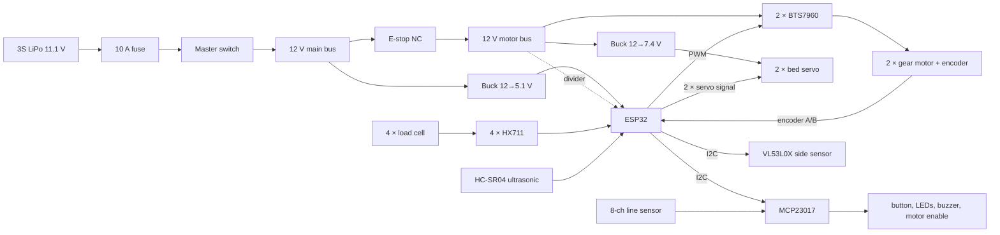
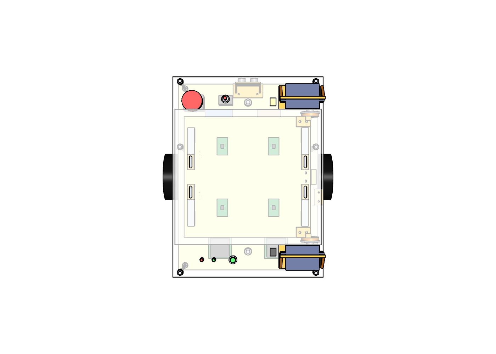
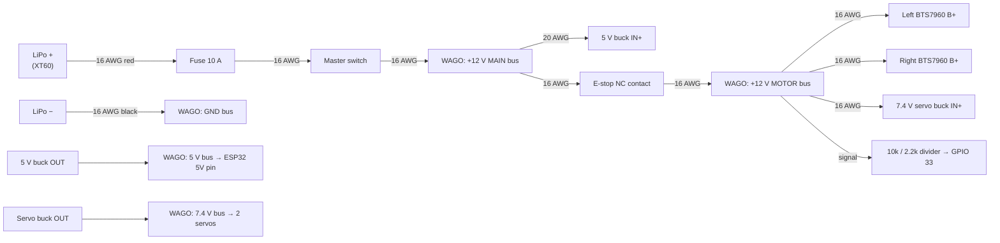
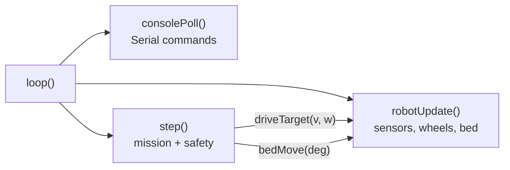

# Cargo Robot: Complete Build Guide (Phase II)

**From Monday 28 September 2026 to the final defense (week of 14 December 2026).**

This guide covers the whole build: parts, tools, fabrication, assembly, every wire, the ESP32 firmware, calibration, line following, the tilting bed, testing and the final report. Follow it top to bottom.


---

## Contents

- [0. How to use this guide](#0-how-to-use-this-guide)
- [1. The robot on one page](#1-the-robot-on-one-page)
- [2. Timeline](#2-timeline)
- [3. Safety rules](#3-safety-rules-read-before-you-touch-anything)
- [Week 0: Decisions, shopping, laptop setup (28 Sep – 4 Oct)](#week-0--decisions-shopping-laptop-setup-28-sep--4-oct)
- [Week 1: Fabrication & mechanical assembly (5 – 11 Oct)](#week-1--fabrication--mechanical-assembly-5--11-oct)
- [Week 2: Power & safety wiring (12 – 18 Oct)](#week-2--power--safety-wiring-12--18-oct)
- [Week 3: ESP32 setup, signal wiring, bench tests (19 – 25 Oct)](#week-3--esp32-setup-signal-wiring-bench-tests-19--25-oct)
- [Week 4: The firmware and the tilting bed (26 Oct – 1 Nov)](#week-4--the-firmware-and-the-tilting-bed-26-oct--1-nov)
- [Week 5: Driving: motor control, PID, odometry (2 – 8 Nov)](#week-5--driving-motor-control-pid-odometry-2--8-nov)
- [Week 6: Line following and station marks (9 – 15 Nov)](#week-6--line-following-and-station-marks-9--15-nov)
- [Week 7: Payload logic & obstacles (16 – 22 Nov)](#week-7--payload-logic--obstacles-16--22-nov)
- [Week 8: Delivery missions (23 – 29 Nov)](#week-8--delivery-missions-23--29-nov)
- [Week 9: Field testing & metrics (30 Nov – 6 Dec)](#week-9--field-testing--metrics-30-nov--6-dec)
- [Week 10: Cable harness, covers, final checks (7 – 13 Dec)](#week-10--cable-harness-covers-final-checks-7--13-dec)
- [Week 11: Report, video, presentation, demo (14 – 20 Dec)](#week-11--report-video-presentation-demo-14--20-dec)
- [Troubleshooting](#troubleshooting)
- [Appendix A: Skills crash course](#appendix-a--skills-crash-course)
- [Appendix B: Full source code](#appendix-b--full-source-code)

---

## 0. How to use this guide

- **Each week has:** a goal, numbered steps with checkboxes `- [ ]`, and a **"Done when"** test. Don't start the next week until the "Done when" test passes (or you know exactly why it doesn't).
- **Where things happen:**
  - **[LAPTOP]**: in the Arduino IDE on your laptop (Windows, macOS or Linux), with the ESP32 plugged in by USB.
  - **[SERIAL]**: a command typed into the Arduino IDE's **Serial Monitor** (115200 baud, line ending "Newline"). The robot answers there.
- **You don't need to type any code.** All of it is already in the project folder (see [Appendix B](#appendix-b--full-source-code)); this guide explains it and shows how to use it.
- **New to a skill?** If a step needs something you've never done (soldering, crimping, using a multimeter, git), read [Appendix A](#appendix-a--skills-crash-course) first.

### The project folder

```
Gradfinal/                      <- this folder. Put it on GitHub
├── BUILD_GUIDE.md              <- this guide
├── cad/                        <- 3D design (Python/CadQuery) -> STEP, STL, DXF files
│   ├── robot_cad.py            <- the design; change numbers at the top, re-run
│   ├── wiring.py               <- every wire (P1-P19, S1-S38), in one place
│   ├── autocad/                <- the PDFs (and AutoCAD files):
│   │     CargoRobot_v2_drawings.pdf     10 drawing sheets (+ CargoRobot_v2.dxf with the 3D model)
│   │     CargoRobot_v2_schematics.pdf   4 schematic sheets (+ .dxf)
│   │     CargoRobot_v2_assembly.pdf     list of components + assembly step by step, with pictures
│   │     CargoRobot_v2_connections.pdf  every connection: wire lists, each part's pins, the schematics
│   └── output/                 <- robot_assembly.step, parts/*.stl, dxf/*.dxf, views/*.png, bom.csv
├── firmware/cargo_robot/       <- the ESP32 program (Arduino IDE)
│   ├── cargo_robot.ino         <- the mission and the safety rules
│   ├── config.h                <- the wiring: every pin number (single source of truth)
│   ├── settings.h / .cpp       <- tunable numbers, kept in the ESP32's flash
│   ├── robot.h / .cpp          <- the robot's parts and live readings, wheel control, bed motion
│   ├── hw.h / .cpp             <- drivers: motors, encoders, load cells, I/O expander, ultrasonic, servos
│   ├── control.h / .cpp        <- maths: wheel PID, line position, speed factors
│   └── console.h / .cpp        <- Serial-Monitor commands: bench tests, calibration, settings
└── backup_v2/                  <- design v2 as it was before the tilting bed (Raspberry Pi version)
```

### Words you will meet

| Word | Meaning |
|---|---|
| **ESP32** | The robot's computer: a small board with a dual-core processor, Wi-Fi and lots of pins. It runs one program (the firmware) from power-on. |
| **Firmware** | The program on the ESP32 (`firmware/cargo_robot/`). You upload it from the Arduino IDE. |
| **Arduino IDE** | The program on your laptop that compiles and uploads the firmware, and has the Serial Monitor. |
| **Serial Monitor** | A text window in the Arduino IDE: the robot prints there and you type commands to it. |
| **GPIO** | A pin of the ESP32; each one can be a 3.3 V digital input or output. |
| **PWM** | Switching a pin on and off very fast; the on-percentage ("duty") sets motor power. |
| **Encoder** | A sensor on the motor that sends pulses as it turns. It gives the wheel speed and distance. |
| **HX711** | A tiny amplifier + 24-bit ADC that reads one load cell. |
| **Servo** | A motor with a gearbox and an angle sensor inside: you send it an angle (as a pulse 500–2500 µs long, 50 times per second) and it turns there. Two of them tip the bed. |
| **I2C** | A 2-wire bus (SDA, SCL). The MCP23017 and the VL53L0X share it. |
| **MCP23017** | An I/O expander: 16 extra pins over I2C, for the slow signals (line sensors, LEDs, buzzer, button). |
| **Station mark** | A short strip of black tape across the line. The robot stops at it: one at the pickup, one at the drop-off (the conveyor). |

---

## 1. The robot on one page

| | |
|---|---|
| Size | 407 × 360 × 236 mm (L × W × H), bed flat |
| Frame | 6 mm plywood bottom plate + 5 mm acrylic deck, held apart by 6 M6 threaded rods |
| Drive | 2 × 12 V gear motors with encoders (middle axle), plus 50 mm swivel casters front and rear. Differential drive, so it turns on the spot. |
| Brain | **One ESP32** (DevKitC, 38 pins), running an Arduino program. No Raspberry Pi, no Linux, no ROS. |
| Sensors | 8-channel IR line sensor (under the bottom plate, in front of the wheels), HC-SR04 ultrasonic (front, looking ahead), VL53L0X distance sensor (right side), 4 × 10 kg load cells under the cargo plate |
| Tilting bed | A plywood tilting plate carries the load cells and the cargo plate. **Two 60 kg·cm servos** on the deck's right edge turn it about their shafts (the shafts are the hinge) to 40°; the package slides off to the right onto the conveyor. |
| Power | 3S LiPo 11.1 V 5000 mAh → 10 A fuse → master switch. The 12 V goes through the E-stop to the motor drivers and the 7.4 V servo buck; a 5.1 V buck powers the ESP32 and the sensors. |
| Safety | Latching E-stop cuts **motor and servo power** (the ESP32 stays on and sees it). The software also stops for obstacles, a lost line, and overload. |
| Packages | Up to **3 kg**, up to 20 × 20 × 20 cm. Speed drops smoothly to 50 % at 3 kg; it refuses to move above 3.6 kg. |
| Speed | 0.2 m/s following the line (adjustable) |



**The whole system** has two more parts that are **not in this guide** (they are a separate project): the conveyor belt with its own ESP32, and a laptop with a camera that reads the logo on each package and tells the conveyor where to send it. The robot's only job at the conveyor is to stop beside it and tip the package onto the belt.

### What changed compared to the Phase II plan (tell your supervisor)

| Phase II plan | This guide | Why |
|---|---|---|
| Raspberry Pi **+ ESP32** | **ESP32 only** | The robot no longer runs the AI or maps rooms: it follows a line, weighs, avoids obstacles and tips the bed. One ESP32 does all of that in real time, starts in 1 s and can't corrupt an SD card. |
| RPLIDAR, SLAM (task 2.2) and Nav2 waypoints (task 2.4) | **No lidar.** An IR line sensor and station marks on the floor | A taped route is simpler and very repeatable. Task 2.2 becomes "line and station-mark tuning", task 2.4 becomes "pickup → drop-off missions". |
| Camera + ONNX vision on the robot (task 2.3.2) | **The laptop does the vision, at the conveyor** | The camera has to look at the packages on the belt anyway; the laptop has far more computing power than the robot. |
| Obstacle detection by lidar | **One ultrasonic sensor** looking ahead | Cheap, simple, and enough to stop for a person or a box on the line. |
| Unload by hand | **Tilting bed on 2 servos** | The robot delivers by itself: it tips the package onto the conveyor. |
| E-stop cuts the whole 12 V line | E-stop cuts the **motor and servo** 12 V only | The ESP32 stays on, sees the E-stop and does not lose its place. Everything that moves still stops at once. |
| 2020 aluminium or acrylic/MDF frame | Plywood + acrylic plates on **6 M6 threaded rods** | Cheapest and simplest: the rod is cut with a hacksaw, and the deck height is set with nuts. |
| Heavy-duty omni-wheel casters | **50 mm swivel casters with an M8 threaded stem** | Bolt straight on; the height is adjusted with a nut, so all 4 wheels can be made to touch the floor. |
| 12 V 300–500 RPM motors | **12 V 170 RPM** (same JGB37-520 size) | 300–500 RPM with 100 mm wheels means 1.6–2.6 m/s top speed and little torque. 170 RPM gives about 0.9 m/s and roughly 3× the torque. |

---

## 2. Timeline

| Week | Dates (2026) | Goal | Done when |
|---|---|---|---|
| 0 | 28 Sep – 4 Oct | Approvals, **order everything**, laptop + GitHub ready | Parts ordered, DXF files at the laser shop, Arduino IDE uploads to an ESP32 |
| 1 | 5 – 11 Oct | Cut, print and assemble the mechanics, including the tilting bed | Rolling chassis with all 4 wheels on the floor; the bed swings freely by hand |
| 2 | 12 – 18 Oct | Power & safety wiring + bench tests | 12 V / 5.1 V / 7.4 V measured, E-stop kills motor and servo power, ESP32 runs from the battery |
| 3 | 19 – 25 Oct | Firmware uploaded, signal wiring, bench tests | `enc`, `motortest`, `hx`, `line`, `sonar`, `tof` all pass |
| 4 | 26 Oct – 1 Nov | Servo calibration, tipping tests | The bed tips a 3 kg box off 10 times out of 10 |
| 5 | 2 – 8 Nov | Driving: PID, odometry calibration | Robot drives 3 m straight and ends within 5 cm |
| 6 | 9 – 15 Nov | Line following, station marks | Follows the track for 10 laps and stops on every mark |
| 7 | 16 – 22 Nov | Speed by weight, obstacles | Robot slows when loaded, refuses when overloaded, stops for obstacles |
| 8 | 23 – 29 Nov | Delivery mission | Pickup → drop-off (tip) → pickup works 5 times in a row |
| 9 | 30 Nov – 6 Dec | Field tests & measurements | All test tables filled in |
| 10 | 7 – 13 Dec | Cable harness, covers, final checks | Clean, labelled wiring; covers on |
| 11 | 14 – 20 Dec | Report, video, slides, demo rehearsal | Report submitted, video recorded, 2 full rehearsals done |

> **Parts can be late.** If they are, install the Arduino IDE and upload the firmware to a bare ESP32 early (section 3.1): the Serial Monitor commands work without anything connected, and you learn them before the robot exists.

**Suggested split for a team of 3–4:**

- **Mechanical lead:** weeks 1, 4 and 10.
- **Electrical lead:** weeks 2 and 3 (wiring).
- **Software lead:** weeks 3–8.
- **Everyone:** weeks 9 and 11. One person owns the report from week 5 onwards and writes each week's section as it happens.

---

## 3. Safety rules (read before you touch anything)

1. **LiPo batteries can catch fire.**
   - Charge only with a LiPo balance charger, in a LiPo bag, never unattended, never on a bed or carpet.
   - Never let a cell drop below 3.3 V (the voltage alarm beeps at 3.5 V: stop and charge).
   - A puffy (swollen) battery is dead: stop using it.
   - Store it at 3.8 V per cell (the charger's "storage" mode).
2. **Wheels in the air.** When testing motors, put the robot on a box so the drive wheels spin freely.
3. **Keep fingers out of the bed.** The servos are strong (60 kg·cm each) and the bed's right edge closes against the servo mounts. Never hold the bed or put a hand under it while it moves.
4. **Know where the E-stop is.** It stays within reach every time the robot moves by itself, and one person always watches the robot.
5. **Never put more than 3.3 V on an ESP32 pin.** 5 V on a GPIO pin kills the ESP32. That's why the encoders, HX711s, line sensor and BTS7960 logic are powered from **3.3 V**, the ultrasonic ECHO line goes through a divider, and so does the 12 V sense line.
6. **Wiring changes only with the master switch OFF** and the battery unplugged.
7. **Fuse first:** the fuse must be the first thing after the battery's + wire.

---

## Week 0 — Decisions, shopping, laptop setup (28 Sep – 4 Oct)

**Goal:** by Sunday everything is ordered, the plates are at the laser shop, and your laptop uploads programs to an ESP32.

### 0.1 Get approval from your supervisor (Monday)

Show the drawings, either as `cad/autocad/CargoRobot_v2_drawings.pdf` or the same file opened in AutoCAD, the schematics `cad/autocad/CargoRobot_v2_schematics.pdf`, and the component list in `cad/autocad/CargoRobot_v2_assembly.pdf`. Also show the table "What changed compared to the Phase II plan" in section 1. Then ask:

- [ ] Is it OK to drop the Raspberry Pi and the lidar, and run the robot on one ESP32 with line following?
- [ ] Is it OK that the AI vision runs on a laptop at the conveyor, not on the robot?
- [ ] Is it OK that the E-stop cuts motor and servo power only (not the ESP32)?
- [ ] Is it OK to use 170 RPM motors instead of 300–500 RPM?
- [ ] Is it OK to use swivel casters with threaded stems instead of omni-wheel casters?
- [ ] What is the heaviest package you must demonstrate? (This design tips up to 3 kg; change `max_kg` in the settings if your limit is lower.)
- [ ] Where is the test area, and can you put tape lines and station marks on its floor?

### 0.2 Shopping list

Buy locally what you can; online orders from abroad can take 2–4 weeks. **Order the servos and motors first.** Quantities include a few spares where parts are cheap and easy to break. `cad/output/bom.csv` has the same list in short form.

**Electronics**

| # | Item | Qty | What to check when buying |
|---|---|---|---|
| E1 | ESP32 DevKitC, 38 pins (ESP32-WROOM-32, USB) | 2 | One spare. Get the **38-pin** board, not the 30-pin one: the pin numbers in this guide are for it. |
| E2 | 38-pin ESP32 screw-terminal breakout board | 1 | Wires screw in instead of loose jumpers |
| E3 | MCP23017 I2C I/O expander module | 1 | Any module with the A0–A2 address pins brought out |
| E4 | JGB37-520 12 V gear motor **170 RPM** with Hall encoder (6 wires) | 2 | Shaft 6 mm D-shaped. The 6-wire cable usually has 2 motor wires + VCC, GND, A, B. Ask the seller for the gear ratio and encoder pulses per revolution (usually 11 PPR). |
| E5 | Wheel 100 mm diameter, ~30 mm wide, for 6 mm D-shaft (with hub/coupling + set screw) | 2 | Rubber tyre |
| E6 | Swivel caster, **50 mm** wheel, **M8 threaded stem** (≥ 25 mm long), ≥ 20 kg rating, rubber/PU wheel | 2 | Height from the floor to the top of its swivel body **60–70 mm** (the nuts make up the rest of the 72 mm). |
| E7 | BTS7960 43 A motor driver module ("IBT-2") | 2 | |
| E8 | **Servo 60 kg·cm**, metal gears, digital, 180°, 6–8.4 V, 25T spline, about 65 × 30 × 48 mm (e.g. **DS5160**) | 2 | Both the same model. Check it comes with an aluminium disc horn; if not, add E9. |
| E9 | 25T aluminium disc servo horn, about 38 mm | 2 | Only if the servos come without one |
| E10 | Buck converter **10 A** (e.g. 300 W XL4016 module), with voltage pot | 1 | For the servos: set to 7.4 V |
| E11 | XL4015 5 A buck converter module (with current-limit pot) | 2 | 1 spare. For the ESP32 and sensors: set to 5.1 V |
| E12 | 8-channel IR line sensor array, TCRT5000, **digital outputs**, 3.3–5 V | 1 | One output per sensor, with an adjustment pot per sensor; about 100 mm wide |
| E13 | HC-SR04 ultrasonic sensor | 2 | 1 spare |
| E14 | VL53L0X time-of-flight distance sensor module | 1 | The common purple "GY-530" board is fine |
| E15 | Straight-bar load cell, **10 kg**, 80 × 12.7 × 12.7 mm, 4 wires | 4 | Note the thread size of the end holes (M4 or M5) |
| E16 | HX711 load-cell amplifier module | 5 | 1 spare |
| E17 | 3S LiPo 11.1 V 5000 mAh, ≥ 20 C, XT60 plug | 1 (2 is better) | A second battery saves your demo day |
| E18 | LiPo balance charger (IMAX B6 / ISDT / SkyRC class) + power supply | 1 | |
| E19 | LiPo fire-safe bag | 1 | |
| E20 | LiPo voltage alarm (1–8 S buzzer, plugs into the balance lead) | 1 | |
| E21 | Inline blade-fuse holder (14 AWG) + 10 A blade fuses | 1 + 5 | |
| E22 | Master switch: panel toggle switch, **12 V DC ≥ 15 A**, 12 mm mounting hole | 1 | The DC rating matters, not the AC rating |
| E23 | Emergency-stop mushroom button, **22 mm panel-mount**, latching, with an **NC contact block** (10 A) | 1 | "NC" = normally closed: power flows until pressed |
| E24 | Push button, 12 mm panel-mount, momentary, normally open | 1 | The start button |
| E25 | 5 mm LEDs green + red, with 5 mm panel clips (6 mm hole) | 1 each | |
| E26 | Active buzzer module, 3 pins, 3.3–5 V | 1 | |
| E27 | XT60 connector pairs | 4 | |
| E28 | WAGO 221 lever connectors: 221-415 (5-way) × 8, 221-413 (3-way) × 6 | 14 | Makes power buses without soldering |
| E29 | Resistors (¼ W): 1 kΩ × 3, 2 kΩ × 3, 10 kΩ × 5, 2.2 kΩ × 1, 4.7 kΩ × 2, 330 Ω × 2; capacitor 100 nF × 1 | 1 set | Dividers and pull resistors |
| E30 | Small perfboard (5 × 7 cm) | 2 | The I/O board |
| E31 | Silicone wire 16 AWG red + black | 3 m each | Battery, fuse, switch, E-stop, drivers, servo supply |
| E32 | Silicone wire 20 AWG red + black | 2 m each | Bucks, motors |
| E33 | Jumper wires female-female and male-female, 20 cm | 40 each | Signals |
| E34 | 4-core cable 50 cm | 4 | Load cells → HX711s |
| E35 | Servo extension leads, 30 cm | 2 | Servo → I/O board |
| E36 | Ferrule kit + ferrule crimper | 1 | For every wire going into a screw terminal |
| E37 | Heat-shrink assortment, zip ties, spiral wrap, 20 mm velcro strap (1 m), double-sided foam tape | 1 | |
| E38 | VHB (strong double-sided foam) tape, 19 mm | 1 roll | Holds the small boards without drilling |
| E39 | USB cable (USB-A or USB-C to micro-USB, matching your ESP32), ≥ 1 m, **data** cable | 1 | Some cheap cables only charge: try it before the build |

**Mechanical**

| # | Item | Qty | Notes |
|---|---|---|---|
| M1 | Laser cutting: `bottom_plate.dxf` and `tilt_plate.dxf` in **6 mm plywood** | 1 each | They carry the weight. **Not acrylic** (it cracks). |
| M2 | Laser cutting: `top_deck.dxf` and `cargo_plate.dxf` in 5 mm acrylic | 1 each | |
| M3 | 3D prints (PETG): `servo_mount_front`, `servo_mount_rear`, `horn_adapter_front`, `horn_adapter_rear`, `bed_rest` × 2, `load_cell_spacer` × 8, `line_sensor_bracket`, `sonar_bracket`, `tof_bracket` (about 250 g, 12 hours) | 1 set | Any printer with a 200 × 200 mm bed. Settings in section 1.2. |
| M4 | **M6 threaded rod**, 1 m (zinc-plated steel) | 1 | Cut into 6 pieces of 130 mm |
| M5 | M6 nuts + M6 washers | 26 each | 24 needed (4 per rod) |
| M6 | Steel mounting bracket for 37 mm gear motors (often sold with the motor, including its M3 screws) | 2 | |
| M7 | M4 × 12 screws + M4 nylock nuts + washers | 20 each | Motor brackets (4), servo mounts (6), servo tabs (8), bed rests (2) |
| M8 | M4 × 20 screws + nuts | 4 | Horn adapters through the tilting plate |
| M9 | Screws for the load cells: M4 × 16 or M5 × 16 (match the cells' threads) + washers | 16 each | 2 per cell end |
| M10 | M3 × 10 screws (servo horns, self-tapping into the print) | 8 | Often included with the horn |
| M11 | M3 × 20 screws + nuts | 6 | Sensor brackets |
| M12 | Blue thread-locker | 1 | Wheel set screws, horn screws |
| M13 | Self-adhesive rubber pads, 18 mm, 2 mm thick | 2 | On the bed rests |
| M14 | Black matte tape 19 mm or 50 mm (line) + white/light floor, masking tape | 1 roll each | Line following + station marks |

**Tools you need:**

- Soldering iron, solder
- Multimeter (with a 10 A range)
- Wire stripper, side cutters, ferrule crimper
- Hacksaw and a file (to cut the threaded rod)
- Drill with a 4.5 mm bit (the only holes you drill yourself: motor brackets in plywood)
- Spanners 7 mm (M4), 10 mm (M6 nuts) and 13 mm (M8 caster nuts), hex keys, screwdrivers
- Heat gun or lighter, marker, tape measure, square ruler, protractor (or a phone angle app)
- A known reference weight for calibration: 2 kg of rice or sugar weighed on a kitchen scale is fine

### 0.3 Send the plates to the laser shop (Monday/Tuesday)

1. Files: `cad/output/dxf/bottom_plate.dxf`, `tilt_plate.dxf`, `top_deck.dxf`, `cargo_plate.dxf`.
2. Tell the shop:
   - "Units are millimetres, cut every line, 1 piece each."
   - Material and thickness per the table above.
   - "Keep the protective film on the acrylic."
3. When you collect them, check them against the hole tables on sheets 03–06 of `CargoRobot_v2_drawings.pdf`:
   - **Bottom plate** (400 × 300 mm, plywood): 6 rod holes, 2 caster holes, 4 small sensor-bracket holes (2 at the front edge, 2 on the centre line further back), 4 battery-strap slots, 2 cable slots.
   - **Top deck** (400 × 300 mm, acrylic): 6 rod holes, E-stop (22.5 mm), switch and button (12.2 mm), 2 LED holes, 8 M4 holes (servo mounts and bed rests), 2 small side-sensor holes, 3 cable cut-outs.
   - **Tilting plate** (236 × 247 mm, plywood): 4 load-cell slots, 4 horn-adapter holes, 2 cable-tie slots.
   - **Cargo plate** (260 × 280 mm, acrylic): 4 load-cell slots.

### 0.4 Get the parts printed

All printed parts are in `cad/output/parts/` (settings in [section 1.2](#12-3d-printing)). About 12 hours of printing. Anyone with a printer can do it.

> **Before printing the servo mounts, check your servo.** No seller lists the tab-hole spacing of the DS5160-type servo; the mount assumes 74 mm along the servo and 18 mm across. Measure yours with a ruler (hole centre to hole centre). If it differs, change `hole_l` / `hole_w` in `SERVO` at the top of `cad/robot_cad.py` and run the four CAD commands in [A.8](#a8-regenerating-the-cad-files), or simply drill the holes in the print to match.

### 0.5 Set up your laptop

1. Install **Arduino IDE 2** from arduino.cc/en/software (Windows, macOS or Linux).
2. **Add the ESP32 boards:** *File → Preferences → Additional boards manager URLs*: paste `https://espressif.github.io/arduino-esp32/package_esp32_index.json` → OK.
3. *Tools → Board → Boards Manager* → search **esp32** → install **"esp32 by Espressif Systems"** (version 3.x). It is a big download (about 500 MB).
4. *Tools → Manage Libraries* → search **VL53L0X** → install **"VL53L0X by Pololu"**. That is the only extra library.
5. Plug in an ESP32 with the USB cable.
   - **Windows:** if no new COM port appears (*Tools → Port*), install the USB driver for the chip printed next to the USB socket: CP2102 → "CP210x VCP driver" from silabs.com; CH340 → "CH341SER" from wch-ic.com.
6. Test: *File → Examples → 01.Basics → Blink*. *Tools → Board → esp32 → **ESP32 Dev Module***, *Tools → Port* → the ESP32's port → **Upload**. The blue LED on the board blinks.

### 0.6 Put the project on GitHub

1. Create a free GitHub account for each team member. One person creates a **private** repository called `cargo_robot` and adds the others as collaborators.
2. [WINDOWS] Install **GitHub Desktop**. File → Add local repository → choose `C:\University\Gradfinal` → it offers to "create a repository here" → yes.
3. The project already has a `.gitignore` so the big CAD Python environment isn't uploaded.
4. GitHub Desktop → **Commit to main** → **Publish repository** (keep "private" ticked).
5. From now on, every change is committed with a short message ("tuned PID", "servo end points"). This gives you a history for the report, and a way back when something breaks.

**Done when:**

- [ ] Supervisor approved the changes.
- [ ] Parts ordered, with an expected delivery date written down.
- [ ] Plates at the laser shop, printing started.
- [ ] Blink runs on an ESP32 from your laptop.
- [ ] The repository is on GitHub.

---

## Week 1 — Fabrication & mechanical assembly (5 – 11 Oct)

**Goal:** a rolling chassis: plates, rods, motors, wheels, casters, sensors, E-stop, switch, button, LEDs, and the tilting bed with its servos, load cells and cargo plate. There's no wiring yet.

Keep `cad/autocad/CargoRobot_v2_assembly.pdf` open while you work: it has the same steps as below with a picture of every stage. Sheet 07 of the drawings shows the tilting bed. All positions below are in millimetres, measured from the **centre** of the plate: +X is forward, +Y is left. Almost every hole is already cut in the plates, so the positions are mostly for checking.



### 1.1 Laser-cut parts

Collect the four plates (section 0.3). Peel the film only from the side you'll write on. Mark the top face and the **FRONT** edge on each plate with a marker:

- **Bottom plate:** the 2 small ultrasonic-bracket holes are at the front edge.
- **Top deck:** the big 22.5 mm E-stop hole is at the front-left.
- **Tilting plate:** the 4 single holes (horn adapters) are along its **right** edge, at the front and rear corners.
- **Cargo plate:** it's symmetric, so any way round works.

### 1.2 3D printing

PETG, 0.2 mm layers, 245 °C nozzle / 80 °C bed, 4 walls (sheets 08–09 of the drawings show every part with its sizes):

| Part (file in `cad/output/parts/`) | Qty | Orientation | Infill | Supports |
|---|---|---|---|---|
| `servo_mount_front.stl`, `servo_mount_rear.stl` | 1 each | Foot flat on the bed | 40 % | None |
| `horn_adapter_front.stl`, `horn_adapter_rear.stl` | 1 each | Round wall flat on the bed | 100 % | "Supports on build plate only" |
| `bed_rest.stl` | 2 | Flat end down | 40 % | None |
| `load_cell_spacer.stl` | 8 | Flat | 100 % | None |
| `line_sensor_bracket.stl` | 1 | Flange flat on the bed | 40 % | Under the shelf |
| `sonar_bracket.stl` | 1 | Base flat on the bed | 40 % | None |
| `tof_bracket.stl` | 1 | Top flange flat on the bed | 40 % | None |

### 1.3 Cut the threaded rods

1. Cut **6 pieces of 130 mm** from the M6 rod with a hacksaw.
2. **Trick:** before cutting, screw a nut past the cut mark. After cutting, unscrew it over the cut end. It re-forms the damaged thread.
3. File each cut end flat and lightly chamfered.

### 1.4 Assembly, step by step

Use nylock nuts where listed, and don't over-tighten anything that touches acrylic: firm with a small spanner is enough.

**Step 1: Motors into their steel brackets**

- [ ] Fix each motor to its bracket with the M3 screws that came with the bracket. The shaft sticks out of the bracket's outer face.

**Step 2: Brackets under the bottom plate** (the only holes you drill)

1. Turn the bottom plate upside down. Place a bracket so its flat base lies on the plate:
   - the vertical face (with the shaft) is **5 mm in from the side edge**;
   - the bracket is centred at X = 0 (the middle of the plate's length);
   - the motor body lies along the plate, pointing inwards.
2. Mark the bracket's base holes, drill **4.5 mm**, and fix with M4 × 12 + washer + nylock nut. Do the other side as a mirror image.
3. Route each motor's 6-wire cable up through the nearest cable slot (the 20 × 12 mm slots at X = +40, Y = ±70).

**Step 3: Drive wheels**

- [ ] Put a drop of blue thread-locker on the set screw.
- [ ] Slide the wheel hub onto the 6 mm D-shaft, ~2 mm clear of the bracket, and tighten the set screw **on the flat of the D**.

**Step 4: Rods on the bottom plate**

For each rod:

1. Screw an M6 nut on ~7 mm from one end and add a washer. This is the bottom end.
2. Push the rod **up** through a 6.5 mm hole from below. Add a washer + nut on top and tighten the two nuts against the plate.
3. Screw a third nut down the rod and put a washer on it. Set it so the top of the washer is **exactly 100 mm above the plate's top surface**. Cut a 100 mm piece of wood or card as a gauge and use it on all 6 rods. The deck will rest on these 6 washers.

Rod positions (the holes are pre-cut): X = −190, +60, +190 at Y = ±135.

**Step 5: Casters**

1. On each caster's M8 stem, screw one nut all the way down to the caster body and add a washer.
2. Push the stem up through the 8.5 mm hole (X = +160 front, X = −160 rear).
3. Add a washer + nut on top and tighten with a 13 mm spanner.

The final height is set in section 1.5.

**Step 6: Front sensors**

1. **Line sensor:** screw the 8-channel sensor board under the shelf of `line_sensor_bracket`, sensors facing **down** (2 × M3 through the board's end holes; drill the print to suit if your board's holes differ). Sensor 1 must be on the robot's **left**.
2. Bolt the bracket **under** the bottom plate, between the drive wheels and the front caster: 2 × M3 × 12 + nut through the 2 holes on the centre line (X = +86 and +110). The sensors end up about 5 mm above the floor, 98 mm in front of the wheels.
3. **Ultrasonic sensor:** push the HC-SR04 into `sonar_bracket` from behind so its two silver cans go through the windows. Hold it with a dab of hot glue or 2 zip ties, pins downwards. Bolt the bracket on **top** of the bottom plate at the front edge, looking forward (2 × M3 + nut).
4. Check that the front caster still swivels a full turn without touching the line-sensor bracket.

**Step 7: Deck parts** (before the deck goes on the rods)

1. **E-stop:**
   1. Unclip the contact block and unscrew the big ring nut from the button.
   2. Push the button through the **22.5 mm hole** (front-left) from **above**.
   3. Screw the ring nut on from below, then clip the contact block back on underneath.
   4. Attach 2 × 40 cm of 16 AWG wire to its **NC** terminals now (it's easier than later). Week 2 connects them.
2. **Master switch:** remove its nut, push it up through the **12.2 mm hole at the front middle** from **below**, add the washer + nut on top, attach 2 × 40 cm of 16 AWG wire.
3. **Start button:** the 12.2 mm hole at the **rear**: same way as the switch. Attach 2 × 30 cm jumper wires.
4. **LEDs:** push the 2 clips into the 6.2 mm holes next to the button (green nearer the button, red outside), then the LEDs into the clips. Note which leg is longer (+). Attach jumper wires.
5. **Side sensor:** screw the VL53L0X behind the window of `tof_bracket` (its sensor chip in the window, looking out), and bolt the bracket **under** the deck at its right edge with 2 × M3 through the 2 small holes (X = −40). The window faces outwards (right).
6. **Servo mounts:** bolt `servo_mount_front` (front-right corner) and `servo_mount_rear` (rear-right corner) to the deck, each with 3 × M4 × 12 + washer + nylock nut. Their upright plates face each other's inside; compare with `render_iso.png`.
7. **Bed rests:** push an M4 nut into the pocket at the top of each `bed_rest`, then bolt each to its hole (X = ±40, Y = +95) with an M4 × 20 from below. Stick a rubber pad on top.

**Step 8: Servos**

1. **Find the servo centre first** (week 3 explains the commands; with no electronics yet, skip the horn alignment and do it in week 4). Lay each servo in its mount: body through the window, shaft towards the middle of the robot, **shaft end outwards** (towards the deck's right edge), cable at the bottom. Fix the 4 tabs with M4 × 12 + nut.
2. Route each servo cable down through the cut-out next to its mount.

**Step 9: Put the deck on**

1. Lower the deck onto the 6 rods (rods through the 6.5 mm holes). It rests on the 6 washers at 100 mm.
2. Add a washer + nut on top of each rod and tighten.
3. Put a spirit level (or a phone level app) on the deck to check it's level. Adjust the nuts if needed.

**Step 10: Load cells on the tilting plate**

The tilting plate has 4 round-ended slots for the cells' **fixed ends**, near its front and rear edges.

- All 4 cells sit at Y = ±110, parallel to the robot's length. Their fixed ends face outward (front cells to the front, rear cells to the rear); their loaded ends point towards the middle of the bed.

1. Each cell has an arrow on its side. Mount it so the arrow points **down**, the direction the load pushes.
2. Put a printed spacer on the plate over the slot, and the cell's fixed end on top.
3. Push 2 screws + washers up **from below**, through the slot and spacer, into the cell's threads. The slot fits hole spacings from ~5 to 23 mm from the cell's end, so any common bar cell fits.
4. Line the cell up parallel to the plate edge, then tighten.
5. The screws must **not** come out of the top of the cell. If they do, the cell can't flex. Use shorter screws or add a washer.
6. Stick the 4 HX711 boards on the tilting plate between the cells (see `render_top.png`) with VHB tape.

> The middle of each cell (the part with the white glue/gauges) must be free: it must not touch the plate or the cargo plate.

**Step 11: Horn adapters and cargo plate**

1. Bolt `horn_adapter_front` and `horn_adapter_rear` on top of the tilting plate's two right-hand corners (round wall sticking out past the plate's end), each with 2 × M4 × 20 down through the plate and a nut underneath.
2. Screw an aluminium disc horn onto each adapter's round wall: 4 × M3 × 10 into the 2.8 mm holes (they cut their own thread; a drop of thread-locker). Leave the horn's centre screw out for now.
3. Put a printed spacer on each cell's **loaded end**, lay the cargo plate on so its 4 slots sit over the spacers, and push 2 screws + washers **down** through each slot and spacer into the cell. Tighten gently.
4. The cargo plate must touch **only** the 4 spacers. Check with paper all around: no rubbing anywhere.
5. **No anti-slip mat:** the package must slide off when the bed tips.

**Step 12: Hang the bed on the servos**

1. Lower the bed so it lies on the 2 rest posts, and push the two horns onto the servo splines. Each horn's hub must slide fully onto its spline. If one doesn't line up, turn that servo's shaft by hand (gently) one spline tooth at a time until it does.
2. Fit the horns' centre screws (thread-locker).
3. Lift the bed's left edge by hand (servos unpowered they turn, stiffly): it must swing up to about 45° and back without touching anything. Watch the right edge of the cargo plate pass the servo mounts.

**Step 13: Check the bed**

- [ ] The bed lies level on its 2 rest posts and the 2 servo shafts.
- [ ] Nothing rubs anywhere between 0° and 45°.
- [ ] The cargo plate's right edge ends up just outside the deck when tipped (sheet 07 of the drawings: 6 mm).

### 1.5 Set the casters: all 4 wheels on the floor

The two drive wheels must carry most of the weight (for grip), and the casters must just touch the floor.

1. Put the robot on a flat floor. Slide a sheet of paper under each **caster**.
2. **Paper slides out freely** (the caster is too high):
   1. Loosen the top nut.
   2. Screw the lower nut **up** the stem (towards the plate) by half a turn; add a washer if needed.
   3. Retighten the top nut.
3. **A drive wheel lifts off** (the caster is too low): do the opposite, moving the lower nut down towards the caster body.
4. **Target:** each caster grips its paper, but a firm tug still pulls it out. Both drive wheels grip their paper hard.

### 1.6 Mechanical checks

- [ ] Push the robot by hand: it rolls straight, turns smoothly, the casters swivel freely, nothing rubs.
- [ ] Put 3 kg on the cargo plate: nothing bends visibly, the cargo plate touches only the spacers, and no wheel lifts.
- [ ] Press the E-stop hard: the deck doesn't bend noticeably.

**Done when:** the chassis rolls freely with all 4 wheels on the floor and carries 3 kg, and the bed swings from 0° to 45° by hand without touching anything. Take photos for the report.

---

## Week 2 — Power & safety wiring (12 – 18 Oct)

**Goal:** battery → fuse → switch → 12 V bus → (E-stop → motor drivers and servo buck) and (buck → 5.1 V → ESP32). Everything is measured and safe.

> Work with the battery **unplugged**. Plug it in only for the measurements, with the master switch OFF first.

### 2.1 Power diagram

The full power schematic is sheet E02 in `cad/autocad/CargoRobot_v2_schematics.pdf` (also as an AutoCAD `.dxf`). Print it and keep it next to you while wiring. `cad/autocad/CargoRobot_v2_connections.pdf` has every wire of this week and the next in one place, also listed part by part.



### 2.2 Power wire list

<!-- power wires: generated by cad/make_docs.py from cad/wiring.py -->
| # | From | To | Wire | Notes |
|---|---|---|---|---|
| P1 | Battery BT1 **+ (XT60)** | Fuse holder F1 **in** | 16 AWG red, 10 cm | XT60 soldered |
| P2 | Fuse holder F1 **out** | Master switch SW1 **terminal 1** | 16 AWG red |  |
| P3 | Master switch SW1 **terminal 2** | WAGO +12 V MAIN | 16 AWG red | WAGO 221-415 |
| P4 | Battery BT1 **- (XT60)** | WAGO GND | 16 AWG black | WAGO 221-415, link a second one |
| P5 | WAGO +12 V MAIN | E-stop S1 **NC terminal 1** | 16 AWG red, 40 cm | ferrule |
| P6 | E-stop S1 **NC terminal 2** | WAGO +12 V MOTOR | 16 AWG red, 40 cm | ferrule |
| P7 | WAGO +12 V MOTOR | BTS7960 left U2 **B+** | 16 AWG red | ferrule |
| P8 | WAGO +12 V MOTOR | BTS7960 right U3 **B+** | 16 AWG red | ferrule |
| P9 | WAGO GND | BTS7960 left U2 **B-** | 16 AWG black | ferrule |
| P10 | WAGO GND | BTS7960 right U3 **B-** | 16 AWG black | ferrule |
| P11 | BTS7960 left U2 **M+** | Left motor M1 **red (motor +)** | 20 AWG or the motor's wire | ferrule |
| P11 | BTS7960 left U2 **M-** | Left motor M1 **white (motor -)** | 20 AWG or the motor's wire | ferrule |
| P12 | BTS7960 right U3 **M+** | Right motor M2 **red (motor +)** | 20 AWG or the motor's wire | ferrule |
| P12 | BTS7960 right U3 **M-** | Right motor M2 **white (motor -)** | 20 AWG or the motor's wire | ferrule |
| P13 | WAGO +12 V MAIN | 5 V buck U1 **IN+** | 20 AWG red | ferrule |
| P14 | WAGO GND | 5 V buck U1 **IN-** | 20 AWG black | ferrule |
| P15 | 5 V buck U1 **OUT+** | WAGO +5 V | 20 AWG red | set to 5.10 V first |
| P15 | 5 V buck U1 **OUT-** | WAGO GND | 20 AWG black |  |
| P15 | WAGO +5 V | ESP32 (breakout) **5V** | 20 AWG red |  |
| P15 | WAGO GND | ESP32 (breakout) **GND** | 20 AWG black | the logic ground starts here |
| P16 | Battery BT1 **balance plug** | LiPo voltage alarm | - | set it to 3.5 V per cell |
| P17 | WAGO +12 V MOTOR | Servo buck U5 **IN+** | 16 AWG red | ferrule |
| P18 | WAGO GND | Servo buck U5 **IN-** | 16 AWG black | ferrule |
| P19 | Servo buck U5 **OUT+** | WAGO +7.4 V | 16 AWG red | set to 7.4 V first |
| P19 | Servo buck U5 **OUT-** | WAGO GND | 16 AWG black |  |
| P19 | WAGO +7.4 V | Front servo SV1 **red (+)** | servo lead |  |
| P19 | WAGO GND | Front servo SV1 **brown (-)** | servo lead |  |
| P19 | WAGO +7.4 V | Rear servo SV2 **red (+)** | servo lead |  |
| P19 | WAGO GND | Rear servo SV2 **brown (-)** | servo lead |  |
<!-- end -->

> **Motor wire colours:** the most common JGB37-520 encoder cable is red = motor +, white = motor −, blue = encoder VCC, black = encoder GND, yellow = encoder A, green = encoder B. **Check your seller's diagram.** Only red and white go to the driver in this week; the other four are for week 3.

### 2.3 Building it, in order

1. **Battery lead.** Solder a male XT60 onto 10 cm of 16 AWG red + black. Heat-shrink each joint. Red goes to the XT60's **+** pin. Plug it into the battery: with the multimeter's red probe on the red wire, it must read **+11 to +12.6 V** (not a negative number).
2. **Fuse.** Crimp or solder the inline fuse holder into the red wire, as close to the XT60 as possible. Leave the fuse **out** for now.
3. **Switch** (P2, P3). Put the WAGO buses on the bottom plate in the space between the battery and the rear motor drivers (sheet 02 of the drawings), fixed with VHB tape.
   - Leave the wires going up to the deck (switch, E-stop, button, LEDs, side sensor, servos, load cells) with **~10 cm of slack**, so the deck can be lifted off with the wires still connected.
4. **GND bus** (P4, P9, P10, P14, P18).
5. **E-stop** (P5, P6). With a multimeter on continuity between the two wire ends: button released → **beep**; pressed → **no beep**.
6. **Motor drivers** (P7–P12). Stick the BTS7960 boards to the bottom plate at the rear, one each side of the centre line, with **VHB tape**. Heatsinks up.
7. **5 V buck** (P13, P14). VHB at the rear-left. Don't connect its output yet.
8. **Servo buck** (P17, P18). VHB at the rear-right. Don't connect its output yet.
9. **Set both bucks (important):**
   1. Insert the 10 A fuse, connect the battery with the master switch **OFF**. Switch **ON**. Release the E-stop (the servo buck is after it).
   2. Multimeter on the 5 V buck's OUT+ / OUT−: turn its **voltage** pot (often many turns) to **5.10–5.20 V**. Turn its current pot fully clockwise.
   3. Multimeter on the servo buck's OUT+ / OUT−: turn its voltage pot to **7.4 V** (7.2–7.6 V). Never above 8.4 V: it destroys the servos.
   4. Switch **OFF**.
10. **5 V bus** (P15) and **7.4 V bus** (P19). Connect the buck outputs to their WAGOs. Don't connect the ESP32 or the servos yet.
11. **Battery alarm** (P16): plug it into the balance lead; set it to **3.5 V** if it's adjustable.

### 2.4 Bench tests: record the results for the report

With the battery **unplugged**:

| Test | How | Expect | Result |
|---|---|---|---|
| T2.1 No short circuit | Multimeter Ω between MAIN +12 V and GND | Not 0 Ω; it starts low and climbs as the bucks' capacitors charge | |
| T2.2 No short on motor bus | Ω between MOTOR +12 V and GND | Same as above | |

With the battery **connected**:

| Test | How | Expect | Result |
|---|---|---|---|
| T2.3 Switch off | Switch OFF, V at MAIN bus | 0 V | |
| T2.4 Main bus | Switch ON, V at MAIN bus | 11.1–12.6 V (the battery voltage) | |
| T2.5 E-stop | E-stop pressed: V at MOTOR bus and at the 7.4 V bus. Released (twist to unlatch): V again | 0 V / battery V and 7.4 V | |
| T2.6 5 V bus | V at the 5 V WAGO | 5.10–5.20 V | |
| T2.7 ESP32 boots | Connect the ESP32 breakout's 5V/GND (P15). Switch ON | The board's red power LED lights | |
| T2.8 Servos | Connect the servos to the 7.4 V bus (P19), signal wire not connected yet. Switch ON | Nothing moves, no buzzing; the 7.4 V bus stays at 7.2–7.6 V | |
| T2.9 Idle current | Multimeter in **10 A** mode in series with the fuse (take the fuse out, probes into the fuse holder) | ESP32 + sensors ≈ 0.1–0.2 A at 12 V | |

> **Never connect the ESP32's USB to the laptop while you probe the 12 V side with a meter in current mode.** Measure first, then plug in the USB.

### 2.5 Charging the LiPo

1. Charger mode **LiPo BALANCE**, **3S (11.1 V)**, current **5.0 A** (= 1 C for 5000 mAh).
2. Plug in both the main lead and the white balance plug.
3. Charge in the LiPo bag, on a tile or concrete floor, and stay nearby.
4. Full = 4.20 V per cell (12.6 V). Stop using it at 3.5 V per cell under load (the alarm beeps).
5. For storage longer than a week: charger **STORAGE** mode (3.8 V per cell).

**Done when:** T2.1–T2.8 pass. Pressing the E-stop kills motor and servo power but not the ESP32. The fuse is in.

---

## Week 3 — ESP32 setup, signal wiring, bench tests (19 – 25 Oct)

**Goal:** the firmware is on the ESP32, every sensor and motor is wired, and each one passes its bench test in the Serial Monitor.

### 3.1 Upload the firmware [LAPTOP]

1. Get the project onto your laptop (GitHub Desktop → *Clone repository*, or download the ZIP).
2. In the Arduino IDE: *File → Open* → `firmware/cargo_robot/cargo_robot.ino`. All the other files open as tabs.
3. *Tools → Board → esp32 → **ESP32 Dev Module***. *Tools → Port* → the ESP32.
4. **Upload.** If it stops at "Connecting....", hold the board's **BOOT** button until the upload starts.
5. *Tools → Serial Monitor*, **115200 baud**, line ending **Newline**. Press the board's **EN** (reset) button. You see `Cargo robot (ESP32) - type help`, followed by warnings about the parts that aren't wired yet. That's fine.
6. Type `help`: the list of commands.

> **Upload with the robot's power on or off?** Both work. With the battery off, the USB powers the ESP32 and you can do all the sensor tests except the motors and servos.

### 3.2 Signal wiring

Sheets E03 and E04 in `cad/autocad/CargoRobot_v2_schematics.pdf` show everything in this section, and `cad/autocad/CargoRobot_v2_connections.pdf` lists the same wires part by part (handy for checking one board at a time). Every wire with the same name is connected together. All numbers below are **GPIO numbers**, printed on the screw-terminal breakout ("25" or "GPIO25").

**Master switch OFF, battery unplugged, USB unplugged.**

**The I/O board.** Build it on the 5 × 7 cm perfboard, and stick it next to the ESP32 (sheet 02):

- The MCP23017 module, with A0, A1, A2 to GND (address 0x20) and RESET to 3.3 V.
- 2 × 4.7 kΩ pull-ups: SDA → 3.3 V, SCL → 3.3 V.
- 1 × 10 kΩ pull-down on the MOTOR_EN line (MCP GPB0 → GND): the motors stay off until the ESP32 has started.
- 4 × 10 kΩ pull-ups on the encoder lines (GPIO 34, 35, 36, 39 have none inside).
- The ultrasonic ECHO divider: ECHO → 1 kΩ → junction → 2 kΩ → GND; the junction goes to the ESP32.
- The bus-sense divider: MOTOR +12 V → 10 kΩ → junction → 2.2 kΩ → GND (+ 100 nF across the 2.2 kΩ); the junction to GPIO 33.
- 2 × 330 Ω for the LEDs.
- Small buses (a row of linked pins, or WAGOs): **3V3** (from the ESP32's 3V3 pin), **GND**, **5V** (from the 5 V WAGO bus).

**Signal wire list** (24–26 AWG jumpers, ferrules into screw terminals):

<!-- signal wires: generated by cad/make_docs.py from cad/wiring.py -->
| # | From | To | Notes |
|---|---|---|---|
| S1 | BTS7960 left U2 **RPWM** | ESP32 (breakout) **GPIO 25** | forward PWM |
| S2 | BTS7960 left U2 **LPWM** | ESP32 (breakout) **GPIO 26** | reverse PWM |
| S3 | BTS7960 right U3 **RPWM** | ESP32 (breakout) **GPIO 27** | forward PWM |
| S4 | BTS7960 right U3 **LPWM** | ESP32 (breakout) **GPIO 14** | reverse PWM |
| S5 | BTS7960 left U2 **R_EN + L_EN (linked)** | MCP23017 U4 **GPB0** | MOTOR_EN; 10k pull-down to GND |
| S5 | BTS7960 right U3 **R_EN + L_EN (linked)** | MCP23017 U4 **GPB0** | MOTOR_EN |
| S6 | BTS7960 left U2 **VCC** | 3V3 bus | 3.3 V, not 5 V |
| S6 | BTS7960 right U3 **VCC** | 3V3 bus | 3.3 V, not 5 V |
| S7 | BTS7960 left U2 **GND (logic)** | GND bus |  |
| S7 | BTS7960 right U3 **GND (logic)** | GND bus |  |
| S8 | Left motor M1 **blue (encoder VCC)** | 3V3 bus | 3.3 V, never 5 V |
| S9 | Left motor M1 **black (encoder GND)** | GND bus |  |
| S10 | Left motor M1 **yellow (encoder A)** | ESP32 (breakout) **GPIO 34** | 10k pull-up to 3V3 |
| S11 | Left motor M1 **green (encoder B)** | ESP32 (breakout) **GPIO 35** | 10k pull-up to 3V3 |
| S12 | Right motor M2 **blue (encoder VCC)** | 3V3 bus | 3.3 V, never 5 V |
| S13 | Right motor M2 **black (encoder GND)** | GND bus |  |
| S14 | Right motor M2 **yellow (encoder A)** | ESP32 (breakout) **GPIO 36 (VP)** | 10k pull-up to 3V3 |
| S15 | Right motor M2 **green (encoder B)** | ESP32 (breakout) **GPIO 39 (VN)** | 10k pull-up to 3V3 |
| S16 | HX711 front-left **VCC** | 3V3 bus | bus on the tilting plate, 1 wire down |
| S16 | HX711 front-right **VCC** | 3V3 bus | bus on the tilting plate, 1 wire down |
| S16 | HX711 rear-left **VCC** | 3V3 bus | bus on the tilting plate, 1 wire down |
| S16 | HX711 rear-right **VCC** | 3V3 bus | bus on the tilting plate, 1 wire down |
| S17 | HX711 front-left **GND** | GND bus | bus on the tilting plate, 1 wire down |
| S17 | HX711 front-right **GND** | GND bus | bus on the tilting plate, 1 wire down |
| S17 | HX711 rear-left **GND** | GND bus | bus on the tilting plate, 1 wire down |
| S17 | HX711 rear-right **GND** | GND bus | bus on the tilting plate, 1 wire down |
| S18 | HX711 front-left **SCK** | ESP32 (breakout) **GPIO 5** | bus on the tilting plate, 1 wire down |
| S18 | HX711 front-right **SCK** | ESP32 (breakout) **GPIO 5** | bus on the tilting plate, 1 wire down |
| S18 | HX711 rear-left **SCK** | ESP32 (breakout) **GPIO 5** | bus on the tilting plate, 1 wire down |
| S18 | HX711 rear-right **SCK** | ESP32 (breakout) **GPIO 5** | bus on the tilting plate, 1 wire down |
| S19 | HX711 front-left **DT** | ESP32 (breakout) **GPIO 16** |  |
| S20 | HX711 front-right **DT** | ESP32 (breakout) **GPIO 17** |  |
| S21 | HX711 rear-left **DT** | ESP32 (breakout) **GPIO 18** |  |
| S22 | HX711 rear-right **DT** | ESP32 (breakout) **GPIO 19** |  |
| S23 | Load cell front-left **red** | HX711 front-left **E+** | the cell's own wires |
| S23 | Load cell front-left **black** | HX711 front-left **E-** | the cell's own wires |
| S23 | Load cell front-left **white** | HX711 front-left **A-** | the cell's own wires |
| S23 | Load cell front-left **green** | HX711 front-left **A+** | the cell's own wires |
| S23 | Load cell front-right **red** | HX711 front-right **E+** | the cell's own wires |
| S23 | Load cell front-right **black** | HX711 front-right **E-** | the cell's own wires |
| S23 | Load cell front-right **white** | HX711 front-right **A-** | the cell's own wires |
| S23 | Load cell front-right **green** | HX711 front-right **A+** | the cell's own wires |
| S23 | Load cell rear-left **red** | HX711 rear-left **E+** | the cell's own wires |
| S23 | Load cell rear-left **black** | HX711 rear-left **E-** | the cell's own wires |
| S23 | Load cell rear-left **white** | HX711 rear-left **A-** | the cell's own wires |
| S23 | Load cell rear-left **green** | HX711 rear-left **A+** | the cell's own wires |
| S23 | Load cell rear-right **red** | HX711 rear-right **E+** | the cell's own wires |
| S23 | Load cell rear-right **black** | HX711 rear-right **E-** | the cell's own wires |
| S23 | Load cell rear-right **white** | HX711 rear-right **A-** | the cell's own wires |
| S23 | Load cell rear-right **green** | HX711 rear-right **A+** | the cell's own wires |
| S24 | HC-SR04 (front) **VCC** | WAGO +5 V | 5 V |
| S25 | HC-SR04 (front) **GND** | GND bus |  |
| S26 | HC-SR04 (front) **TRIG** | ESP32 (breakout) **GPIO 4** |  |
| S27 | HC-SR04 (front) **ECHO** | ESP32 (breakout) **GPIO 23** | through a 1k / 2k divider (5 V -> 3.3 V) |
| S28 | Front servo SV1 **orange (signal)** | ESP32 (breakout) **GPIO 2** | servo lead |
| S29 | Rear servo SV2 **orange (signal)** | ESP32 (breakout) **GPIO 12** | servo lead; nothing else on this pin (must be LOW at start-up) |
| S30 | ESP32 (breakout) **GPIO 21 (SDA)** | MCP23017 U4 **SDA** | 4.7k pull-up to 3V3 |
| S30 | ESP32 (breakout) **GPIO 21 (SDA)** | VL53L0X **SDA** |  |
| S31 | ESP32 (breakout) **GPIO 22 (SCL)** | MCP23017 U4 **SCL** | 4.7k pull-up to 3V3 |
| S31 | ESP32 (breakout) **GPIO 22 (SCL)** | VL53L0X **SCL** |  |
| S32 | ESP32 (breakout) **3V3** | 3V3 bus | feeds every 3.3 V part |
| S32 | ESP32 (breakout) **GND** | GND bus |  |
| S32 | MCP23017 U4 **VDD, RESET** | 3V3 bus |  |
| S32 | MCP23017 U4 **VSS, A0, A1, A2** | GND bus | address 0x20 |
| S32 | VL53L0X **VIN** | 3V3 bus |  |
| S32 | VL53L0X **GND** | GND bus |  |
| S33 | Line sensor **VCC** | 3V3 bus |  |
| S33 | Line sensor **GND** | GND bus |  |
| S34 | Line sensor **OUT1** | MCP23017 U4 **GPA0** | OUT1 = leftmost |
| S34 | Line sensor **OUT2** | MCP23017 U4 **GPA1** |  |
| S34 | Line sensor **OUT3** | MCP23017 U4 **GPA2** |  |
| S34 | Line sensor **OUT4** | MCP23017 U4 **GPA3** |  |
| S34 | Line sensor **OUT5** | MCP23017 U4 **GPA4** |  |
| S34 | Line sensor **OUT6** | MCP23017 U4 **GPA5** |  |
| S34 | Line sensor **OUT7** | MCP23017 U4 **GPA6** |  |
| S34 | Line sensor **OUT8** | MCP23017 U4 **GPA7** | OUT8 = rightmost |
| S35 | Start button S2 **terminal 1** | MCP23017 U4 **GPB4** | internal pull-up |
| S35 | Start button S2 **terminal 2** | GND bus |  |
| S36 | Green LED D1 **+ (long leg)** | MCP23017 U4 **GPB2** | through 330 ohm |
| S36 | Green LED D1 **- (short leg)** | GND bus |  |
| S36 | Red LED D2 **+ (long leg)** | MCP23017 U4 **GPB3** | through 330 ohm |
| S36 | Red LED D2 **- (short leg)** | GND bus |  |
| S37 | Buzzer module **VCC** | 3V3 bus |  |
| S37 | Buzzer module **GND** | GND bus |  |
| S37 | Buzzer module **I/O** | MCP23017 U4 **GPB1** |  |
| S38 | Bus-sense divider **top of 10k** | WAGO +12 V MOTOR | after the E-stop |
| S38 | Bus-sense divider **bottom of 2.2k** | GND bus | 100 nF across the 2.2k |
| S38 | Bus-sense divider **junction** | ESP32 (breakout) **GPIO 33** | about 2.3 V at 12.6 V; 0 V = E-stop pressed |
<!-- end -->

"Front-left" etc. means: looking down at the robot, with its front pointing away from you.

These pins are defined in one place, `firmware/cargo_robot/config.h`. If you ever move a wire, change it there too (and re-run `cad/make_schematics.py` so the drawings stay right).

**Wires to the bed:** the HX711 bundle (7 wires: 3V3, GND, SCK, 4 × DT) runs along the tilting plate's right edge, through the zip tie at the hinge and down through the cut-out next to it. Leave a 5 cm loop there: the hinge barely moves at that point.

**Before powering on**, check with the multimeter (continuity mode, battery unplugged):

- [ ] No continuity between 3V3 and GND, 5V and GND, 7.4 V and GND.
- [ ] No continuity between 3V3 and any 5 V, 7.4 V or 12 V bus.
- [ ] Measure the bus-sense junction with the battery in and the E-stop released: **2.0–2.3 V**. Above 3.3 V: the resistors are swapped. Fix it before connecting GPIO 33.
- [ ] The ECHO junction with the HC-SR04 powered: never more than 3.4 V.

### 3.3 Bench tests [SERIAL]

Put the robot **on a box, wheels in the air**. Battery in, master switch ON, E-stop released, USB to the laptop, Serial Monitor open. Every test is a command; **Enter** stops the live ones. Settings are changed with `set <name> <value>` and kept with `save` (see `list`).

**Test 1: Status**

Type `status`. One line: state, motor-bus volts (about your battery voltage), kg, the line sensors, the distance ahead (ultrasonic), the side distance, the bed angle. Any `!!` warning at power-up names the part that isn't answering.

**Test 2: Encoders → `ticks_per_rev`**

```
enc
```

1. Turn each wheel slowly **forward** (the direction that would drive the robot forward) by hand. The counts must **increase**.
   - Count goes down → `set inv_l_enc 1` (or `inv_r_enc`).
   - Doesn't change → check the encoder's 3.3 V, GND, A and B wires and the 10 kΩ pull-ups.
2. Stick a piece of tape on the tyre. Press Enter, type `enc` again (the counts carry on from where they were: note them), and turn the wheel exactly **10 turns**.
3. `set ticks_per_rev <counts for 10 turns / 10>`. Sanity check: 11 pulses × 4 edges × gear ratio. For a 1:56 motor that's ≈ 2464.

**Test 3: Motor direction**

```
motortest
```

1. The test spins each wheel forward then backward (30 %, 2 s) and prints the encoder change. Watch each wheel:
   - On **FORWARD** the wheel must turn the way that drives the robot forward. If it turns the wrong way → `set inv_l_motor 1` (or `inv_r_motor`).
2. The test warns you if an encoder counts the wrong way and tells you what to type.
3. Run `motortest` again until both wheels are right with no warnings.

> Nothing moves? The test prints `motor power: OFF` when the E-stop is pressed. Also check that the R_EN/L_EN wires go to MCP GPB0, and that driver VCC is on 3.3 V.

**Test 4: Minimum duty and top speed**

```
mintest
maxtest
```

Each prints the `set` command to type. Typical values: `min_duty` 0.08–0.2, `kf` 0.05–0.07.

**Test 5: Load cells**

```
hx
```

1. Start it with the cargo bed **empty**; it zeroes itself. Four corners and a total appear (small drift is normal).
2. Press gently on each corner of the cargo plate: that corner's number must change a lot, the others a little.
   - `!! HX711 boards not answering` → check every board's DT wire, VCC, GND and the shared SCK.
3. Calibrate with a known weight (e.g. 2.00 kg of rice weighed on a kitchen scale):

   ```
   cal 2.0
   ```

   Follow the prompts (empty the bed → Enter → weight in the middle → Enter). It sets `scale` and the 4 `sign_*` itself.
4. If a cell is marked "opposite sign", either swap its green and white wires on the HX711 (A+ ↔ A−), or keep the `-1` it set.
5. `hx` again (empty bed at the start), then put the 2 kg on: the total must read **2.00 ± 0.05 kg**, in the middle **and** near each corner.

**Test 6: Line sensor**

```
line
```

1. Hold a strip of black tape under the sensors (on your light floor): the sensors over it show `#`.
2. Each sensor has a small pot and an LED on the board. Turn each pot so its LED switches cleanly on/off between the tape and the floor, with the robot on the floor (the sensors 5 mm above it).
3. If the sensors show `#` over the **floor** and `.` over the tape: `set line_black 0`.
4. Slide the tape from left to right: `position` goes from +1 to −1.

**Test 7: Ultrasonic sensor and side sensor**

```
sonar
tof
```

Hold your hand 30 cm in front of the ultrasonic sensor: it reads about 30 cm. Hold a book 10 cm from the robot's right side next to the side sensor: `tof` reads about 100 mm.

**Save your settings and commit:**

```
save
```

Copy the output of `list` into a text file in the project (e.g. `firmware/settings_robot.txt`) and commit it: it's your record of the calibration.

**Done when:**

- [ ] Both encoders count up when driving forward, with the correct `ticks_per_rev`.
- [ ] Both wheels spin the right way.
- [ ] `min_duty` and `kf` are measured.
- [ ] The scale reads the 2 kg weight as 2.0 ± 0.05 kg.
- [ ] `line`, `sonar` and `tof` read sensibly.
- [ ] `status` shows `motor power` OFF (about 0 V) while the E-stop is pressed.

---

## Week 4 — The firmware and the tilting bed (26 Oct – 1 Nov)

**Goal:** you know how the firmware is organised, both servos are calibrated, and the bed tips packages off reliably.

### 4.1 How the firmware is organised

| File | Job |
|---|---|
| `config.h` | The wiring: every pin number, and a few fixed numbers |
| `settings.h / .cpp` | The ~45 tunable numbers (`list`), stored in the ESP32's flash |
| `hw.h / .cpp` | Drivers: motors (hardware PWM), encoders (the ESP32's pulse-counter hardware: no counts are missed), the 4 HX711s on one clock, the MCP23017, the ultrasonic sensor (an interrupt), the servos (50 Hz pulses), the side sensor, the bus voltage |
| `control.h / .cpp` | Maths only: wheel PID, line position, speed factors for weight and obstacles, a median filter |
| `robot.h / .cpp` | `robotUpdate()`: called thousands of times per second. It reads every sensor that has news, runs the wheel controllers 100 times per second, moves the bed smoothly, drives the LEDs and buzzer |
| `console.h / .cpp` | The Serial-Monitor commands |
| `cargo_robot.ino` | `setup()`, `loop()` and the mission (week 8) |



### 4.2 Calibrate the servos

Each servo needs two numbers: its pulse (µs) with the bed **flat**, and with the bed at **40°**. The front and rear servos are mirror images, so one goes up as the pulse grows and the other as it shrinks.

1. Robot on the floor, battery in, E-stop released, bed resting flat. Keep your hands off the bed.
2. Front servo, flat: `servo f 1500`. The front of the bed may jump. Change the number in steps of 10–20 µs (`servo f 1480`, `servo f 1520` …) until that servo holds the bed **exactly flat on its rest post**, without pushing it up and without buzzing. Write the number down: `set f_flat_us <number>`.
3. Front servo, tipped: increase (or decrease, if the bed goes down into the deck: stop at once) the pulse until the bed's front end is at **40°** (phone angle app on the cargo plate). `set f_tip_us <number>`. A 180° servo moves about 11 µs per degree, so expect about 1500 ± 444.
4. `servo f off`. Do the same for the rear servo with `servo r …`, `set r_flat_us …`, `set r_tip_us …`, `servo r off`.
5. Check: `bed 20` (both servos move smoothly to 20°: the bed must not twist; if one end is higher, adjust that servo's numbers), `bed 40`, `bed 0`, `bed off`. Then `save`.

> **If a servo moves the wrong way or hits its end**, its horn is on the wrong spline tooth: take the horn's centre screw out, lift the bed off that servo, turn the shaft to the flat position (`servo f <flat number>`), and push the horn on again with the bed flat.

### 4.3 Tipping tests (report data)

Use cardboard boxes of 0.5, 1, 2 and 3 kg (fill them with rice or books), 10–20 cm wide.

```
tip
```

The bed tips to `tip_deg` at `tip_speed` deg/s, holds for `tip_hold_s`, comes down, and weighs again with the bed flat: "delivered" or "did NOT slide off". Do it 10 times per box, with the box in the middle and near each corner. Record the angle at which each box starts to slide (watch the angle in a phone video).

| Box | Starts sliding at (deg) | Delivered (out of 10) |
|---|---|---|
| 0.5 kg | | |
| 1 kg | | |
| 2 kg | | |
| 3 kg | | |

- Boxes stay on? Increase `tip_deg` (up to 45) or `tip_hold_s`, and check the cargo plate is clean and dry (no mat!).
- Boxes tumble instead of sliding (tall, narrow ones)? Lower `tip_speed` (10–15 deg/s).
- A servo buzzes or the bed shakes at 40° with 3 kg? The servo buck must be 7.4 V under load: measure it during the tip.

**Done when:** a 3 kg box slides off 10 times out of 10, and the bed comes back flat onto its posts every time.

---

## Week 5 — Driving: motor control, PID, odometry (2 – 8 Nov)

**Goal:** the wheel speed control is tuned, and the distance the robot measures is accurate to a few %.

### 5.1 How the driving code works

`robotUpdate()` runs the wheels 100 times per second:

1. It reads both encoder counts and turns the change into wheel speeds (rad/s), filtered a little, and adds up the distance travelled and the change of heading.
2. It ramps the wanted forward speed by `accel` (0.4 m/s² by default), so starts and stops are gentle and the package doesn't slide.
3. It turns the wanted robot speed (v m/s forward, w rad/s turning left) into wheel speeds:
   - left = (v − w·s/2) / r
   - right = (v + w·s/2) / r
4. A **PID controller per wheel** turns wanted vs. measured wheel speed into PWM duty:
   - duty = sign · (`min_duty` + `kf`·|target|) + `kp`·error + ∫`ki`·error
   - The feed-forward part (`kf`, `min_duty`, measured in week 3) does most of the work. `kp` and `ki` correct what's left.
5. Safety: the motors only run while the MCP23017 enables the drivers, and the mission switches them off whenever it stops.

### 5.2 First drive (wheels in the air, then on the floor)

```
drive 0.15 0 3
```

drives forward at 0.15 m/s for 3 s and prints both wheel speeds 4 times per second (target: 0.15 / 0.05 = 3 rad/s), then the distance and turn it measured. Try `drive -0.15 0 3` (backwards), `drive 0 1 3` (turn left on the spot), `drive 0 -1 3`. Then on the floor, gently. **Enter** stops early.

### 5.3 Tune the wheel speed controller

Run `drive 0.3 0 3` with the wheels in the air and watch the printed speeds (target 6 rad/s):

| What you see | Change |
|---|---|
| Both settle clearly **below** 6 | increase `ki` (e.g. 0.10 → 0.2), or check `kf` |
| Slow to reach the speed | increase `kp` (0.02 → 0.04) |
| Speed jumps around / motors buzz / robot jerks | decrease `kp`, then `ki` |
| Jumps forward when starting | decrease `min_duty` a little |
| Doesn't start moving at low speeds | increase `min_duty` a little |

Change with `set`, try again, `save` when happy.

> A good test of the tuning: with 3 kg on the bed, it should still reach the commanded speed.

### 5.4 Calibrate the odometry (on the floor)

**Straight-line test → `wheel_radius`**

1. Put a tape mark on the floor at the robot's axle (the centre of a drive wheel). Measure out **3.00 m** in a straight line and mark the end.
2. `drive 0.15 0 25` and press **Enter** the moment the axle reaches the end mark. Note the printed distance (odometry), and measure the real distance D the axle travelled.
3. **New wheel_radius = old wheel_radius × D / odometry distance.** `set wheel_radius …`

**Spin test → `wheel_sep`**

1. Put a tape arrow on the floor pointing the way the robot faces.
2. `drive 0 0.6 60` and press Enter when the robot has turned **exactly 5 full turns** (1800°). Note the printed angle.
3. **New wheel_sep = old wheel_sep × printed angle / 1800.** `set wheel_sep …`

`save`, and repeat both tests once more to confirm.

### 5.5 The straight-line test (report data)

Drive 3 m 5 times (`drive 0.2 0 15`, stopping at the mark). Measure how far sideways from the line the robot ends, and how far the printed distance is from the real one.

| Run | Real distance (m) | Odometry (m) | Sideways error (cm) |
|---|---|---|---|
| 1 | | | |
| ... | | | |

**Done when:** the wheels follow the commanded speed within ~10 %, and the 3 m test ends within ~5 cm. `save`, and commit your `list` output.

---

## Week 6 — Line following and station marks (9 – 15 Nov)

**Goal:** the robot follows a tape track for 10 laps and stops on every station mark.

### 6.1 Lay the track

- **Line:** black matte tape (19–50 mm wide) on a light, non-shiny floor. A closed loop, curves with a radius of at least 30 cm. Start with an oval about 3 × 1.5 m.
- **Station marks:** a strip of the same tape **across** the line, at least 12 cm long and 2–5 cm wide (so 6 or more sensors see black at once). One for the **pickup**, one for the **drop-off**.
- At the drop-off, the conveyor will be on the robot's **right**, so put that mark on a straight part of the track that runs alongside where the belt will be. For now, use a box or a wall 5–10 cm to the right of where the robot stops.

### 6.2 How the line following works

- The 8 sensors give a position: +1 = line under the leftmost sensor, −1 = rightmost, 0 = centred.
- Turning speed = (`k_line` × position + `kd_line` × how fast the position changes), scaled with the forward speed (so the path is the same when the robot slows down).
- **Line lost** (no sensor on black) for more than `lost_s`: the robot stops and raises an alarm.
- **Station mark** (`mark_min` = 6 or more sensors on black for 2 readings): the robot drives on `stop_mm` (98 mm: from the sensor bar to the middle of the bed) and stops, so the middle of the bed is level with the mark.

### 6.3 Tune it

There's no "follow only" command: use the mission in week 8, but first try it on the bench:

1. `line` with the robot on the track: check the position goes + when the tape is under the left sensors.
2. Put the robot on the track **just after the pickup mark**, facing the drop-off. Put 0.5 kg on the bed (the mission waits for a package), type `run 1`.
3. It follows the line to the drop-off mark, stops, tips (that's week 8; the side sensor must see your box), and follows on to the pickup.

| Symptom | Fix |
|---|---|
| Snakes left-right along a straight line | lower `k_line` (2.5 → 1.8), raise `kd_line` a little |
| Loses the line in curves | raise `k_line` (→ 3.5) and/or lower `follow_speed` (→ 0.15) |
| Turns the **wrong** way, off the line at once | the sensor order is reversed: `set k_line -2.5`, or turn the sensor board round |
| Stops at a mark too early / too late | change `stop_mm` |
| Sees a station mark in a sharp curve | raise `mark_min` to 7 |
| Doesn't see a mark | make the mark wider, or lower `mark_min` to 5 |

### 6.4 Line-following tests (report data)

| Test | How | Record |
|---|---|---|
| L1 | 10 laps at 0.2 m/s, empty | laps without losing the line, lap time |
| L2 | 10 stops at a mark | distance from the middle of the bed to the mark (cm) |

**Done when:** ≥ 9/10 laps without losing the line, and every stop within ±3 cm of its mark. `save`.

---

## Week 7 — Payload logic & obstacles (16 – 22 Nov)

**Goal:** the robot slows down when loaded (and refuses when overloaded), and stops for obstacles.

### 7.1 Weight-dependent speed

The forward speed is multiplied by a factor:

| Load | Factor |
|---|---|
| 0 kg | 1.00 (full speed) |
| 1.5 kg | 0.75 |
| 3 kg (`max_kg`) | 0.50 (`min_factor`) |
| above 3.6 kg (`max_kg` × `overload` 1.2) | **0.00**: refuses to move, alarm "overload" |

Watch it with `watch` (the kg column) while you add weights, then on the track: the robot visibly slows with 3 kg. Change `max_kg` to suit your demo packages.

> If the reading **drifts** slowly with nothing on the bed, that's normal load-cell creep. The mission re-zeroes the scale after every delivery.

### 7.2 Obstacles

| What the ultrasonic sensor sees ahead | What the robot does |
|---|---|
| Nothing closer than `slow_cm` (60 cm) | full speed |
| Something 60 → 25 cm ahead | slows down in proportion |
| Something closer than `stop_cm` (25 cm) | **stops**, red LED flashes, one beep per second ("please remove the obstacle"), drives on 1 s (`clear_s`) after the way is clear |

The sensor looks straight ahead along the line, so the conveyor and walls beside the track don't stop the robot.

Test it during a mission: walk in front of the robot, put a box on the track.

**Done when:**

- [ ] The weight reads within ±0.1 kg while standing still.
- [ ] The robot slows when loaded and refuses when overloaded.
- [ ] It stops for a box in front and drives on when it's taken away.

---

## Week 8 — Delivery missions (23 – 29 Nov)

**Goal:** the robot runs the full delivery by itself: pickup → drop-off (tip) → pickup, 5 times in a row.

### 8.1 The mission

Put the robot on the track **just after the pickup mark** (middle of the bed level with the mark), facing the drop-off, bed **empty**, and power it on (it zeroes the scale at power-on). Then press the **start button** or type `run` (`run 5` = 5 deliveries then stop).

| State | What happens | Lights |
|---|---|---|
| LOAD | Waits until more than `load_kg` (0.15 kg) has been on the bed for `hold_s` (2 s), then beeps | green on |
| FOLLOW | Follows the line to the next station mark: slower when loaded, slow/stop for obstacles | green on |
| DOCK | Drives on `stop_mm`, stops level with the mark | green on |
| CHECK | At the drop-off: the side sensor must see something 20–150 mm to the right (the belt). If not: alarm | |
| TIP | Tips the bed to 40° at 20°/s | green flashing |
| HOLD | Holds it there for `tip_hold_s` (2 s) | green flashing |
| LOWER | Lowers the bed, switches the servos off, waits 1 s, **weighs with the bed flat**: empty → re-zeroes the scale and goes on to the pickup; still loaded → alarm | |
| ALARM | Line lost, overload, no belt, package still on the bed: red LED, beep every 2 s. Fix it, press the start button: it carries on from where it stopped | red on |
| ESTOP | E-stop pressed: everything stops (the servos lose power; the bed sinks back onto its posts). When released: back to IDLE; press start to begin again | red on |

`stop` in the Serial Monitor stops everything at any time and lowers the bed.

> **Why weigh only with the bed flat?** Tipped at 40°, the load cells feel only part of the weight (cos 40° = 0.77), so a light package would look like an empty bed. Flat, the reading is exact.

### 8.2 With the real conveyor

When the conveyor exists, put the drop-off mark where the middle of the bed is level with the belt, and the belt 2–15 cm to the right of the robot's deck edge, with its top **below 200 mm** from the floor (the package leaves the bed at about 217 mm, 6 mm outside the deck). Check `tof` reads within `tof_min_mm`–`tof_max_mm` there; the side sensor is 150–170 mm above the floor, so it must see the conveyor's frame or side guard. If your conveyor is lower, move the sensor or `set tof_check 0`.

### 8.3 Run the delivery mission

Load at the pickup (by hand), watch it deliver, repeat. Record a video of 5 deliveries in a row for the report.

**Done when:** the delivery mission runs **5 times in a row** without help, with 1 kg and with 3 kg packages.

---

## Week 9 — Field testing & metrics (30 Nov – 6 Dec)

**Goal:** measured numbers for the report. Each test lists what to do, what to record and what counts as good. Put every result into a spreadsheet: mean, standard deviation, min and max.

**Recording data:** `watch` prints a status line twice a second. In the Serial Monitor, untick *autoscroll*, select the lines, copy them into a spreadsheet. Film every test with a phone as well; slow motion (240 fps) is great for timing.

### T1: Weight accuracy, static

1. Put known masses of 0, 0.5, 1, 2 and 3 kg on the middle of the bed; for 2 kg, also near each corner.
2. For each, copy 30 s of `watch` lines.
3. **Record:** mean, std, error = mean − true.
4. **Good:** error < 2 % of the load, std < 0.05 kg.

### T2: Weight accuracy while driving

1. With 2 kg on the bed, run the mission (or `drive 0.2 0 10`) while watching the kg column.
2. **Record:** mean, std, max deviation while moving; peaks when starting and stopping.
3. **Good:** the mean stays within 5 %. Peaks at start/stop are expected (inertia); explain them in the report.

### T3: E-stop response time

1. The robot follows the line at 0.2 m/s. Film it from the side in slow motion.
2. Press the E-stop as it passes a tape mark.
3. Count frames from the finger touching the button to the wheels stopping (at 240 fps each frame = 4.2 ms). Measure the stopping distance from the mark.
4. Repeat 5 times, and again with 3 kg on board.
5. **Good:** < 0.3 s and < 10 cm.

### T4: Obstacle reaction

1. The robot follows a straight line. Someone places a box on the line 1 m in front of it.
2. **Record** (from video): the time from the box landing to visible slow-down, the distance at which it stops, whether it touched the box.
3. Repeat 5 times.
4. **Good:** reacts within 0.5 s, stops 20–30 cm from the box, never touches it.

### T5: Station-stop accuracy

1. Run 10 deliveries.
2. At each stop, measure the distance from the middle of the bed to the mark, along the line.
3. **Good:** within ±3 cm.

### T6: Unloading reliability

1. 10 deliveries each with 0.5, 1, 2 and 3 kg boxes.
2. **Record:** delivered / not delivered, the time from stopping to driving on.
3. **Good:** 10/10 for every weight, under 6 s each.

### T7: Battery life under full payload

1. Fully charged battery, 3 kg box.
2. `run` and keep loading at the pickup (or use a fixed box and let someone put it back after each delivery).
3. **Record:** the start time, the number of deliveries, and the time when the voltage alarm beeps (3.5 V per cell).
4. Estimate: runtime ≈ 5 Ah × 0.8 / average current (clamp meter or 10 A multimeter on the battery lead while driving).

### T8: Line following reliability

1. 10 laps of the track. **Record:** lap time and the number of times the line was lost.
2. **Good:** ≥ 9/10 laps without losing the line.

### Results table (copy into the report)

| Test | Metric | Result | Target | Pass? |
|---|---|---|---|---|
| T1 | static weight error @2 kg | | < 2 % | |
| T2 | dynamic weight std @0.2 m/s | | — | |
| T3 | E-stop time / distance | | < 0.3 s / 10 cm | |
| T4 | obstacle reaction time | | < 0.5 s | |
| T5 | station-stop error (mean/max) | | < 3 cm | |
| T6 | unloading success @3 kg | | 10/10 | |
| T7 | runtime @ 3 kg | | ≥ 1 h | |
| T8 | line-follow laps without loss | | ≥ 9/10 | |

**Done when:** every row has a result, backed by a video or data file.

---

## Week 10 — Cable harness, covers, final checks (7 – 13 Dec)

**Goal:** wiring that looks professional and survives the demo, protective covers, and a robot that is ready the moment it is switched on.

### 10.1 Cable harness

1. **Label every wire** at both ends (heat-shrink labels or tape + marker) with its ID from the wire lists (P1…P19, S1…S38).
2. **Route power and signals apart:**
   - power wires (red/black, motor and servo wires) along the **left** side;
   - signal wires along the **right** side;
   - where they must cross, cross at 90°.
3. **Twist** each motor's two power wires together (≈ 1 twist per 2 cm). This reduces electrical noise into the encoders.
4. **Bundle** with zip ties every 8–10 cm. Use spiral wrap where a bundle passes the cable slots or bends.
5. **Strain relief:** every cable that goes to a moving or removable part (the motors, the top deck, **the bed**) gets a zip tie 3–5 cm before its connector. The bed bundle is tied at the hinge zip tie on the tilting plate.
6. **Ferrules:** every stranded wire in a screw terminal must have a crimped ferrule. Tug each wire: none may come out.
7. **Service loop:** leave ~10 cm of slack on the wires between the bottom plate and the top deck.
8. Tip the bed to 45° (`bed 45`): no wire may pull tight. `bed 0`, `bed off`.
9. Take a clear photo from above for the report.

### 10.2 Covers

- The simplest cover is 2–3 mm acrylic or PVC-foam side panels, 400 × 100 mm, one per side (plus front/rear pieces if you want). Hold them against the outside of the rods with small zip ties through 4 mm holes, or VHB tape on the plate edges.
- Leave openings for: the master switch, the ESP32's USB socket (left side), the ultrasonic sensor (front), the side sensor (right), and airflow at the motor drivers and bucks.
- **Never** cover the space under the bed's right edge or the servo horns.

### 10.3 Power-on routine

The ESP32 starts its program by itself at power-on (no laptop needed):

> **Power-on:**
> 1. Cargo bed **empty** and flat (it zeroes the scale at start).
> 2. E-stop released.
> 3. Master switch ON. The green LED blinks slowly after about 1 s (IDLE).
> 4. Put the robot on the track after the pickup mark, press the start button.
>
> **Power-off:** master switch OFF. Nothing to shut down first.

### 10.4 Back up the settings

`list` in the Serial Monitor → copy into `firmware/settings_robot.txt` → commit. If an ESP32 dies on demo day, upload the firmware to the spare (2 minutes) and type the settings back in with `set` + `save` (5 minutes).

**Done when:** tidy, labelled wiring (photo); covers on; the robot works from power-on without the laptop; the spare ESP32 has the firmware.

---

## Week 11 — Report, video, presentation, demo (14 – 20 Dec)

### 11.1 Report outline

1. **Introduction:** problem (indoor cargo delivery and sorting), objectives, scope (the robot; the conveyor and vision are the partner project).
2. **Background:** differential drive, line following, PID, load cells/Wheatstone bridge, HX711, ultrasonic ranging, servos.
3. **System design:**
   - requirements;
   - block diagram (section 1, sheet E01);
   - design changes from the Phase II plan, with reasons (the table in section 1).
4. **Mechanical design:**
   - CAD renders (`cad/output/views/*.png`), and the 10 drawing sheets from `cad/autocad/CargoRobot_v2_drawings.pdf` as an appendix;
   - material choices;
   - load path (package → cargo plate → load cells → tilting plate → servos and rest posts → deck → threaded rods → bottom plate → wheels and casters);
   - **the tilting bed:** why servos on the hinge (no linkages), the torque calculation (sheet 07: 4.7 N·m for 3 kg, 40 % of the servos' stall torque), the tipping tests (week 4);
   - design choices that keep it simple to build: threaded rods, bought steel motor brackets, adjustable swivel casters, laser-cut holes.
5. **Electrical design:**
   - power diagram (E02), wire lists P/S, the ESP32 pin map (E03, E04);
   - E-stop design and the divider calculation;
   - power budget (T2.9, T7).
6. **Software design:**
   - the firmware's structure (section 4.1) and the mission state machine (section 8.1);
   - the PID + odometry maths (section 5.1), line following (section 6.2), the speed-by-weight curve (section 7.1), obstacle handling (section 7.2).
7. **Calibration:** encoders, PID, odometry (week 5 data), load cells, servos.
8. **Testing & results:** T1–T8 tables, graphs, discussion of every failure.
9. **Conclusion & future work:**
   - talk to the conveyor's ESP32 over Wi-Fi (ESP-NOW) so the conveyor knows a package is coming;
   - tip either side (a second pair of servos, or a centre pivot);
   - a docking check with the camera; charging contacts at the pickup;
   - a fleet of robots.
10. **Appendices:** BOM with costs, full wiring tables, code (from GitHub), and this timeline with the actual dates.

**Figures to collect:**

- CAD renders (flat and tipped); photos of each build stage;
- wiring photo;
- the track with its station marks;
- a speed-vs-time plot from the PID tuning;
- speed-factor vs. weight plot;
- a frame sequence of the bed tipping a package off;
- test result charts.

### 11.2 Video

Film in landscape, 1080p, good light, 2–3 minutes total. Shot list:

1. Robot overview, 360° walk-around, then the bed tipping on the bench (15 s).
2. Line following a full lap (20 s).
3. **Full delivery mission:** loading at the pickup, slower drive, stop at the drop-off, bed tips, package slides onto the conveyor, return (60 s).
4. Overload: too much weight → robot refuses (10 s).
5. Obstacle: a person steps in front, the robot stops and beeps, then drives on (15 s).
6. E-stop press (10 s).
7. Slow motion of the package sliding off (10 s).

### 11.3 Slides

About 12–15 slides, 15 minutes:

1. Title
2. Problem & objectives
3. System overview (block diagram, robot + conveyor + laptop)
4. Mechanical design (renders + photo)
5. The tilting bed
6. Electrical design (power diagram, safety chain)
7. Firmware (structure, mission states)
8. Payload sensing and speed by weight
9. Line following and station marks
10. Test results (the results table)
11. Video
12. Challenges & lessons learned
13. Conclusion & future work
14. Questions

### 11.4 Demo-day checklist

- [ ] Two batteries charged (a full one in the robot, a spare in the LiPo bag), plus the charger.
- [ ] Spare fuses, zip ties, screwdrivers, hex keys, multimeter, black tape.
- [ ] Spare ESP32 with the firmware, and the settings file printed.
- [ ] Laptop charged, Arduino IDE and the USB cable tested at home.
- [ ] Track and station marks laid (arrive 1 hour early if the room is new: 20 min of tape plus a few test laps).
- [ ] Test packages (0.5, 1, 3 kg boxes).
- [ ] The video on the laptop **and** a USB stick (plan B if the live demo fails).
- [ ] Two full rehearsals done in the week before, timed.

---

## Troubleshooting

| Symptom | Likely cause | Fix |
|---|---|---|
| Upload stops at "Connecting...." | The ESP32 isn't entering download mode | Hold the **BOOT** button until the upload starts. Unplug the rear-servo signal wire (GPIO 12) and try again. |
| No COM port appears | USB driver or a charge-only cable | Install the CP210x or CH340 driver (section 0.5); try another USB cable |
| The ESP32 resets in a loop, `flash read err` | GPIO 12 is pulled HIGH at start-up | Only the rear servo's signal may be on GPIO 12; check for a short to 3.3 V |
| `!! MCP23017 not found` | I2C wiring | SDA = GPIO 21, SCL = GPIO 22, the 4.7 kΩ pull-ups, MCP VDD on 3.3 V, A0–A2 to GND |
| Motors don't move, no errors | E-stop pressed, or EN not reaching the drivers, or driver VCC not powered | `status` shows the motor-bus volts; check S5 (R_EN/L_EN → MCP GPB0) and 3.3 V at the driver VCC |
| One wheel spins the wrong way | Motor wires reversed | `set inv_l_motor 1` (or right), `save` |
| A drive wheel slips / the robot rocks | A caster is set too low and lifts the drive wheel | Redo the caster setting (section 1.5) on a flat floor |
| Robot spins in circles when told to go straight | One encoder is inverted, or its motor is | Redo `motortest` until there are no warnings |
| Encoder count doesn't change | No pull-up, or wrong supply | 10 kΩ from each encoder line to 3.3 V; encoder VCC on 3.3 V |
| Weight reads negative | Cell wiring or signs | Redo `cal` |
| Weight jumps by huge amounts sometimes | A loose HX711 wire | Check every DT and the shared SCK; the median filter hides single glitches |
| `!! HX711 boards not answering` | One board has no power or a loose DT wire | `hx` shows nothing at all → check the shared VCC/GND/SCK first |
| The bed shakes or a servo buzzes | Pulse beyond the end stop, or the servo supply sags | Recalibrate (section 4.2); measure 7.4 V during a tip; the servo buck must be the 10 A one |
| A servo twitches at power-on | Normal for some servos for a moment | If the bed moves more than a few degrees, check the signal wire isn't swapped with another |
| The bed tips but the box stays on | Too little angle, a sticky plate, or a box with a rubbery base | Raise `tip_deg` (max 45), clean the plate, use cardboard boxes |
| Robot snakes along the line | `k_line` too high | Lower `k_line`, raise `kd_line` a little |
| Line lost in curves | Too fast or `k_line` too low | Lower `follow_speed`, raise `k_line` |
| Stops at random places | It sees station marks in curves, or shadows | Raise `mark_min`; adjust the sensor pots; avoid strong sun patches |
| "obstacle" with nothing in front | The ultrasonic sensor sees the floor or the robot | Check it points straight ahead and level; `sonar` shows what it reads |
| "nothing beside the robot's right side" at the drop-off | The side sensor doesn't see the conveyor | `tof` at the drop-off; move the mark, or the sensor, or `set tof_check 0` |
| The robot stops at the right place but the box misses the belt | `stop_mm` or the mark's position | Move the mark, or change `stop_mm` |

---

## Appendix A — Skills crash course

### A.1 The Arduino IDE and the Serial Monitor

| Action | How |
|---|---|
| Open the firmware | *File → Open* → `firmware/cargo_robot/cargo_robot.ino` |
| Compile only (check for errors) | the **✓** button |
| Upload | the **→** button (hold BOOT if it hangs at "Connecting....") |
| Serial Monitor | *Tools → Serial Monitor*, 115200 baud, **Newline** |
| Restart the ESP32 | the **EN** button on the board |
| Find the right port | unplug the ESP32, look at *Tools → Port*, plug it in again: the new entry is it |

### A.2 Settings

- `list`: every setting with its value.
- `set kp 0.03`: change one; it works at once.
- `save`: keep everything in flash (survives power-off and firmware uploads).
- `defaults`: back to the values in `settings.h`.

### A.3 Git in 5 commands

```bash
git pull                          # get teammates' changes (do this first!)
git status                        # what changed
git add -A                        # stage all changes
git commit -m "short message"     # save a snapshot
git push                          # upload
```

**If `git pull` reports a conflict:** open the file, keep the right lines (delete the `<<<<`, `====`, `>>>>` markers), then `git add -A && git commit`. GitHub Desktop does the same with buttons.

### A.4 Soldering

1. Iron at 330–350 °C. Clean the tip on a damp sponge, then tin it (melt a little solder on it).
2. Twist the wire strands, then **tin the wire** (heat it and feed solder until it soaks in).
3. For a wire-to-wire joint, slide heat-shrink on **first**. Hold the parts together, heat both, feed solder into the joint (not onto the iron) for 2–3 s. Let it cool without moving.
4. **A good joint is shiny and smooth.** A dull, blobby joint is a "cold joint": redo it.
5. XT60 connectors: tin the cup, heat the cup, push the tinned wire in, hold still 3 s. Plug a mating connector on while soldering so the plastic keeps its shape.

### A.5 Ferrules and crimping

1. Strip 10 mm of the wire (match the ferrule's metal length).
2. Twist the strands and push the wire into the ferrule until the insulation sits in the plastic collar.
3. Crimp in the matching slot of the crimper.
4. Tug test: a hard pull must not remove it.

### A.6 Multimeter

| Measure | Dial | Probes |
|---|---|---|
| DC voltage | V⎓ (20 V range if manual) | black COM, red VΩ; touch across the two points |
| Continuity | Ω / diode (beep) | power OFF; beep = connected |
| Resistance | Ω | power OFF |
| Current (up to 10 A) | A⎓ 10 A | red probe moved to the **10 A** socket; the meter goes **in series** (break the circuit and put the meter in the gap). Move the red probe back afterwards, or you'll blow its fuse next time! |

### A.7 Threaded rod and nuts

- **Cutting:** clamp the rod in a vice (wrap it in cloth or cardboard to protect the thread). Cut with a hacksaw, using long, slow strokes.
- **Thread repair:** screw a nut on before cutting and unscrew it over the cut end afterwards (section 1.3).
- **Locking:** two nuts tightened against each other, or against a plate, won't loosen. For extra safety, add a drop of blue thread-locker on the top nuts once everything is adjusted.
- **Setting heights:** always measure from the same reference (the top of the bottom plate), using one gauge block for all rods.

### A.8 Regenerating the CAD files

After changing a number in `cad/robot_cad.py` [WINDOWS PowerShell in `C:\University\Gradfinal\cad`]:

```powershell
.venv\Scripts\python robot_cad.py        # STEP, STL, DXF, SVG, BOM -> output/
.venv\Scripts\python check_render.py     # collision check (bed flat and tipped), wheels on the floor, torque, PNG renders
.venv\Scripts\python make_autocad.py     # AutoCAD file (3D model + 10 drawing sheets) + drawings PDF
.venv\Scripts\python make_schematics.py  # electrical schematics (pins from firmware/cargo_robot/config.h) + PDF
.venv\Scripts\python make_docs.py        # assembly PDF + connections PDF; updates the wire tables and Appendix B here
```

The CAD environment needs CadQuery, ezdxf and matplotlib, plus `reportlab` and `pypdf` for `make_docs.py` (`.venv\Scripts\python -m pip install reportlab pypdf`). Wires live in `cad/wiring.py`: change a wire there, not in this guide.

**AutoCAD:**

1. Open `cad/autocad/CargoRobot_v2.dxf` (File → Open → *Files of type: DXF*).
2. Save it as a `.dwg`.
3. The Model tab has the 3D robot. Set the visual style to *Shaded with Edges* and orbit with Shift + middle mouse button.
4. The layout tabs 01–10 are the A3 drawing sheets, ready to plot.

**Other CAD programs:** open `output/robot_assembly.step` (or `robot_assembly_tipped.step`) in Fusion 360, SolidWorks, Onshape or FreeCAD.

---

<!-- appendix B: generated by cad/make_docs.py -->
## Appendix B — Full source code

Every file below is already in the project folder; this is a copy for reading, printing and the report. Paths are relative to the project folder.

### `firmware/cargo_robot/config.h`

```cpp
// Cargo robot - ESP32 wiring and fixed numbers.
//
// This file is the single source of truth for the wiring: the wire list in BUILD_GUIDE.md (week 3) and the
// schematics (cad/make_schematics.py reads this file) follow it. If you move a wire, change it here too.
// Numbers are the GPIO numbers printed on the ESP32 DevKit / screw-terminal breakout ("GPIO25" or just "25").
#pragma once

// ---------------- ESP32 pins ----------------
// Drive: 2 x BTS7960 (IBT-2). RPWM = forward, LPWM = reverse. R_EN + L_EN come from the MCP23017 (XP_MOTOR_EN).
constexpr int PIN_L_RPWM = 25;
constexpr int PIN_L_LPWM = 26;
constexpr int PIN_R_RPWM = 27;
constexpr int PIN_R_LPWM = 14;
// Wheel encoders (JGB37-520 Hall, powered from 3.3 V). Input-only pins: each needs a 10k pull-up to 3.3 V.
constexpr int PIN_ENC_L_A = 34;
constexpr int PIN_ENC_L_B = 35;
constexpr int PIN_ENC_R_A = 36;          // marked "VP" on most boards
constexpr int PIN_ENC_R_B = 39;          // marked "VN"
// 4 x HX711 load-cell amplifiers: one shared clock, one data line each
constexpr int PIN_HX_SCK = 5;
constexpr int PIN_HX_DT[4] = {16, 17, 18, 19};   // front-left, front-right, rear-left, rear-right
// HC-SR04 ultrasonic sensor, looking straight ahead; ECHO through a 1k / 2k divider (5 V -> 3.3 V)
constexpr int PIN_SONAR_TRIG = 4;
constexpr int PIN_SONAR_ECHO = 23;
// Bed servos: signal wire only (their power comes from the 7.4 V servo buck converter)
constexpr int PIN_SERVO_FRONT = 2;
constexpr int PIN_SERVO_REAR = 12;       // GPIO12 must be LOW while the ESP32 starts: connect nothing else to it
// I2C: MCP23017 I/O expander (0x20) + VL53L0X side distance sensor (0x29), 4.7k pull-ups to 3.3 V
constexpr int PIN_SDA = 21;
constexpr int PIN_SCL = 22;
// Motor 12 V (after the E-stop) through a 10k / 2.2k divider: battery voltage, about 0 V = E-stop pressed
constexpr int PIN_BUS_SENSE = 33;

// ---------------- MCP23017 pins (0-7 = GPA0-GPA7, 8-15 = GPB0-GPB7) ----------------
constexpr int MCP_ADDR = 0x20;           // A0, A1, A2 tied to GND
constexpr int XP_LINE_FIRST = 0;         // GPA0..GPA7 <- line sensors 1 (leftmost) .. 8 (rightmost)
constexpr int XP_MOTOR_EN = 8;           // GPB0 -> R_EN + L_EN of both BTS7960 (10k pull-down: off at power-up)
constexpr int XP_BUZZER = 9;             // GPB1 -> active buzzer module
constexpr int XP_LED_GREEN = 10;         // GPB2 -> green LED + 330 ohm
constexpr int XP_LED_RED = 11;           // GPB3 -> red LED + 330 ohm
constexpr int XP_BUTTON = 12;            // GPB4 <- start button to GND (internal pull-up)

// ---------------- fixed numbers ----------------
constexpr float BUS_DIVIDER = (10.0f + 2.2f) / 2.2f;   // motor-bus volts per volt at PIN_BUS_SENSE
constexpr float BUS_ON_V = 7.0f;         // below this the motors have no power: E-stop pressed or battery out
constexpr int CONTROL_HZ = 100;          // wheel speed control and line following
constexpr int DRIVE_PWM_HZ = 20000;      // BTS7960 PWM, above hearing
constexpr int SONAR_PERIOD_MS = 60;      // one ultrasonic ping
constexpr float SONAR_MAX_CM = 400.0f;   // reported when nothing echoes back
```

### `firmware/cargo_robot/settings.h`

```cpp
// Tunable numbers, kept in the ESP32's flash so they survive a power cycle.
//
// Change them in the Serial Monitor:   set kp 0.03   (takes effect at once)   then   save   (keeps it).
// "list" prints them all, "defaults" goes back to the values below. Switches use 1 = yes, 0 = no.
#pragma once
#include <Arduino.h>

struct Settings {
  // ---- drive (week 3 bench tests, week 5) ----
  float wheel_radius = 0.05f;     // m - fine-tune with the 3 m straight-line test
  float wheel_sep = 0.33f;        // m, middle of the left tyre to middle of the right tyre - 5-turn spin test
  float ticks_per_rev = 2464;     // encoder counts per wheel turn - measure with "enc"
  float max_wheel = 12.0f;        // rad/s (12 x 0.05 m = 0.6 m/s)
  float kf = 0.05f;               // duty per rad/s - from "maxtest"
  float kp = 0.02f;
  float ki = 0.10f;
  float min_duty = 0.10f;         // duty that just starts a wheel - from "mintest"
  float accel = 0.4f;             // m/s^2: gentle, so the package does not slide
  float inv_l_motor = 0, inv_r_motor = 0, inv_l_enc = 0, inv_r_enc = 0;
  // ---- payload (week 3 calibration, week 7) ----
  float scale = 22000;            // raw counts (sum of the 4 cells) per kg - from "cal"
  float sign_fl = 1, sign_fr = 1, sign_rl = 1, sign_rr = 1;   // -1 for a cell wired "upside down"
  float max_kg = 3.0f;            // the speed has dropped to min_factor at this load
  float min_factor = 0.5f;
  float overload = 1.2f;          // refuse to move above max_kg x overload
  float load_kg = 0.15f;          // this much on the bed counts as "a package is on"
  float hold_s = 2.0f;            // ... for this long
  // ---- line following (week 6) ----
  float line_black = 1;           // 1 = a sensor output is HIGH over black tape, 0 = LOW over black
  float follow_speed = 0.20f;     // m/s, empty bed
  float k_line = 2.5f;            // rad/s of turning per unit of line error (-1..+1)
  float kd_line = 0.15f;
  float lost_s = 0.5f;            // stop if the line is gone this long
  float mark_min = 6;             // this many sensors on black at once = a station mark
  float stop_mm = 98;             // drive on this far after a mark: sensor bar -> middle of the bed
  // ---- obstacles (week 7) ----
  float stop_cm = 25;             // something closer than this ahead: stop
  float slow_cm = 60;             // ... closer than this: slow down
  float clear_s = 1.0f;           // the way must be clear this long before driving on
  // ---- tilting bed (week 4, week 8) ----
  float tip_deg = 40;             // how far the bed tips to drop the package
  float tip_speed = 20;           // deg/s
  float f_flat_us = 1500, f_tip_us = 1944;   // front servo pulse, bed flat / bed at tip_deg - set with "servo"
  float r_flat_us = 1500, r_tip_us = 1056;   // rear servo: a mirror image, so it turns the other way
  float tip_hold_s = 2;           // seconds the bed stays tipped before it comes down
  float tof_check = 1;            // 1 = only tip when something (the belt) is beside the robot's right side
  float tof_min_mm = 20, tof_max_mm = 150;
};

extern Settings cfg;

void settingsLoad();
bool settingsSave();
void settingsDefaults();
bool settingsSet(const char *name, float value);
bool settingsGet(const char *name, float &value);
void settingsList(Print &out);
```

### `firmware/cargo_robot/settings.cpp`

```cpp
#include "settings.h"

#include <Preferences.h>

Settings cfg;

namespace {

struct Entry {
  const char *name;   // also the key in flash (max 15 characters)
  float *value;
};

Entry entries[] = {
    {"wheel_radius", &cfg.wheel_radius}, {"wheel_sep", &cfg.wheel_sep}, {"ticks_per_rev", &cfg.ticks_per_rev},
    {"max_wheel", &cfg.max_wheel},       {"kf", &cfg.kf},               {"kp", &cfg.kp},
    {"ki", &cfg.ki},                     {"min_duty", &cfg.min_duty},   {"accel", &cfg.accel},
    {"inv_l_motor", &cfg.inv_l_motor},   {"inv_r_motor", &cfg.inv_r_motor},
    {"inv_l_enc", &cfg.inv_l_enc},       {"inv_r_enc", &cfg.inv_r_enc},
    {"scale", &cfg.scale},               {"sign_fl", &cfg.sign_fl},     {"sign_fr", &cfg.sign_fr},
    {"sign_rl", &cfg.sign_rl},           {"sign_rr", &cfg.sign_rr},     {"max_kg", &cfg.max_kg},
    {"min_factor", &cfg.min_factor},     {"overload", &cfg.overload},   {"load_kg", &cfg.load_kg},
    {"hold_s", &cfg.hold_s},
    {"line_black", &cfg.line_black},     {"follow_speed", &cfg.follow_speed}, {"k_line", &cfg.k_line},
    {"kd_line", &cfg.kd_line},           {"lost_s", &cfg.lost_s},       {"mark_min", &cfg.mark_min},
    {"stop_mm", &cfg.stop_mm},
    {"stop_cm", &cfg.stop_cm},           {"slow_cm", &cfg.slow_cm},     {"clear_s", &cfg.clear_s},
    {"tip_deg", &cfg.tip_deg},           {"tip_speed", &cfg.tip_speed},
    {"f_flat_us", &cfg.f_flat_us},       {"f_tip_us", &cfg.f_tip_us},
    {"r_flat_us", &cfg.r_flat_us},       {"r_tip_us", &cfg.r_tip_us},
    {"tip_hold_s", &cfg.tip_hold_s},     {"tof_check", &cfg.tof_check},
    {"tof_min_mm", &cfg.tof_min_mm},     {"tof_max_mm", &cfg.tof_max_mm},
};

Entry *find(const char *name) {
  for (Entry &e : entries)
    if (strcmp(e.name, name) == 0) return &e;
  return nullptr;
}

}  // namespace

void settingsLoad() {
  Preferences p;
  p.begin("cargo", true);                 // read-only; missing keys keep their default
  for (Entry &e : entries) *e.value = p.getFloat(e.name, *e.value);
  p.end();
}

bool settingsSave() {
  Preferences p;
  if (!p.begin("cargo", false)) return false;
  bool ok = true;
  for (Entry &e : entries) ok &= p.putFloat(e.name, *e.value) == sizeof(float);
  p.end();
  return ok;
}

void settingsDefaults() {
  cfg = Settings();
  Preferences p;
  p.begin("cargo", false);
  p.clear();
  p.end();
}

bool settingsSet(const char *name, float value) {
  Entry *e = find(name);
  if (!e) return false;
  *e->value = value;
  return true;
}

bool settingsGet(const char *name, float &value) {
  Entry *e = find(name);
  if (!e) return false;
  value = *e->value;
  return true;
}

void settingsList(Print &out) {
  for (Entry &e : entries) out.printf("  %-14s %g\n", e.name, *e.value);
}
```

### `firmware/cargo_robot/hw.h`

```cpp
// Hardware drivers for the cargo robot's ESP32.
//
//   Motor       one BTS7960 channel (RPWM = forward, LPWM = reverse), hardware PWM
//   Encoder     quadrature counter in the ESP32's pulse-counter hardware (x4 decoding, no CPU load)
//   HX711Array  the 4 HX711 boards on one shared clock line
//   Expander    MCP23017 over I2C: line sensors, motor enable, buzzer, LEDs, start button
//   sonar::     the HC-SR04 in front; echo time measured with an interrupt
//   BedServo    one servo signal (50 Hz pulses); no pulses = the servo goes limp
//   sideMm()    VL53L0X distance to whatever is beside the robot's right side
//   busVolts()  motor 12 V bus, through the divider
//
// Pin numbers come from config.h.
#pragma once
#include <Arduino.h>
#include "driver/pulse_cnt.h"

class Motor {
 public:
  void begin(int pinFwd, int pinRev);
  void set(float duty);            // -1..1; 0 = brake
  bool invert = false;

 private:
  int fwd_ = -1, rev_ = -1;
};

class Encoder {
 public:
  bool begin(int pinA, int pinB);
  long count();                    // x4 counts since start, negative when turning backwards
  bool invert = false;

 private:
  pcnt_unit_handle_t unit_ = nullptr;
};

class HX711Array {
 public:
  void begin();
  int notReady();                  // bit i set = board i has no new reading yet
  bool read(long out[4], uint32_t timeoutMs = 300);   // signed 24-bit reading of every board
};

class Expander {
 public:
  bool begin();                    // Wire must already be running
  uint8_t lineBits();              // bit i = output level of line sensor i + 1
  bool buttonPressed();
  void out(int pin, bool on);      // XP_MOTOR_EN, XP_BUZZER, XP_LED_GREEN, XP_LED_RED
  bool ok = false;

 private:
  bool write(uint8_t reg, uint8_t value);
  int read(uint8_t reg);
  uint8_t olatB_ = 0;
};

namespace sonar {
void begin();
void update();                     // call often: pings every SONAR_PERIOD_MS
float cm();                        // distance straight ahead; SONAR_MAX_CM = nothing there
}  // namespace sonar

class BedServo {
 public:
  void begin(int pin);
  void pulse(float us);            // 500..2500 us
  void off();
  bool on() const { return on_; }

 private:
  int pin_ = -1;
  bool on_ = false;
};

bool sideBegin();
int sideMm();                      // latest reading, -1 = no sensor or no reading
float busVolts();
```

### `firmware/cargo_robot/hw.cpp`

```cpp
#include "hw.h"

#include <VL53L0X.h>
#include <Wire.h>

#include "config.h"

// ---------------- Motor ----------------
void Motor::begin(int pinFwd, int pinRev) {
  fwd_ = pinFwd;
  rev_ = pinRev;
  ledcAttach(fwd_, DRIVE_PWM_HZ, 10);
  ledcAttach(rev_, DRIVE_PWM_HZ, 10);
  set(0);
}

void Motor::set(float duty) {
  duty = constrain(duty, -1.0f, 1.0f);
  if (invert) duty = -duty;
  uint32_t d = (uint32_t)(fabsf(duty) * 1023.0f + 0.5f);
  ledcWrite(duty >= 0 ? rev_ : fwd_, 0);          // both inputs low = both low-side switches on = brake
  ledcWrite(duty >= 0 ? fwd_ : rev_, d);
}

// ---------------- Encoder ----------------
bool Encoder::begin(int pinA, int pinB) {
  pcnt_unit_config_t unit = {};
  unit.low_limit = -30000;
  unit.high_limit = 30000;
  unit.flags.accum_count = 1;                     // keep counting past the limits
  if (pcnt_new_unit(&unit, &unit_) != ESP_OK) return false;
  pcnt_glitch_filter_config_t filter = {};
  filter.max_glitch_ns = 1000;                    // ignore spikes shorter than 1 us
  pcnt_unit_set_glitch_filter(unit_, &filter);
  pcnt_chan_config_t a = {}, b = {};
  a.edge_gpio_num = pinA;
  a.level_gpio_num = pinB;
  b.edge_gpio_num = pinB;
  b.level_gpio_num = pinA;
  pcnt_channel_handle_t chA, chB;
  pcnt_new_channel(unit_, &a, &chA);
  pcnt_new_channel(unit_, &b, &chB);
  // x4 decoding: count every edge of A and of B, direction from the level of the other channel
  pcnt_channel_set_edge_action(chA, PCNT_CHANNEL_EDGE_ACTION_DECREASE, PCNT_CHANNEL_EDGE_ACTION_INCREASE);
  pcnt_channel_set_level_action(chA, PCNT_CHANNEL_LEVEL_ACTION_KEEP, PCNT_CHANNEL_LEVEL_ACTION_INVERSE);
  pcnt_channel_set_edge_action(chB, PCNT_CHANNEL_EDGE_ACTION_INCREASE, PCNT_CHANNEL_EDGE_ACTION_DECREASE);
  pcnt_channel_set_level_action(chB, PCNT_CHANNEL_LEVEL_ACTION_KEEP, PCNT_CHANNEL_LEVEL_ACTION_INVERSE);
  pcnt_unit_add_watch_point(unit_, unit.high_limit);
  pcnt_unit_add_watch_point(unit_, unit.low_limit);
  pcnt_unit_enable(unit_);
  pcnt_unit_clear_count(unit_);
  pcnt_unit_start(unit_);
  return true;
}

long Encoder::count() {
  int c = 0;
  if (unit_) pcnt_unit_get_count(unit_, &c);
  return invert ? -c : c;
}

// ---------------- HX711Array ----------------
static portMUX_TYPE hxMux = portMUX_INITIALIZER_UNLOCKED;

void HX711Array::begin() {
  pinMode(PIN_HX_SCK, OUTPUT);
  digitalWrite(PIN_HX_SCK, LOW);                  // SCK low = the chips are powered up
  for (int pin : PIN_HX_DT) pinMode(pin, INPUT_PULLUP);
}

int HX711Array::notReady() {
  int bits = 0;
  for (int i = 0; i < 4; i++)
    if (digitalRead(PIN_HX_DT[i])) bits |= 1 << i;   // DOUT high = no new reading yet
  return bits;
}

bool HX711Array::read(long out[4], uint32_t timeoutMs) {
  uint32_t t0 = millis();
  while (notReady()) {
    if (millis() - t0 > timeoutMs) return false;
    delay(1);
  }
  uint32_t v[4] = {0, 0, 0, 0};
  portENTER_CRITICAL(&hxMux);                     // keep SCK high short: > 60 us high = the HX711 powers down
  for (int bit = 0; bit < 24; bit++) {
    digitalWrite(PIN_HX_SCK, HIGH);
    delayMicroseconds(1);
    digitalWrite(PIN_HX_SCK, LOW);
    for (int i = 0; i < 4; i++) v[i] = (v[i] << 1) | digitalRead(PIN_HX_DT[i]);
    delayMicroseconds(1);
  }
  digitalWrite(PIN_HX_SCK, HIGH);                 // 25th pulse: next reading = channel A, gain 128
  delayMicroseconds(1);
  digitalWrite(PIN_HX_SCK, LOW);
  portEXIT_CRITICAL(&hxMux);
  for (int i = 0; i < 4; i++) out[i] = (v[i] & 0x800000) ? (long)v[i] - 0x1000000L : (long)v[i];
  return true;
}

// ---------------- Expander (MCP23017, registers with IOCON.BANK = 0) ----------------
namespace {
constexpr uint8_t IODIRA = 0x00, IODIRB = 0x01, GPPUA = 0x0C, GPPUB = 0x0D, GPIOA = 0x12, GPIOB = 0x13,
                  OLATB = 0x15;
constexpr uint8_t PORTB_INPUTS = 0xF0;           // GPB0-3 outputs, GPB4-7 inputs
}  // namespace

bool Expander::write(uint8_t reg, uint8_t value) {
  Wire.beginTransmission(MCP_ADDR);
  Wire.write(reg);
  Wire.write(value);
  return Wire.endTransmission() == 0;
}

int Expander::read(uint8_t reg) {
  Wire.beginTransmission(MCP_ADDR);
  Wire.write(reg);
  if (Wire.endTransmission(false) != 0) return -1;
  if (Wire.requestFrom((uint8_t)MCP_ADDR, (uint8_t)1) != 1) return -1;
  return Wire.read();
}

bool Expander::begin() {
  olatB_ = 0;                                     // motors disabled, buzzer and LEDs off
  write(OLATB, olatB_);
  write(IODIRA, 0xFF);                            // port A: 8 line-sensor inputs (the board drives them)
  write(GPPUA, 0x00);
  write(IODIRB, PORTB_INPUTS);
  write(GPPUB, PORTB_INPUTS);                     // pull-ups on the button and the spare inputs
  ok = read(IODIRB) == PORTB_INPUTS;
  return ok;
}

uint8_t Expander::lineBits() {
  int v = read(GPIOA);
  return v < 0 ? 0 : (uint8_t)v;
}

bool Expander::buttonPressed() {
  int v = read(GPIOB);
  return v >= 0 && !(v & (1 << (XP_BUTTON - 8)));  // pressed = pulled to GND
}

void Expander::out(int pin, bool on) {
  uint8_t mask = 1 << (pin - 8);
  uint8_t next = on ? (olatB_ | mask) : (olatB_ & ~mask);
  if (next != olatB_ && write(OLATB, next)) olatB_ = next;
}

// ---------------- sonar ----------------
namespace sonar {
namespace {
volatile uint32_t riseUs = 0, widthUs = 0;
volatile bool fresh = false;
float lastCm = SONAR_MAX_CM;
uint32_t lastPing = 0;

void IRAM_ATTR onEcho() {
  uint32_t now = micros();
  if (digitalRead(PIN_SONAR_ECHO)) {
    riseUs = now;
  } else {
    widthUs = now - riseUs;
    fresh = true;
  }
}
}  // namespace

void begin() {
  pinMode(PIN_SONAR_TRIG, OUTPUT);
  digitalWrite(PIN_SONAR_TRIG, LOW);
  pinMode(PIN_SONAR_ECHO, INPUT);
  attachInterrupt(PIN_SONAR_ECHO, onEcho, CHANGE);
}

void update() {
  if (millis() - lastPing < SONAR_PERIOD_MS) return;
  lastPing = millis();
  lastCm = fresh ? min(widthUs / 58.0f, SONAR_MAX_CM) : SONAR_MAX_CM;   // result of the previous ping
  fresh = false;
  digitalWrite(PIN_SONAR_TRIG, HIGH);
  delayMicroseconds(10);
  digitalWrite(PIN_SONAR_TRIG, LOW);
}

float cm() { return lastCm; }
}  // namespace sonar

// ---------------- BedServo ----------------
void BedServo::begin(int pin) {
  pin_ = pin;
  ledcAttach(pin_, 50, 16);
  off();
}

void BedServo::pulse(float us) {
  ledcWrite(pin_, (uint32_t)(constrain(us, 500.0f, 2500.0f) * 65536.0f / 20000.0f));
  on_ = true;
}

void BedServo::off() {
  ledcWrite(pin_, 0);
  on_ = false;
}

// ---------------- side distance sensor (VL53L0X) ----------------
static VL53L0X side;
static bool sideOk = false;
static int sideLast = -1;

bool sideBegin() {
  side.setBus(&Wire);
  side.setTimeout(50);
  sideOk = side.init();
  if (sideOk) side.startContinuous(50);
  return sideOk;
}

int sideMm() {
  if (!sideOk) return -1;
  if (side.readReg(VL53L0X::RESULT_INTERRUPT_STATUS) & 0x07) {    // a new reading is waiting
    uint16_t mm = side.readRangeContinuousMillimeters();
    sideLast = (side.timeoutOccurred() || mm >= 8000) ? -1 : mm;
  }
  return sideLast;
}

// ---------------- motor bus voltage ----------------
float busVolts() { return analogReadMilliVolts(PIN_BUS_SENSE) / 1000.0f * BUS_DIVIDER; }
```

### `firmware/cargo_robot/control.h`

```cpp
// Maths used by the main program (no hardware in here).
#pragma once
#include <Arduino.h>

// Wheel speed controller: feed-forward + PI. Target and measurement in rad/s, output = motor duty -1..1.
//   duty = sign(target) * (min_duty + kf * |target|) + kp * error + integral
struct WheelPID {
  float integral = 0;
  float update(float target, float measured, float dt, float kf, float kp, float ki, float minDuty);
  void reset() { integral = 0; }
};

struct LowPass {
  float alpha, value = 0;
  explicit LowPass(float a) : alpha(a) {}
  float update(float x) { return value += alpha * (x - value); }
};

// Distance travelled (m) and heading change (rad, + = turned left) from the distance each wheel rolled.
struct Odometry {
  float distance = 0, heading = 0;
  void update(float dLeft, float dRight, float wheelSep);
};

// Robot speed (v m/s forward, w rad/s turning left) -> wheel speeds (rad/s), scaled down together if too fast.
void twistToWheels(float v, float w, float wheelSep, float wheelRadius, float maxWheel, float &left, float &right);

// 1.0 empty -> minFactor at maxKg -> 0.0 (refuse to move) above maxKg * overload.
float payloadFactor(float kg, float maxKg, float minFactor, float overload);

// 1.0 when the way ahead is clear (beyond slowCm) -> 0.0 at stopCm and closer.
float obstacleFactor(float cm, float stopCm, float slowCm);

// The 8 line sensors as a position: +1 = line under the leftmost sensor, -1 = rightmost, 0 = centred.
struct Line {
  int count = 0;                   // sensors on black
  float pos = 0;
  uint8_t black = 0;               // bit i = sensor i + 1 is on black
};
Line readLine(uint8_t bits, bool blackIsHigh);

// Median of the last n values (n <= 9): removes the odd wild load-cell reading.
class Median {
 public:
  explicit Median(int n) : n_(n) {}
  float update(float x);
  void clear() { count_ = 0; }

 private:
  float buf_[9];
  int n_, count_ = 0, next_ = 0;
};
```

### `firmware/cargo_robot/control.cpp`

```cpp
#include "control.h"

float WheelPID::update(float target, float measured, float dt, float kf, float kp, float ki, float minDuty) {
  if (fabsf(target) < 1e-3f) {
    reset();
    return 0;
  }
  float error = target - measured;
  integral = constrain(integral + ki * error * dt, -0.3f, 0.3f);
  float ff = copysignf(minDuty + kf * fabsf(target), target);
  return constrain(ff + kp * error + integral, -1.0f, 1.0f);
}

void Odometry::update(float dLeft, float dRight, float wheelSep) {
  distance += (dLeft + dRight) / 2;
  heading += (dRight - dLeft) / wheelSep;
}

void twistToWheels(float v, float w, float wheelSep, float wheelRadius, float maxWheel, float &left, float &right) {
  left = (v - w * wheelSep / 2) / wheelRadius;
  right = (v + w * wheelSep / 2) / wheelRadius;
  float biggest = max(fabsf(left), fabsf(right));
  if (biggest > maxWheel) {                       // keep the curve, just slower
    left *= maxWheel / biggest;
    right *= maxWheel / biggest;
  }
}

float payloadFactor(float kg, float maxKg, float minFactor, float overload) {
  if (kg <= 0) return 1;
  if (kg > maxKg * overload) return 0;
  return 1 - (1 - minFactor) * min(kg / maxKg, 1.0f);
}

float obstacleFactor(float cm, float stopCm, float slowCm) {
  return constrain((cm - stopCm) / (slowCm - stopCm), 0.0f, 1.0f);
}

Line readLine(uint8_t bits, bool blackIsHigh) {
  Line l;
  l.black = blackIsHigh ? bits : (uint8_t)~bits;
  float sum = 0;
  for (int i = 0; i < 8; i++) {
    if (l.black & (1 << i)) {
      sum += (3.5f - i) / 3.5f;                   // sensor 1 -> +1 ... sensor 8 -> -1
      l.count++;
    }
  }
  if (l.count) l.pos = sum / l.count;
  return l;
}

float Median::update(float x) {
  buf_[next_] = x;
  next_ = (next_ + 1) % n_;
  if (count_ < n_) count_++;
  float s[9];
  memcpy(s, buf_, count_ * sizeof(float));
  for (int i = 1; i < count_; i++)                // insertion sort: at most 9 values
    for (int j = i; j > 0 && s[j - 1] > s[j]; j--) std::swap(s[j - 1], s[j]);
  return count_ % 2 ? s[count_ / 2] : (s[count_ / 2 - 1] + s[count_ / 2]) / 2;
}
```

### `firmware/cargo_robot/robot.h`

```cpp
// The robot's parts and live readings, shared by the main program and the serial console.
#pragma once
#include "control.h"
#include "hw.h"

extern Motor motorL, motorR;
extern Encoder encL, encR;
extern HX711Array cells;
extern Expander io;
extern BedServo servoFront, servoRear;
extern bool manualMotors;          // true while a bench test drives the motors directly (no wheel control)

// Updated by robotUpdate().
struct Readings {
  float busV = 0;                  // motor 12 V bus; below BUS_ON_V = E-stop pressed
  long raw[4] = {0, 0, 0, 0};      // load cells, raw counts: FL, FR, RL, RR
  float cornerKg[4] = {0, 0, 0, 0};
  float kg = 0;                    // total weight on the bed, median-filtered
  bool cellsOk = false;            // the HX711s answered in the last second
  Line line;
  float sonarCm = 0;               // ultrasonic, straight ahead
  int sideMm = -1;                 // right side (VL53L0X); -1 = nothing in range
  float wheelL = 0, wheelR = 0;    // rad/s
  Odometry odom;
  float bedDeg = 0;                // where the servos have been told to hold the bed
};
extern Readings rd;

enum class Light { Off, On, Slow, Fast };

void robotBegin();                 // start every part (called once from setup)
void robotUpdate();                // call as often as possible: sensors, wheel control, bed, lights, buzzer
void driveTarget(float v, float w);   // wanted speed: m/s forward, rad/s turning left (ramped by "accel")
void driveStop();                  // stop now
void motorsEnable(bool on);
bool tare();                       // zero the scale - the bed must be empty
void bedMove(float deg);           // move the bed smoothly (tip_speed) to deg; 0 = flat
bool bedMoving();
void bedRelax();                   // servos off: the bed rests flat on its two posts
void lights(Light green, Light red);
void beep(int ms);
void applyInversions();            // after changing inv_* settings
```

### `firmware/cargo_robot/robot.cpp`

```cpp
#include "robot.h"

#include <Wire.h>

#include "config.h"
#include "settings.h"

Motor motorL, motorR;
Encoder encL, encR;
HX711Array cells;
Expander io;
BedServo servoFront, servoRear;
bool manualMotors = false;
Readings rd;

namespace {
WheelPID pidL, pidR;
LowPass speedL(0.5f), speedR(0.5f);
Median weightFilter(5);
long offsets[4] = {0, 0, 0, 0};
long lastCountL = 0, lastCountR = 0;
uint32_t lastTick = 0, lastCellRead = 0, lastSide = 0, beepUntil = 0;
float targetV = 0, targetW = 0, rampV = 0;
float bedTarget = 0;
bool motorsOn = false;
Light greenMode = Light::Off, redMode = Light::Off;

float sign(int i) {
  const float s[4] = {cfg.sign_fl, cfg.sign_fr, cfg.sign_rl, cfg.sign_rr};
  return s[i] < 0 ? -1.0f : 1.0f;
}

bool lit(Light mode) {
  switch (mode) {
    case Light::On: return true;
    case Light::Slow: return millis() % 1000 < 150;
    case Light::Fast: return millis() % 300 < 150;
    default: return false;
  }
}

void writeServos() {
  float k = cfg.tip_deg != 0 ? rd.bedDeg / cfg.tip_deg : 0;
  servoFront.pulse(cfg.f_flat_us + (cfg.f_tip_us - cfg.f_flat_us) * k);
  servoRear.pulse(cfg.r_flat_us + (cfg.r_tip_us - cfg.r_flat_us) * k);
}

void controlTick(float dt) {
  // wheels: encoder counts -> speeds and odometry
  long cl = encL.count(), cr = encR.count();
  float radPerTick = 2 * PI / cfg.ticks_per_rev;
  float dl = (cl - lastCountL) * radPerTick, dr = (cr - lastCountR) * radPerTick;
  lastCountL = cl;
  lastCountR = cr;
  rd.wheelL = speedL.update(dl / dt);
  rd.wheelR = speedR.update(dr / dt);
  rd.odom.update(dl * cfg.wheel_radius, dr * cfg.wheel_radius, cfg.wheel_sep);

  // speed ramp: gentle starts and stops, so the package does not slide
  float step = cfg.accel * dt;
  rampV += constrain(targetV - rampV, -step, step);
  if (!manualMotors) {
    float left = 0, right = 0;
    if (motorsOn) twistToWheels(rampV, targetW, cfg.wheel_sep, cfg.wheel_radius, cfg.max_wheel, left, right);
    motorL.set(pidL.update(left, rd.wheelL, dt, cfg.kf, cfg.kp, cfg.ki, cfg.min_duty));
    motorR.set(pidR.update(right, rd.wheelR, dt, cfg.kf, cfg.kp, cfg.ki, cfg.min_duty));
  }

  // line sensors
  rd.line = readLine(io.lineBits(), cfg.line_black != 0);

  // bed: move towards its target at tip_speed
  if (servoFront.on()) {
    float s = cfg.tip_speed * dt;
    rd.bedDeg += constrain(bedTarget - rd.bedDeg, -s, s);
    writeServos();
  }
}
}  // namespace

void robotBegin() {
  Wire.begin(PIN_SDA, PIN_SCL, 400000);
  if (!io.begin()) Serial.println("!! MCP23017 not found at 0x20: check SDA/SCL, 3.3 V and A0-A2 to GND");
  motorL.begin(PIN_L_RPWM, PIN_L_LPWM);
  motorR.begin(PIN_R_RPWM, PIN_R_LPWM);
  if (!encL.begin(PIN_ENC_L_A, PIN_ENC_L_B) || !encR.begin(PIN_ENC_R_A, PIN_ENC_R_B))
    Serial.println("!! encoder counter set-up failed");
  applyInversions();
  cells.begin();
  sonar::begin();
  if (!sideBegin()) Serial.println("!! VL53L0X side sensor not found: check its wires (or set tof_check 0)");
  servoFront.begin(PIN_SERVO_FRONT);
  servoRear.begin(PIN_SERVO_REAR);
  motorsEnable(false);
  lastTick = micros();
}

void applyInversions() {
  motorL.invert = cfg.inv_l_motor != 0;
  motorR.invert = cfg.inv_r_motor != 0;
  encL.invert = cfg.inv_l_enc != 0;
  encR.invert = cfg.inv_r_enc != 0;
  lastCountL = encL.count();
  lastCountR = encR.count();
}

void robotUpdate() {
  rd.busV = busVolts();

  // load cells: a new reading 10 times per second
  if (cells.notReady() == 0) {
    long raw[4];
    if (cells.read(raw, 0)) {
      float total = 0;
      for (int i = 0; i < 4; i++) {
        rd.raw[i] = raw[i];
        rd.cornerKg[i] = sign(i) * (raw[i] - offsets[i]) / cfg.scale;
        total += rd.cornerKg[i];
      }
      rd.kg = weightFilter.update(total);
      lastCellRead = millis();
    }
  }
  rd.cellsOk = millis() - lastCellRead < 1000;

  sonar::update();
  rd.sonarCm = sonar::cm();
  if (millis() - lastSide >= 20) {
    lastSide = millis();
    rd.sideMm = sideMm();
  }

  uint32_t now = micros();
  if (now - lastTick >= 1000000 / CONTROL_HZ) {
    float dt = (now - lastTick) * 1e-6f;
    lastTick = now;
    controlTick(dt);
  }

  io.out(XP_LED_GREEN, lit(greenMode));
  io.out(XP_LED_RED, lit(redMode));
  io.out(XP_BUZZER, (int32_t)(beepUntil - millis()) > 0);
}

void driveTarget(float v, float w) {
  targetV = v;
  targetW = w;
}

void driveStop() {
  targetV = targetW = rampV = 0;
  pidL.reset();
  pidR.reset();
  motorL.set(0);
  motorR.set(0);
}

void motorsEnable(bool on) {
  if (!on) driveStop();
  motorsOn = on;
  io.out(XP_MOTOR_EN, on);
}

bool tare() {
  long sum[4] = {0, 0, 0, 0};
  int n = 0;
  for (int k = 0; k < 15; k++) {
    long raw[4];
    if (!cells.read(raw)) continue;
    for (int i = 0; i < 4; i++) sum[i] += raw[i];
    n++;
  }
  if (n < 8) return false;
  for (int i = 0; i < 4; i++) offsets[i] = sum[i] / n;
  weightFilter.clear();
  rd.kg = 0;
  return true;
}

void bedMove(float deg) {
  if (!servoFront.on()) {                         // waking up: the bed is resting flat on its posts
    rd.bedDeg = 0;
    writeServos();
  }
  bedTarget = constrain(deg, 0.0f, 45.0f);
}

bool bedMoving() { return servoFront.on() && fabsf(rd.bedDeg - bedTarget) > 0.1f; }

void bedRelax() {
  servoFront.off();
  servoRear.off();
  rd.bedDeg = bedTarget = 0;
}

void lights(Light green, Light red) {
  greenMode = green;
  redMode = red;
}

void beep(int ms) { beepUntil = millis() + ms; }
```

### `firmware/cargo_robot/console.h`

```cpp
// Serial-Monitor commands (115200 baud, line ending "Newline"): bench tests, calibration and settings.
// Type "help" for the list.
#pragma once

void consolePoll();                // call from loop(): runs a command when a whole line has arrived
void startMission(int deliveries); // defined in cargo_robot.ino
void stopMission();
const char *stateName();
```

### `firmware/cargo_robot/console.cpp`

```cpp
#include "console.h"

#include "config.h"
#include "robot.h"
#include "settings.h"

namespace {

String lineBuf;

// ---------------- helpers for the tests ----------------
bool keyPressed() {
  if (!Serial.available()) return false;
  while (Serial.available()) Serial.read();
  return true;
}

void waitEnter(const char *prompt) {
  Serial.print(prompt);
  Serial.println("  (press Enter)");
  while (!Serial.available()) robotUpdate();
  while (Serial.available()) {
    Serial.read();
    delay(2);
  }
}

// Repeat print() 5 times a second until a key is pressed.
template <typename F>
void monitor(F print, int periodMs = 200) {
  Serial.println("(press Enter to stop)");
  uint32_t last = 0;
  while (!keyPressed()) {
    robotUpdate();
    if (millis() - last >= (uint32_t)periodMs) {
      last = millis();
      print();
    }
  }
}

void runFor(float seconds) {
  uint32_t t0 = millis();
  while (millis() - t0 < seconds * 1000) robotUpdate();
}

const char *SIDES[2] = {"left", "right"};
Motor *motors[2] = {&motorL, &motorR};
Encoder *encs[2] = {&encL, &encR};

void powerCheck() {
  robotUpdate();
  Serial.printf("motor power: %s (%.1f V)\n", rd.busV > BUS_ON_V ? "ON" : "OFF - E-stop pressed or battery out",
                rd.busV);
}

// ---------------- motor and encoder tests (wheels in the air!) ----------------
void testEncoders() {
  Serial.println("Turn each wheel FORWARD by hand: its count must go UP.");
  monitor([] {
    Serial.printf("left %8ld (%+6.2f turns)    right %8ld (%+6.2f turns)\n", encL.count(),
                  encL.count() / cfg.ticks_per_rev, encR.count(), encR.count() / cfg.ticks_per_rev);
  });
}

void testMotors(float duty) {
  powerCheck();
  manualMotors = true;
  motorsEnable(true);
  for (int s = 0; s < 2; s++) {
    for (int dir : {1, -1}) {
      Serial.printf("\n[%s wheel %s]", SIDES[s], dir > 0 ? "FORWARD" : "BACKWARD");
      waitEnter(" watch the wheel");
      long c0 = encs[s]->count();
      motors[s]->set(dir * duty);
      runFor(2.0f);
      motors[s]->set(0);
      runFor(0.5f);
      long delta = encs[s]->count() - c0;
      Serial.printf("  encoder change: %+ld counts (%+.2f wheel turns)\n", delta, delta / cfg.ticks_per_rev);
      if (delta == 0)
        Serial.println("  !! the encoder did not count: check its 3.3 V, GND, A/B wires and the 10k pull-ups");
      else if ((delta > 0) != (dir > 0))
        Serial.printf("  !! count has the wrong sign: type   set inv_%c_enc %d   then run motortest again\n",
                      SIDES[s][0], (s == 0 ? cfg.inv_l_enc : cfg.inv_r_enc) == 0 ? 1 : 0);
    }
  }
  motorsEnable(false);
  manualMotors = false;
  Serial.println("\nBy eye: on FORWARD, did each wheel turn the way that drives the robot FORWARD?");
  Serial.println("If not: set inv_l_motor 1 (or inv_r_motor 1), then run motortest again. Type save when done.");
}

void testMaxSpeed() {
  powerCheck();
  manualMotors = true;
  motorsEnable(true);
  float slowest = 1e9;
  for (int s = 0; s < 2; s++) {
    Serial.printf("\n[%s wheel 100 %%]", SIDES[s]);
    waitEnter("");
    motors[s]->set(1.0f);
    runFor(1.0f);                                 // let it spin up
    long c0 = encs[s]->count();
    runFor(2.0f);
    float w = (encs[s]->count() - c0) / cfg.ticks_per_rev * 2 * PI / 2.0f;
    motors[s]->set(0);
    runFor(0.5f);
    Serial.printf("  top speed %.1f rad/s = %.0f rpm\n", w, w * 30 / PI);
    slowest = min(slowest, fabsf(w));
  }
  motorsEnable(false);
  manualMotors = false;
  if (slowest > 0.1f) Serial.printf("\nType:   set kf %.3f   then   save\n", 1.0f / slowest);
}

void testMinDuty() {
  powerCheck();
  manualMotors = true;
  motorsEnable(true);
  float found = 0;
  for (int s = 0; s < 2; s++) {
    Serial.printf("\n[%s wheel slow ramp]", SIDES[s]);
    waitEnter("");
    float duty = 0;
    long c0 = encs[s]->count();
    while (duty < 0.5f && labs(encs[s]->count() - c0) < 20) {
      duty += 0.01f;
      motors[s]->set(duty);
      runFor(0.3f);
    }
    motors[s]->set(0);
    Serial.printf("  started moving at %.2f\n", duty);
    found = max(found, duty);
  }
  motorsEnable(false);
  manualMotors = false;
  Serial.printf("\nType:   set min_duty %.2f   then   save\n", 0.9f * found);
}

void testOneMotor(char side, float duty, float seconds) {
  powerCheck();
  manualMotors = true;
  motorsEnable(true);
  Motor *m = side == 'r' ? &motorR : &motorL;
  m->set(duty);
  uint32_t t0 = millis();
  while (millis() - t0 < seconds * 1000 && !keyPressed()) robotUpdate();
  m->set(0);
  motorsEnable(false);
  manualMotors = false;
}

void testDrive(float v, float w, float seconds) {
  powerCheck();
  Odometry start = rd.odom;
  motorsEnable(true);
  driveTarget(v, w);
  uint32_t t0 = millis(), last = 0;
  Serial.println("(press Enter to stop early)");
  while (millis() - t0 < seconds * 1000 && !keyPressed()) {
    robotUpdate();
    if (millis() - last >= 250) {
      last = millis();
      Serial.printf("wheels L %+5.2f R %+5.2f rad/s\n", rd.wheelL, rd.wheelR);
    }
  }
  driveTarget(0, 0);
  runFor(1.5f);                                   // ramp down
  motorsEnable(false);
  Serial.printf("odometry: %.3f m forward, turned %.1f deg\n", rd.odom.distance - start.distance,
                (rd.odom.heading - start.heading) * 180 / PI);
}

// ---------------- load cells ----------------
const char *CORNERS[4] = {"front-left", "front-right", "rear-left", "rear-right"};

void testCells() {
  if (!tare()) {
    Serial.println("!! HX711 boards not answering: check their VCC, GND, SCK and DT wires");
    return;
  }
  Serial.println("zeroed - corners in kg, then the total (uses scale and sign_* from the settings)");
  monitor([] {
    for (int i = 0; i < 4; i++) Serial.printf("%s %7.3f   ", CORNERS[i], rd.cornerKg[i]);
    Serial.printf("| total %7.3f kg\n", rd.kg);
  });
}

bool average(float out[4]) {                      // 1.5 s of readings, per cell
  long raw[4];
  float sum[4] = {0, 0, 0, 0};
  int n = 0;
  for (int k = 0; k < 15; k++) {
    if (!cells.read(raw)) continue;
    for (int i = 0; i < 4; i++) sum[i] += raw[i];
    n++;
  }
  for (int i = 0; i < 4; i++) out[i] = sum[i] / max(n, 1);
  if (n < 8) Serial.println("!! HX711 boards not answering: check their VCC, GND, SCK and DT wires");
  return n >= 8;
}

void calibrate(float kg) {
  float zero[4], loaded[4];
  waitEnter("1) EMPTY the cargo bed");
  if (!average(zero)) return;
  Serial.printf("2) put the %.2f kg weight in the MIDDLE of the bed", kg);
  waitEnter("");
  if (!average(loaded)) return;
  float delta[4], total = 0;
  for (int i = 0; i < 4; i++) {
    delta[i] = loaded[i] - zero[i];
    total += delta[i];
  }
  float majority = total >= 0 ? 1 : -1, scale = 0;
  float *signs[4] = {&cfg.sign_fl, &cfg.sign_fr, &cfg.sign_rl, &cfg.sign_rr};
  for (int i = 0; i < 4; i++) {
    bool same = delta[i] * majority >= 0 || fabsf(delta[i]) < 0.05f * fabsf(total) / 4;
    *signs[i] = same ? 1 : -1;
    scale += *signs[i] * delta[i];
    Serial.printf("   %-12s change %+10.0f%s\n", CORNERS[i], delta[i],
                  same ? "" : "   <-- opposite sign: swap this cell's A+/A- wires, or keep sign -1");
  }
  cfg.scale = scale / kg;
  Serial.printf("\nscale %.1f, signs %g %g %g %g - now in use. Type save to keep them.\n", cfg.scale, cfg.sign_fl,
                cfg.sign_fr, cfg.sign_rl, cfg.sign_rr);
  if (fabsf(cfg.scale) < 1000) Serial.println("!! very small change - check the load-cell wiring (E+/E-/A+/A-)");
  tare();
}

// ---------------- sensors ----------------
void testLine() {
  Serial.println("sensor 1 (left) .. 8 (right): # = black");
  monitor([] {
    char s[9];
    for (int i = 0; i < 8; i++) s[i] = rd.line.black & (1 << i) ? '#' : '.';
    s[8] = 0;
    Serial.printf("%s   on black %d   position %+.2f%s\n", s, rd.line.count, rd.line.pos,
                  rd.line.count >= cfg.mark_min ? "   STATION MARK" : "");
  }, 100);
}

void testSonar() {
  monitor([] {
    Serial.printf("ahead %5.0f cm   (%.0f = nothing there)\n", rd.sonarCm, SONAR_MAX_CM);
  });
}

void testSide() {
  monitor([] {
    if (rd.sideMm < 0) Serial.println("side: nothing in range (or no sensor)");
    else Serial.printf("side: %d mm%s\n", rd.sideMm,
                       rd.sideMm >= cfg.tof_min_mm && rd.sideMm <= cfg.tof_max_mm ? "   OK to tip" : "");
  });
}

// ---------------- bed ----------------
void testServo(char which, const String &arg) {
  BedServo *s = which == 'r' ? &servoRear : &servoFront;
  if (arg == "off") {
    s->off();
    return;
  }
  powerCheck();
  s->pulse(arg.toFloat());
  Serial.printf("%s servo at %.0f us. Change it in small steps (10-20 us); \"servo %c off\" to release.\n",
                which == 'r' ? "rear" : "front", arg.toFloat(), which);
}

void testTip() {
  powerCheck();
  Serial.printf("on the bed: %.2f kg - tipping to %.0f deg ...\n", rd.kg, cfg.tip_deg);
  uint32_t t0 = millis();
  bedMove(cfg.tip_deg);
  while (bedMoving()) robotUpdate();
  Serial.printf("tipped after %.1f s, holding %.1f s\n", (millis() - t0) / 1000.0f, cfg.tip_hold_s);
  runFor(cfg.tip_hold_s);
  bedMove(0);
  while (bedMoving()) robotUpdate();
  runFor(0.5f);
  bedRelax();
  runFor(1.0f);                                   // weigh with the bed flat: tipped, the cells feel less weight
  Serial.printf("bed flat again: %.2f kg on it - %s\n", rd.kg,
                rd.kg < cfg.load_kg / 2 ? "delivered" : "the package did NOT slide off");
}

// ---------------- status ----------------
void status() {
  char bits[9];
  for (int i = 0; i < 8; i++) bits[i] = rd.line.black & (1 << i) ? '#' : '.';
  bits[8] = 0;
  Serial.printf("%-7s | %4.1f V | %6.3f kg%s | line %s | ahead %3.0f cm | side %4d mm | bed %4.1f deg\n",
                stateName(), rd.busV, rd.kg, rd.cellsOk ? "" : " (no HX711)", bits, rd.sonarCm, rd.sideMm, rd.bedDeg);
}

void help() {
  Serial.println(R"(
MISSION    run [n]          start (n deliveries, 0 = until stopped); the start button does the same
           stop             stop everything
           status | watch   one line of readings | the same, twice a second
DRIVE      enc              encoder counts (turn the wheels by hand)          WHEELS IN THE AIR for:
           motortest        each wheel forward/back 30 %, checks directions
           mintest | maxtest   measure min_duty | kf
           motor l|r <duty> [s]   one motor open loop, duty -1..1
           drive <v> <w> [s]      closed loop: v m/s, w rad/s, default 2 s; prints odometry
LOAD CELLS hx               live corners + total kg (zeroes first: bed empty)
           tare             zero the scale (bed empty)
           cal <kg>         calibrate with a known weight
SENSORS    line | sonar | tof   live line sensors | ultrasonic | side distance
BED        servo f|r <us>   one servo to a raw pulse (calibration); servo f|r off
           bed <deg>        both servos smoothly to deg (0 = flat); bed off = release
           tip              tip, wait until empty, lower
SETTINGS   list | get <name> | set <name> <value> | save | defaults)");
}

void settingsCommand(const String &cmd, const String &a1, const String &a2) {
  if (cmd == "list") {
    settingsList(Serial);
  } else if (cmd == "get") {
    float v;
    if (settingsGet(a1.c_str(), v)) Serial.printf("%s = %g\n", a1.c_str(), v);
    else Serial.println("unknown setting (type list)");
  } else if (cmd == "set") {
    if (!settingsSet(a1.c_str(), a2.toFloat())) {
      Serial.println("unknown setting (type list)");
      return;
    }
    applyInversions();
    Serial.printf("%s = %g (in use now; type save to keep it after power-off)\n", a1.c_str(), a2.toFloat());
  } else if (cmd == "save") {
    Serial.println(settingsSave() ? "saved" : "!! save failed");
  } else if (cmd == "defaults") {
    settingsDefaults();
    applyInversions();
    Serial.println("back to the defaults (also in flash)");
  }
}

void runCommand(String line) {
  line.trim();
  line.toLowerCase();
  if (!line.length()) return;
  String w[4];
  int n = 0;
  for (int start = 0; n < 4 && start < (int)line.length();) {
    int sp = line.indexOf(' ', start);
    if (sp < 0) sp = line.length();
    if (sp > start) w[n++] = line.substring(start, sp);
    start = sp + 1;
  }
  const String &c = w[0];
  if (c == "stop") return stopMission();
  if (c == "status") return status();
  if (c == "help") return help();
  if (strcmp(stateName(), "IDLE") != 0) {
    Serial.println("busy: type stop first");
    return;
  }
  if (c == "run") return startMission(w[1].toInt());
  if (c == "watch") return monitor(status, 500);
  if (c == "enc") return testEncoders();
  if (c == "motortest") return testMotors(w[1].length() ? w[1].toFloat() : 0.3f);
  if (c == "mintest") return testMinDuty();
  if (c == "maxtest") return testMaxSpeed();
  if (c == "motor") return testOneMotor(w[1][0], w[2].toFloat(), w[3].length() ? w[3].toFloat() : 2.0f);
  if (c == "drive") return testDrive(w[1].toFloat(), w[2].toFloat(), w[3].length() ? w[3].toFloat() : 2.0f);
  if (c == "hx") return testCells();
  if (c == "tare") return (void)Serial.println(tare() ? "zeroed" : "!! HX711 boards not answering");
  if (c == "cal") return calibrate(w[1].toFloat() > 0 ? w[1].toFloat() : 2.0f);
  if (c == "line") return testLine();
  if (c == "sonar") return testSonar();
  if (c == "tof") return testSide();
  if (c == "servo") return testServo(w[1][0], w[2]);
  if (c == "bed") {
    if (w[1] == "off") return bedRelax();
    bedMove(w[1].toFloat());
    while (bedMoving()) robotUpdate();
    return;
  }
  if (c == "tip") return testTip();
  if (c == "list" || c == "get" || c == "set" || c == "save" || c == "defaults") return settingsCommand(c, w[1], w[2]);
  Serial.println("unknown command - type help");
}

}  // namespace

void consolePoll() {
  while (Serial.available()) {
    char ch = Serial.read();
    if (ch == '\n' || ch == '\r') {
      if (lineBuf.length()) {
        Serial.printf("> %s\n", lineBuf.c_str());
        runCommand(lineBuf);
      }
      lineBuf = "";
    } else if (lineBuf.length() < 80) {
      lineBuf += ch;
    }
  }
}
```

### `firmware/cargo_robot/cargo_robot.ino`

```cpp
// Cargo robot - main program for the ESP32 (Arduino IDE 2, board "ESP32 Dev Module").
//
// The robot follows a black tape line. Stations are short strips of tape across the line ("station marks"):
// the pickup and the drop-off (the conveyor, on the robot's RIGHT). It carries one package on its tilting bed.
//
//   LOAD     at the pickup: wait until a package is on the bed (weight > load_kg for hold_s)
//   FOLLOW   follow the line to the next station mark: slower when loaded, slow or stop for obstacles
//   DOCK     drive on stop_mm so the middle of the bed is level with the mark, then stop
//   CHECK    at the drop-off: the side sensor must see the belt beside the robot (tof_check)
//   TIP      tip the bed to tip_deg (at tip_speed); the package slides off to the right
//   HOLD     keep it tipped for tip_hold_s
//   LOWER    lower the bed, switch the servos off, weigh: empty -> zero the scale and FOLLOW on to the pickup
// Always:  E-stop pressed -> everything stops.  Overload -> refuse to move.  Line lost, no belt or package still
//          on the bed -> ALARM: red LED + beeps; fix it, then press the start button to carry on.
//
// Start a mission with the start button or "run" in the Serial Monitor (115200 baud, Newline).
// "help" lists the test and calibration commands. Wiring: config.h. Settings: settings.h.
#include "config.h"
#include "console.h"
#include "robot.h"
#include "settings.h"

enum State { IDLE, LOAD, FOLLOW, DOCK, CHECK, TIP, HOLD, LOWER, ALARM, ESTOP };
const char *NAMES[] = {"IDLE", "LOAD", "FOLLOW", "DOCK", "CHECK", "TIP", "HOLD", "LOWER", "ALARM", "ESTOP"};

State state = IDLE, resumeTo = IDLE;    // resumeTo: where ALARM goes back to when the button is pressed
bool toDropoff = true;                  // the next station mark is the drop-off (else the pickup)
int deliveriesLeft = 0;                 // 0 = until stopped
uint32_t since = 0, condSince = 0;      // when the state started / when the condition we wait for became true
float dockStart = 0;
bool buttonWas = false;
bool relaxWhenFlat = false;             // after "stop": lower the bed, then switch the servos off

const char *stateName() { return NAMES[state]; }

void go(State s) {
  state = s;
  since = millis();
  condSince = 0;
  Serial.printf("[%s]\n", NAMES[s]);
}

// true once cond has held for seconds without a break
bool heldFor(bool cond, float seconds) {
  if (!cond) {
    condSince = 0;
    return false;
  }
  if (!condSince) condSince = millis();
  return millis() - condSince >= seconds * 1000;
}

void alarm(const char *why, State retry) {
  driveStop();
  motorsEnable(false);
  resumeTo = retry;
  Serial.printf("!! ALARM: %s - fix it, then press the start button\n", why);
  go(ALARM);
}

void startMission(int deliveries) {
  if (rd.busV < BUS_ON_V) {
    Serial.println("motor power is off: release the E-stop first");
    return;
  }
  deliveriesLeft = deliveries;
  bedRelax();
  Serial.println(deliveries ? "mission started" : "mission started (until stopped)");
  go(LOAD);
}

void stopMission() {
  driveStop();
  motorsEnable(false);
  if (servoFront.on()) {
    bedMove(0);
    relaxWhenFlat = true;
  }
  go(IDLE);
}

bool buttonPressed() {                  // one press = one event
  bool now = io.buttonPressed();
  bool edge = now && !buttonWas;
  buttonWas = now;
  return edge;
}

// ---------------- line following ----------------
bool markArmed = true;
int markTicks = 0;
float lastPos = 0, lastPosTime = 0;
uint32_t lostSince = 0, obstacleSince = 0;

// Steer along the line at the speed allowed by the load and the obstacles. Returns true when a station mark
// has just been crossed (6 or more sensors on black for 2 readings in a row).
bool follow() {
  const Line &l = rd.line;
  if (l.count == 0) {
    if (!lostSince) lostSince = millis();
    if (millis() - lostSince > cfg.lost_s * 1000) {
      alarm("line lost", state);
      return false;
    }
  } else {
    lostSince = 0;
  }

  float load = payloadFactor(rd.kg, cfg.max_kg, cfg.min_factor, cfg.overload);
  if (load == 0) {
    alarm("overload - take some weight off", state);
    return false;
  }
  float clear = obstacleFactor(rd.sonarCm, cfg.stop_cm, cfg.slow_cm);
  if (clear == 0) {                     // something in front: stop and ask for it to be moved
    if (!obstacleSince) Serial.println("obstacle - please remove it");
    obstacleSince = millis();
    lights(Light::On, Light::Fast);
    if (millis() % 1000 < 30) beep(120);
  } else if (obstacleSince && millis() - obstacleSince < cfg.clear_s * 1000) {
    clear = 0;                          // wait until the way has been clear for clear_s
  } else {
    obstacleSince = 0;
    lights(Light::On, Light::Off);
  }

  float pos = l.count ? l.pos : lastPos;  // line just lost: keep turning the way it went
  float now = millis() / 1000.0f;
  float dpos = (now > lastPosTime && lastPosTime > 0) ? (pos - lastPos) / (now - lastPosTime) : 0;
  lastPos = pos;
  lastPosTime = now;
  float v = cfg.follow_speed * load * clear;
  float w = (cfg.k_line * pos + cfg.kd_line * dpos) * (v / cfg.follow_speed);
  driveTarget(v, w);

  if (l.count >= cfg.mark_min) {
    if (markArmed && ++markTicks >= 2) {
      markArmed = false;
      return true;
    }
  } else {
    markTicks = 0;
    if (l.count <= 3) markArmed = true;
  }
  return false;
}

// ---------------- the mission ----------------
void step() {
  bool power = rd.busV > BUS_ON_V;
  if (!power && state != ESTOP && state != IDLE) {
    driveStop();
    motorsEnable(false);
    bedRelax();                         // the servos have lost power too; never jump back to an old angle
    Serial.println("E-STOP: motor power is off");
    lights(Light::Off, Light::On);
    go(ESTOP);
    return;
  }
  bool button = buttonPressed();

  switch (state) {
    case IDLE:
      lights(Light::Slow, power ? Light::Off : Light::On);
      if (relaxWhenFlat && !bedMoving()) {
        bedRelax();
        relaxWhenFlat = false;
      }
      if (button) startMission(0);
      break;

    case ESTOP:
      if (heldFor(power, 1.0f)) {
        Serial.println("motor power is back - press the start button or type run");
        go(IDLE);
      }
      break;

    case LOAD:
      lights(Light::On, Light::Off);
      motorsEnable(false);
      if (heldFor(rd.cellsOk && rd.kg > cfg.load_kg, cfg.hold_s)) {
        Serial.printf("package on: %.2f kg\n", rd.kg);
        beep(200);
        toDropoff = true;
        motorsEnable(true);
        markArmed = true;
        go(FOLLOW);
      }
      break;

    case FOLLOW:
      if (follow()) {
        dockStart = rd.odom.distance;
        go(DOCK);
      }
      break;

    case DOCK:
      follow();
      if (state == DOCK && rd.odom.distance - dockStart >= cfg.stop_mm / 1000) {
        driveStop();
        motorsEnable(false);
        if (toDropoff) {
          go(CHECK);
        } else if (deliveriesLeft && --deliveriesLeft == 0) {
          Serial.println("all deliveries done");
          go(IDLE);
        } else {
          go(LOAD);
        }
      }
      break;

    case CHECK:
      if (millis() - since < 500) break;  // let the robot settle
      if (cfg.tof_check != 0 && !(rd.sideMm >= cfg.tof_min_mm && rd.sideMm <= cfg.tof_max_mm)) {
        alarm("nothing beside the robot's right side - not at the conveyor?", CHECK);
        break;
      }
      bedMove(cfg.tip_deg);
      lights(Light::Fast, Light::Off);
      go(TIP);
      break;

    case TIP:
      if (!bedMoving()) go(HOLD);
      break;

    case HOLD:
      if (millis() - since >= cfg.tip_hold_s * 1000) {
        bedMove(0);
        go(LOWER);
      }
      break;

    case LOWER:                         // weigh only with the bed flat: tipped, the cells feel less weight
      if (bedMoving()) break;
      if (servoFront.on()) {
        bedRelax();                     // resting on its posts now
        since = millis();
      } else if (millis() - since > 1000) {
        if (rd.cellsOk && rd.kg > cfg.load_kg / 2) {
          alarm("the package is still on the bed - press the button to tip again", CHECK);
          break;
        }
        Serial.println("package delivered");
        if (!tare()) Serial.println("!! could not zero the scale");
        toDropoff = false;
        motorsEnable(true);
        markArmed = true;
        lights(Light::On, Light::Off);
        go(FOLLOW);
      }
      break;

    case ALARM:
      lights(Light::Off, Light::On);
      if (millis() % 2000 < 30) beep(150);
      if (button) {
        Serial.println("carrying on");
        if (resumeTo == FOLLOW || resumeTo == DOCK) motorsEnable(true);
        go(resumeTo);
      }
      break;
  }
}

void setup() {
  Serial.begin(115200);
  delay(300);
  Serial.println("\nCargo robot (ESP32) - type help");
  settingsLoad();
  robotBegin();
  delay(500);                           // let the HX711s settle
  if (!tare()) Serial.println("!! HX711 boards not answering - the scale is not zeroed");
  else Serial.println("scale zeroed (the bed must be empty at power-on)");
  robotUpdate();
  Serial.printf("motor power %s (%.1f V)\n", rd.busV > BUS_ON_V ? "ON" : "OFF", rd.busV);
  go(IDLE);
}

void loop() {
  robotUpdate();
  consolePoll();
  step();
}
```
