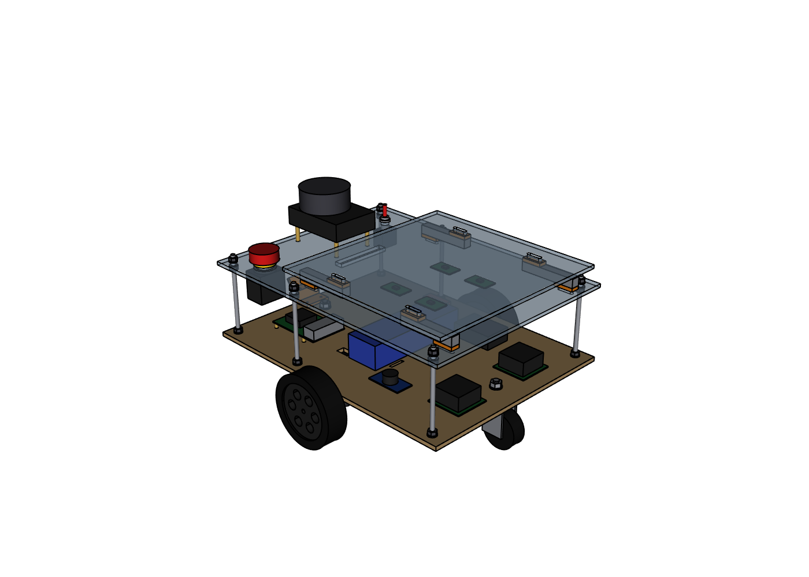
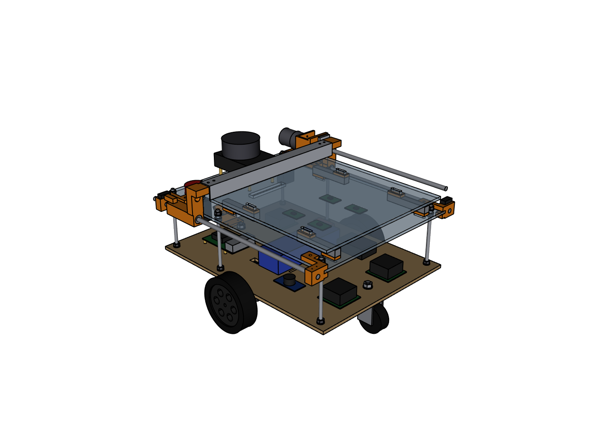
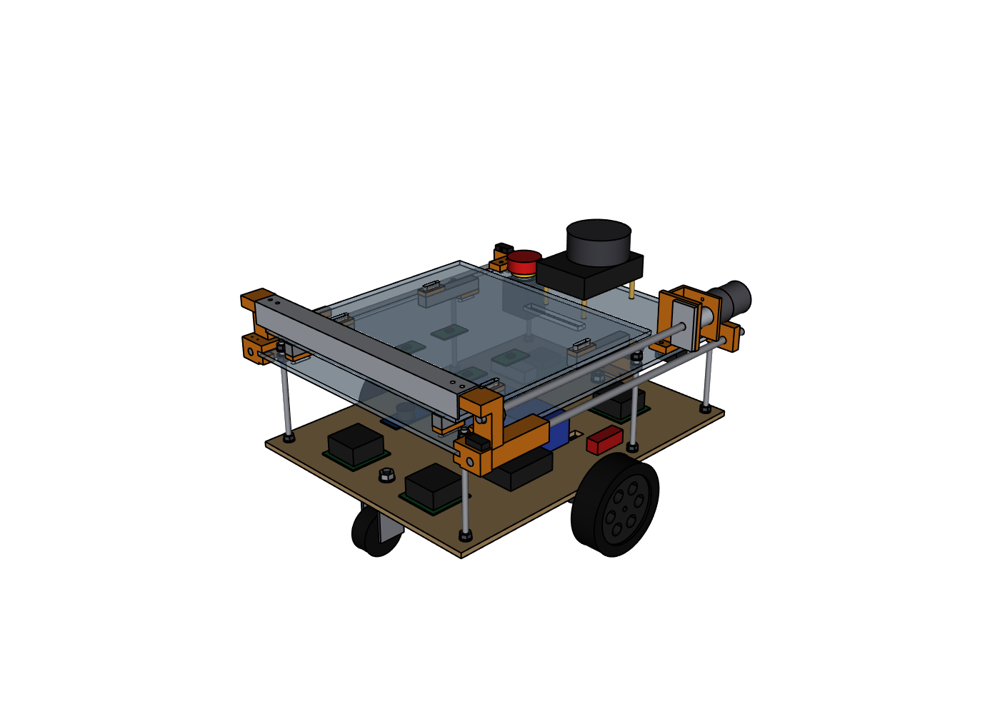

# What the pusher adds: design v3 compared with design v2

Design v3 is design v2 with one new ability: the robot can back up to a conveyor and push its cargo off the rear of the bed. This file says what that costs, part by part and number by number, so you can decide whether to build it.

| Design v2 | Design v3, blade parked | Design v3, blade fully out |
|---|---|---|
|  |  |  |

- **v2** is kept untouched in `backup_v2/` (CAD, drawings, guide, code).
- **v3** is everything outside that folder.

> **Status.** The pusher is designed and collision-checked in CAD, and its software passes tests against a simulated mechanism on a PC. It has not been printed, built or run on the robot. The numbers marked *estimate* below are calculated or typical values, not measurements.

## The short answer

The pusher is a moderate addition, not a redesign. It bolts onto the v2 chassis and leaves the drive, the sensors, the weighing and the navigation as they were.

| It adds | How much |
|---|---|
| Work | About **1 week** for one person, on an 11-week plan (*estimate*) |
| Money | Roughly **40–65 USD** of parts at typical online hobby prices (*estimate*, local prices vary) |
| Shopping list | **12** more lines (46 → 58) |
| Parts in the CAD model | **23** more (77 → 100, +30 %) |
| Printed pieces | **6** more (9 → 15), about 150 g and 10–12 hours of printing (*estimate*) |
| Motors and drivers | **1** more of each (2 → 3) |
| GPIO pins | **4** more (15 → 19), plus one line of Pi configuration |
| Wires | **10** more (46 → 56) |
| Robot code | About **330** more lines (947 → 1281, +35 %), one more node |
| Weight | About **1.1 kg** more (≈ 5 → 6 kg, *estimate*) |

And it takes away:

- **13 mm of bed length** (270 → 257 mm usable), because the parked blade stands at the front of the bed.
- **The anti-slip mat.** The cargo has to slide, so the plate stays bare.
- **Freedom over the drop-off.** Unloading by hand works anywhere; the pusher needs a conveyor of the right height with a backstop (below).

## What changes, side by side

### Mechanical

| | v2 | v3 | Change |
|---|---|---|---|
| Overall size (L × W × H) | 434 × 360 × 263 mm | 434 × 360 × 263 mm | none |
| Nav2 footprint | 0.45 × 0.38 m | 0.45 × 0.38 m | none |
| Width at deck height | 300 mm (the deck) | 355 mm (rods and carriages outside the deck edges) | +55 mm, still inside the 360 mm wheel width |
| Farthest point from the turning centre | 250 mm (deck corners) | 266 mm (rear rod holders) | +16 mm |
| Usable bed | 270 × 280 mm | 257 × 280 mm | −13 mm of length |
| Bed surface | anti-slip mat | bare acrylic | cargo held by friction only; the parked blade acts as a front stop |
| Moving axes | 2 (the wheels) | 3 (+ the blade: 262 mm stroke) | +1 |
| Parts in the CAD model | 77 | 100 | +23 |
| Laser-cut plates | 3 | 3 (the same outlines) | top deck: +5 holes of 4.5 mm. Bottom plate and cargo plate unchanged |
| Printed parts | 2 designs, 9 pieces | 7 designs, 15 pieces | +5 designs, +6 pieces |
| Cut by hand | 6 threaded rods | + 1 lead screw, 1 aluminium angle with 4 holes | +2 cuts, +4 holes |
| Highest pusher part | — | 242 mm | 8 mm under the lidar's scan plane (250 mm): the lidar's view is not blocked |
| Weight without cargo | ≈ 5 kg | ≈ 6 kg (*estimate*) | +1.1 kg: rods 0.32, motor 0.2, prints 0.15, lead screw 0.1, blade 0.08, the rest 0.25 |

**A deck already cut from the v2 file stays usable.** The only difference is the 5 holes, which can be drilled by hand.

### Parts to buy

Twelve new lines on the shopping list (E34–E37, M4b, M14–M20 in the build guide):

| Part | Qty | New kind of part? |
|---|---|---|
| JGB37-520 gear motor, about 110 RPM | 1 | No: the same family as the drive motors |
| BTS7960 motor driver | 1 | No: the same module as the two drive drivers |
| Lever microswitch | 2 (+1 spare) | Yes |
| 2-core signal cable | 2 m | No |
| T8 lead screw, 8 mm lead, 350 mm, with brass nut | 1 | Yes |
| Smooth steel rod 8 mm × 400 mm | 2 | Yes |
| LM8UU linear bearing | 4 | Yes |
| KFL08 flange bearing block | 1 | Yes |
| Flexible coupler 6 → 8 mm | 1 | Yes |
| Aluminium angle 25 × 25 × 2 mm | 1 m | Yes |
| Screws M4 × 20, M4 × 25, M3 × 16, M3 × 8, M2 × 10 | 1 set | M2 is new |
| 3D prints: 2 carriages, 3 rod holders, 1 drive bracket | 6 pieces | — |

- **Not needed any more:** the anti-slip mat.
- **One thing to watch:** all of these are standard 3D-printer and hobby parts, but they come from different sellers. A late lead screw or bearing block holds up the whole pusher.

### Electrical

| | v2 | v3 | Change |
|---|---|---|---|
| Motor drivers | 2 | 3 | +1, on the motor bus after the E-stop |
| Power wires | 16 (P1–P16) | 19 (P1–P19) | +3 |
| Signal wires | 30 (S1–S30) | 37 (S1–S37) | +7 |
| GPIO pins used | 15 | 19 | +4: GPIO 9 and 10 (driver), GPIO 4 and 6 (limit switches) |
| Pi configuration | — | SPI switched off | 1 line in `/boot/firmware/config.txt`: Ubuntu reserves GPIO 9 and 10 for SPI |
| Free GPIO pins that need no configuration | 2 (GPIO 4 and 6) | 0 | anything added later has to use the I2C, UART or remaining SPI pins |
| WAGO buses | MOTOR +12 V: 4 of 5 slots used | 5 of 5 used; one more GND connector | the motor bus is full |
| Fuse | 10 A | 10 A | none: the pusher only runs while the robot stands still |
| Battery use | — | about 0.01 Ah per unload (*estimate*: 1 A for 40 s) | 100 unloads ≈ 1 Ah, a fifth of the battery |
| Schematic sheets | 3 | 3 | all three redrawn (E01, E02, E03) |

The E-stop needs no change: the pusher's driver is fed from the same motor bus, so pressing it cuts the pusher too.

### Software

| | v2 | v3 | Change |
|---|---|---|---|
| Our ROS nodes | 4 | 5 | + `pusher_node` |
| Robot code | 947 lines | 1281 lines | +334 (+35 %) |
| New files | — | `pusher_node.py` (120 lines), `tools/test_pusher.py` (123 lines) | |
| Changed files | — | `control.py` (+93: the pusher's sequence), `mission.py` (+115: docking, pushing, checks), `pins.py`, `robot.yaml`, `robot.launch.py`, `setup.py`, the URDF | |
| Topics / services | — | `/pusher/state`; `/pusher/push`, `/pusher/home`, `/pusher/stop` | +1 topic, +3 services |
| Mission options | 5 | 10 | + `--conveyor`, `--dock-distance`, `--dock-speed`, `--clear-distance`, `--push-timeout` |
| Settings in `robot.yaml` | 4 nodes | 5 nodes | + 6 settings under `pusher_node` |
| Bench tests | 4 | 5 | + test 5 (pusher) |
| Field tests | T1–T7 | T1–T8 | + T8 (conveyor unloading) |

Nothing changes for a robot without the pusher. The pusher node only starts with `pusher:=true`, and the mission only uses it with `--conveyor`; the default is still "wait until someone takes the cargo off".

### Documents

| | v2 | v3 |
|---|---|---|
| Drawing sheets | 7 | 8 (new sheet 07: pusher assembly) |
| Build guide, without the code appendix | 1873 lines | 2110 lines (+13 %) |
| Bill of materials | 25 lines | 37 lines |

## What the pusher demands from the drop-off

This is the largest change in how the robot is used. In v2 a person lifts the cargo off, anywhere. In v3 the conveyor has to suit the robot:

| | Requirement | Why |
|---|---|---|
| Belt height | Top of the belt 180–205 mm above the floor | The bed is 211 mm high. A pusher cannot lift. |
| Side facing the robot | A flat, rigid face from 165 mm up to the belt, 40 cm wide | The robot backs up until its rear presses on it. That is how it finds the conveyor: it has no rear sensor. |
| Backstop | A board on the far side of the belt, its top more than 260 mm above the floor | The lidar scans at 250 mm and cannot see a 200 mm conveyor. Without the board, Nav2 does not know the conveyor is there. |
| Belt | Running during the transfer | A heavy package on a stopped rubber belt pushes the robot away. Onto a stopped belt, keep it under about 6 kg (*estimate*). |
| Packages | Rigid boxes, at least 10 mm high, up to 255 × 280 mm, up to 15 kg | The blade is 25 mm tall and rides 3 mm above the plate. |

**The conveyor's height was not known when this was designed.** If its belt is higher than about 205 mm, this pusher does not work as drawn: the whole deck would have to be raised to match, which is a bigger change than the pusher itself.

## Time

About one week for one person, spread over the weeks where the same kind of work is already happening (*estimate*):

| Work | Time | When |
|---|---|---|
| Ordering the extra parts | 1–2 h | week 0 |
| Printing 6 pieces | 10–12 h of printer time, mostly unattended | weeks 0–1 |
| Cutting, drilling, assembling and aligning | 5–7 h | week 1, step 12 |
| Power wiring (3 wires, 1 driver) | 1 h | week 2 |
| Signal wiring (7 wires, 2 switches), SPI setting, bench test 5 | 2–3 h | week 3 |
| Setting up the conveyor, backstop, new map and dropoff station | 3–4 h | week 8 |
| Getting the `--conveyor` mission reliable, then test T8 | 1–2 days | weeks 8–9 |

The last row is the uncertain one. Assembly is mostly following steps; making docking and pushing work nine times out of ten on a real conveyor is where time goes.

## Cost

Roughly 40–65 USD, from typical online hobby-store prices (*estimate*; nothing here was quoted by a seller):

| Part | USD |
|---|---|
| Gear motor | 8–12 |
| BTS7960 driver | 5–8 |
| Lead screw with nut | 5–8 |
| 2 steel rods | 6–10 |
| 4 LM8UU, KFL08, coupler | 6–11 |
| 3 microswitches, cable | 2–4 |
| Aluminium angle | 2–4 |
| Screws | 3–5 |
| About 150 g of PETG | 3–4 |

A conveyor, if you have to build or buy one, is not included.

## New things that can go wrong

Each of these is a failure v2 cannot have.

| What | How likely it matters | What is done about it |
|---|---|---|
| The blade or a wire touches the cargo plate, so the scale reads wrong | Likely during assembly | 3 mm gap by design; a card-gauge check in the assembly steps |
| Rods not parallel, so a carriage binds | Likely on the first assembly | The holders register on the laser-cut deck edges; an alignment step in the guide |
| The lead screw drives from one side only, so the blade can skew under a heavy, off-centre load | Possible near 15 kg (about 1–2 mm of skew, *estimate*) | Two bearings per carriage, blade bolted to both; centre heavy packages |
| A printed hole comes out too tight or too loose | Likely: the parts have not been test-printed | Print one carriage first and check three fits |
| The motor is too weak for a full 15 kg load | Possible | The push needs about 1.9 kg·cm at 15 kg; a 110 RPM motor of this type is typically rated around 2.2 kg·cm (*estimates*). If it stalls, the software faults after 45 s instead of cooking the motor. |
| A limit-switch wire breaks | Possible | A broken wire reads as "pressed", so the motor stops instead of running into the end |
| The motor is wired backwards | Likely once | Bench test 5 finds it; the software gives up after 2 s if the blade has not left its switch |
| The E-stop is released while a push was under way | Possible | The pusher never restarts by itself; it waits for `/pusher/home` |
| The robot pushes the cargo onto the floor because it is not at the conveyor | Possible | It only pushes after it has moved and then been stopped by something; otherwise the mission ends with an error |
| Nav2 drives into a conveyor it cannot see | Likely without the backstop | The backstop requirement above |
| Fingers, sleeves or loose wires in the lead screw or under the blade | Always a hazard | A new safety rule; slow stroke (about 15 mm/s); the E-stop cuts its power |
| Cargo slides on the bare plate while driving | Unlikely at this robot's gentle accelerations | The parked blade is a front stop; there is no stop at the rear or the sides |
| `GPIO busy` when the pusher starts | Likely once | SPI must be switched off (guide section 3.3) |

## What stays exactly the same

- Chassis: bottom plate, cargo plate, rods, wheels, casters, motors, brackets.
- Drive, odometry, PID and all their settings.
- Lidar, camera, load cells, HX711 boards and their wiring.
- The E-stop circuit, the fuse, the buck converter and the Pi's power.
- The robot's outer size, its Nav2 footprint and the laser filter.
- SLAM, AMCL, Nav2 and their settings.
- Line following and station markers.
- The mission without `--conveyor`.

## What has not been checked

- **Nothing has been built.** No part has been printed; no fit, alignment or stroke has been tried.
- **The ROS code has not run on a Pi or under ROS.** It was syntax-checked and its logic was tested on a PC with stand-ins for ROS, the GPIO pins, the mechanism, the scale and the conveyor (46 checks, all passing). That covers the sequence and the safety stops, not real timing, real switches or real friction.
- **Motor torque and speed** are typical catalogue values for this motor family, not your seller's.
- **The SPI setting.** Ubuntu for the Pi normally reserves GPIO 9 and 10 for SPI. If your image does not, the extra step does no harm.
- **Docking on a real floor.** Backing up until the wheels stop relies on the wheel speed controller stalling gently. That is how it is designed, but it has not been watched happening.

## If you decide against it

- Build from `backup_v2/`, or simply skip every step marked **Pusher** in the main guide: it produces the same robot.
- A deck cut from the v3 file has 5 small extra holes; they do no harm.
- Leave `pusher:=true` and `--conveyor` off. The rest of the v3 code behaves like v2.
- Put the anti-slip mat back on the cargo plate.
- You can still add the pusher later: it needs no change to anything already built except the 5 holes.
