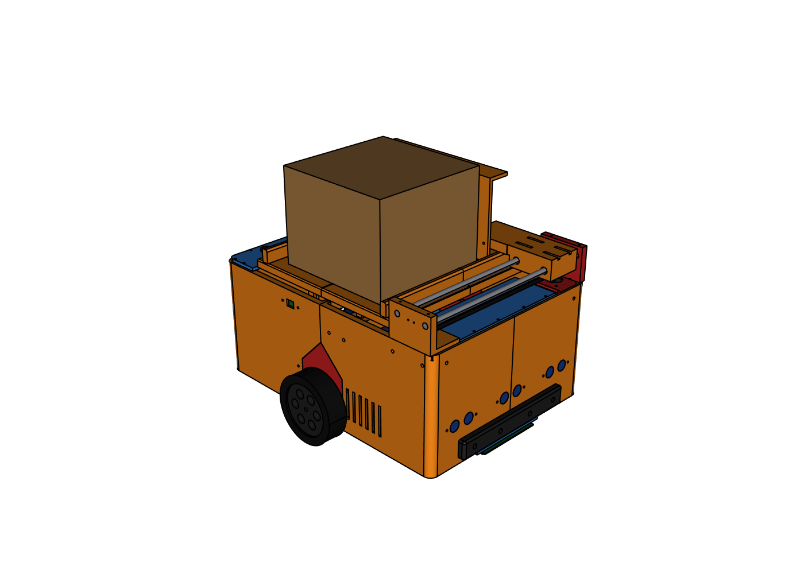
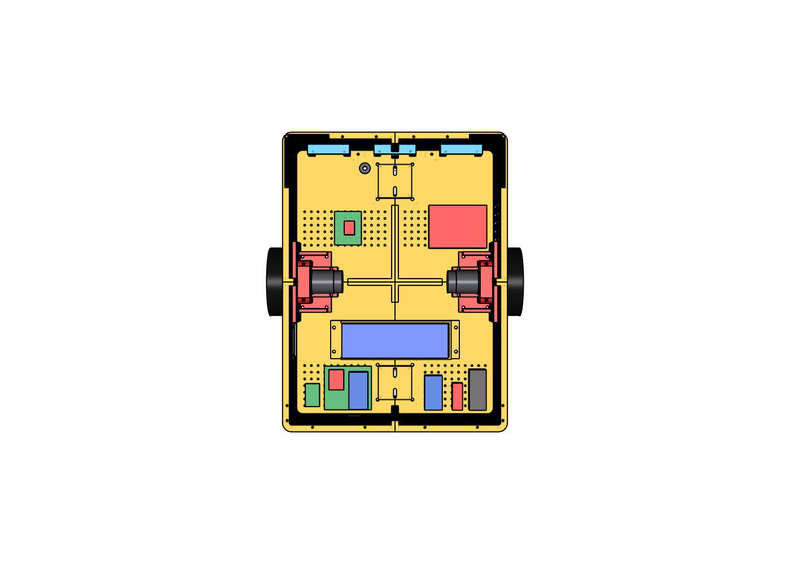

# Cargo robot: mechanical design v4 (3D-printed, ESP32 only)

Design v4 is the robot from the build plan of 20 October 2026:

- **One ESP32 on the robot:** it follows a taped line, watches for obstacles, weighs the package to set its speed, and runs the pusher.
- **No Raspberry Pi and no lidar.** A laptop with a USB webcam reads the logo on the conveyor and sorts the package.
- **The robot stops beside the conveyor** and pushes the package **sideways** off its right side, onto the belt.
- **The body is 3D printed:** every printed part fits a 220 × 220 mm printer.

The conveyor isn't part of this design yet.



| Blade fully out: the package is on the belt | Inside, top view (bed and pusher removed) |
|---|---|
|  |  |

## The numbers

| | Value |
|---|---|
| Overall size | 410 × 366 × 337 mm (L × W × H, with the wheels, bumper and blade) |
| Body | 400 × 300 mm tub, 173 mm deep, ground clearance 22 mm |
| Cargo bed | 265 × 280 mm, top at **212 mm** above the floor |
| Drive | 2 × JGB37-520 gear motors with encoders, 100 mm wheels, track 336 mm, one ball caster front and rear |
| Packages | 120–200 mm along the push direction, up to 200 mm wide (front to back), up to 3 kg |
| Pusher | Blade 209 × 120 mm, 5 mm above the bed. Stroke 210 mm, from Y = +65 (parked) to Y = −145, which is 5 mm inside the robot's right side. Driven by a NEMA17 and a GT2 belt, so the stroke takes about 2 s. |
| Weighing | One 5 kg bar load cell carries the whole bed (a single-point platform scale) |
| Printed parts | 34 files, 50 pieces, about 3 kg of filament (see [`../print/README.md`](../print/README.md)) |

## How it is built

- **Body:** a tub printed in 4 tiles, split at the middle both ways, so each tile is 200 × 150 mm.
  - Flanges along the seams are bolted together (M4).
  - The parts that cross a seam also hold the tiles together: the 2 motor mounts, the 2 caster pods, the battery tray and the load-cell bridge.
- **Drive:**
  - Each motor mount fills a window in a side wall. Its 3 mm face plate takes the place of the wall, so the gear motor's short shaft still reaches into the wheel hub.
  - It clamps the 37 mm gearbox, so it doesn't depend on the gearbox's screw-hole pattern.
- **Casters:**
  - Each ball caster bolts up into a printed pod, which is pushed up through a square hole in the floor.
  - The robot sits level with one 2 mm shim per caster. Swap shims (1 mm and 2 mm are printed) to raise or lower each end by up to 2 mm.
- **Weighing:**
  - A beam (the bridge, in 2 halves) spans the tub and carries the load cell's fixed end.
  - The cargo bed (4 tiles bolted together) sits on the cell's other end, and nothing else touches it.
  - Two posts on the bridge stop 1.5 mm under the bed, so a heavy knock can't bend the cell.
- **Pusher:** it all sits in the front strip of the robot, so the bed stays clear.
  - Two 8 mm rods run across the robot. A carriage on 4 LM8UU bearings runs on them, pulled by a GT2 belt.
  - The stepper hangs under the left rod holder with its shaft up; the idler is on the right holder.
  - The blade hangs from an arm on the carriage, reaches back over the bed, and passes between two guide rails.
  - Limit switches: HOME on a post on the left holder, END on the right holder.
- **Sensors:**
  - 3 HC-SR04 sensors behind the front wall.
  - A soft TPU bumper below them.
  - The 8-channel line sensor under the front, 5–8 mm above the floor.
  - A VL53L0X in the right wall, which measures the gap to the conveyor.
- **Controls:** on the rear panel: the E-stop, master switch, green and red LEDs, buzzer and an optional GO button.
- **Battery:** lies across the robot behind the left wheel and slides out through a door in the left wall.

### Changes from the build plan, and why

| Build plan | This design | Why |
|---|---|---|
| T8 lead screw, stroke 260 mm | GT2 belt, stroke 210 mm | A screw, its motor and a 260 mm stroke don't fit across a 300 mm robot. The belt's motor hangs underneath, so nothing sticks out, and it's about 5 times faster. 210 mm still pushes packages from 120 to 200 mm far enough onto the belt. |
| Gap from the robot to the belt: 50 mm | **40 mm** | The blade stops 5 mm inside the robot. With a 40 mm gap, even a 120 mm package ends with its middle over the belt. |
| Base and deck plates laser-cut | Printed tub (4 tiles) | Everything is printed, as asked. |
| Motor mounts in PETG | ABS | They touch the motors. |

## How it meets the conveyor

The conveyor has to suit these numbers:

- **Belt top:** 208 mm above the floor, 4 mm below the bed. The belt edge is 40 mm from the robot's right side.
- **Clearance for the right wheel:** the wheel sticks out 33 mm beyond the body, up to 100 mm above the floor. Keep the conveyor's frame clear of it on the robot's side.
- **A flat face for the VL53L0X:** the sensor looks out of the right wall 175 mm above the floor, 60 mm behind the axle. It needs a flat face there to measure the 40 mm gap.

## Putting it together

1. **Body:** bolt the 4 tub tiles together along their seams (M4 × 16).
2. **Drive:**
   - Clamp each gear motor in its mount, gearbox face against the face plate.
   - Fit the mount into the side-wall window. Bolt its foot to the floor (4 × M4) and its ears through the wall (4 × M3).
   - Fit the wheels.
3. **Casters:**
   - Push each caster pod up through its floor hole and bolt it (4 × M4).
   - Put one 2 mm shim under each caster and bolt the caster to the pod.
   - Stand the robot on a flat floor and swap shims until all 4 wheels touch.
4. **Battery:** battery tray with the 2 TPU pads, velcro strap, battery door.
5. **Electronics:**
   - Fix the boards to the floor's 10 mm grid of 2.8 mm holes, with M3 self-tapping screws or standoffs. The layout picture above shows where each one goes.
   - Fit the TPU grommet in the floor's cable hole.
6. **Sensors:**
   - Ultrasonic clips: slide the HC-SR04 boards in, then screw the clips on from outside.
   - Line sensor bar under the front, with standoffs so the sensors are 5–8 mm above the floor.
   - VL53L0X bracket in the right wall.
   - Front bumper.
7. **Weighing:**
   - Bolt the bridge halves to the side walls and to each other.
   - Fit the load cell on its spacer, arrow pointing down.
   - Bolt the 4 bed tiles together (M3) and fit the guide rails from underneath.
   - Bolt the bed to the cell's loaded end. Socket-head screws sink into the slot in the bed.
8. **Pusher:**
   - Bolt the rod holders to the walls.
   - Fit the NEMA17 under the left holder and put the pulley on.
   - Slide the rods through the holders and the carriage's bearings (the LM8UU snap in from below and get a zip tie each). Tighten the pinch screws.
   - Belt: clamp both ends in the carriage, round the pulley and the idler. Tension it by sliding the idler bolt in its slot.
   - Bolt the blade to the arm.
   - Push the limit switches into their pockets (M2).
9. **Covers:** front cover, rear panel halves with the E-stop, switch, LEDs and buzzer, and the joiner underneath.

## Wiring (ESP32 #1, the robot)

The pins follow the build plan. The slow signals go through an MCP23017 I2C expander, so a standard ESP32 DevKit has enough pins.

| Signal | ESP32 pin | Notes |
|---|---|---|
| Left motor PWM / DIR | 25 / 26 | MDD10A (or BTS7960) |
| Right motor PWM / DIR | 27 / 14 | |
| Left encoder A / B | 34 / 35 | input-only pins; power the encoders from 3.3 V |
| Right encoder A / B | 36 / 39 | |
| Ultrasonic TRIG (all 3) | 13 | HC-SR04 on 5 V |
| Ultrasonic ECHO left / centre / right | 16 / 17 / 18 | through a 1k/2k divider each (5 V → 3.3 V) |
| HX711 DT / SCK | 19 / 23 | |
| Stepper STEP / DIR / EN | 4 / 5 / 32 | TMC2209; 100 µF on its motor supply |
| Buzzer | 33 | |
| I2C SDA / SCL | 21 / 22 | MCP23017 (0x20) and VL53L0X (0x29), both on 3.3 V |
| Line sensors 1–8 | MCP23017 A0–A7 | power the line board from 3.3 V: the MCP23017's inputs are not 5 V tolerant |
| Limit switch HOME / END | MCP23017 B0 / B1 | |
| Green LED / red LED | MCP23017 B2 / B3 | |
| E-stop sense | MCP23017 B4 | 10k/3.3k divider from the motor 12 V (after the E-stop) |
| GO button (optional) | MCP23017 B5 | |
| Free for later | GPIO 0, 2, 12, 15 | boot-strapping pins: only things that don't pull them at power-up |

**Power:**

- **Main line:** battery → 10 A fuse → master switch → 12 V bus.
- **Motor supply:** the 12 V goes through the E-stop to the motor driver and the stepper driver. The E-stop cuts motor power only.
- **Logic supply:** a 5 V buck converter feeds the ESP32's 5 V pin and the ultrasonic sensors.
- **3.3 V:** everything else runs from the ESP32's 3.3 V pin.
- **Ground:** join all grounds.

## Files

| File | What it is |
|---|---|
| `../print/<material>/*.stl` | Every printed part, ready to slice ([`../print/README.md`](../print/README.md)) |
| `output/robot_assembly.step` | The whole robot, coloured: Fusion 360, SolidWorks, Onshape, FreeCAD, AutoCAD (`IMPORT`) |
| `output/parts_step/*.step` | Each printed part where it sits in the robot, for editing |
| `output/print_list.csv` | Printed parts: material, quantity, size, grams, how to print |
| `output/bom.csv` | Parts to buy |
| `output/views/*.png` | Pictures |

## Change it

Edit the parameters at the top of `robot_cad.py`, then run:

```
.venv\Scripts\python robot_cad.py       # every file above
.venv\Scripts\python check_render.py    # collision check (blade parked, half-way, fully out), floor contact,
                                        # printer fit and flat-face check for every part, pictures
```

Useful parameters:

| Parameter | What it sets |
|---|---|
| `CASTER_H` | Your casters' height |
| `BED_TOP` | Bed height |
| `PUSH_HOME`, `PUSH_END` | Blade travel |
| `PRINTER` | Largest part allowed |
| `WALL`, `FLOOR` | Tub thickness, for less plastic |

## What has and has not been checked

- **Checked in CAD:**
  - No two of the 90 parts overlap, with the blade parked, half-way or fully out.
  - The belt clamp stays between the pulleys over the whole stroke.
  - All 4 wheels touch the floor.
  - Every printed part fits a 220 × 220 × 250 mm printer and stands on a real flat face.
  - The STL files read back at the right size.
- **Not checked yet:**
  - Nothing has been printed or test-fitted. Print one motor mount, a caster pod and the carriage first, to check the fits.
  - Bought parts vary. Check these against what you buy:
    - JGB37 shaft length (the hub needs about 15 mm of shaft beyond the plate)
    - caster height
    - board sizes and hole spacings
    - wheel hub
  - The new ESP32 firmware isn't written yet.
