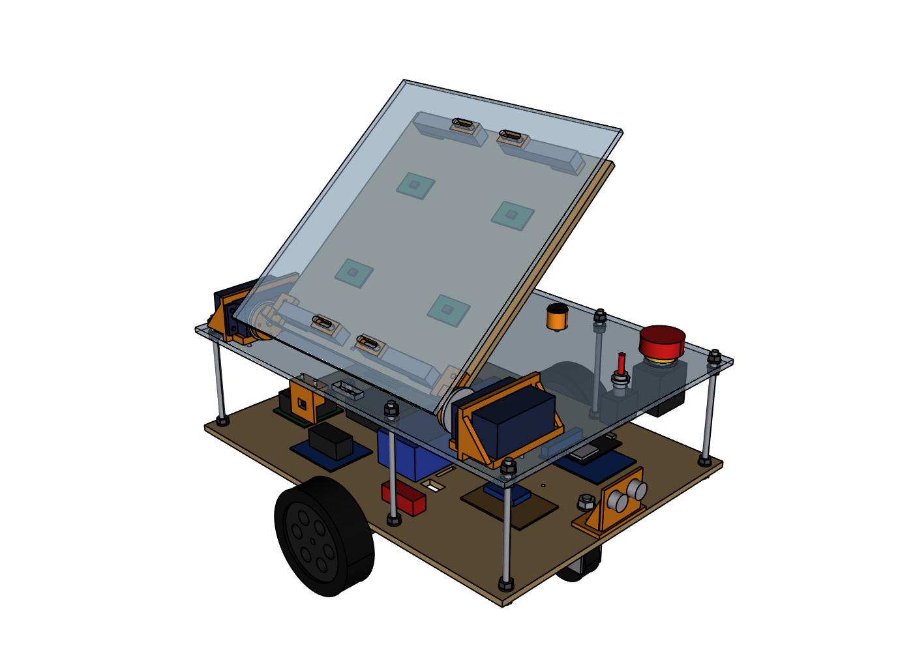

# Cargo robot: mechanical design v2 with a tilting bed (Phase II)

**Overall size:** 407 × 360 × 236 mm (L × W × H) with the bed flat.

**Layout:**

- Two drive wheels in the middle, and swivel casters (M8 threaded stems) at the front and rear.
- The bottom plate (6 mm plywood) carries the electronics: ESP32, motor drivers, battery, two buck converters.
- The top deck (5 mm acrylic) sits on 6 M6 threaded rods. The E-stop and master switch are at its front, the start button and two LEDs at its rear.
- **Tilting bed:** a 6 mm plywood tilting plate carries the 4 load cells and the acrylic cargo plate. Two 60 kg·cm servos on the deck's right edge, one at each end of the bed, turn it about their shafts (the shafts are the hinge). The bed tips 40° to the right and the package slides off onto the conveyor. Flat, it rests on two printed posts.
- **Sensors:** an 8-channel IR line sensor under the bottom plate (in front of the wheels, nothing sticks out), one HC-SR04 ultrasonic sensor at the front of the electronics bay looking ahead, and a VL53L0X distance sensor under the deck's right edge (it checks that the belt is there before the bed tips).



## AutoCAD

`autocad/CargoRobot_v2.dxf` is the design in AutoCAD's own format.

- **Open it:** File → Open → *Files of type: DXF* → the file. Then File → Save As → *AutoCAD 2018 Drawing (*.dwg)*.
- **Model tab:** the full 3D robot on layers `3D-CHASSIS`, `3D-DRIVE`, `3D-ELECTRONICS`, `3D-SENSORS`, `3D-CONTROLS`, `3D-TILT` (servos and their mounts) and `3D-PAYLOAD` (everything that tips).
  - Orbit with Shift + middle mouse button, or the ViewCube.
  - Set the visual style (top-left corner of the view) to *Shaded with Edges*.
- **Layout tabs 01–10:** A3 engineering drawings with dimensions, a title block and a bill of materials.
  - 01 general arrangement, 02 layout with the deck removed, 03–06 the four plates with hole tables, 07 the tilting bed, 08–09 printed parts, 10 BOM.
  - They're set up to plot on *DWG To PDF*, A3, 1:1.
  - Fill in the "DRAWN" box in the title block.
- **True 3D solids** (full AutoCAD, not LT): type `IMPORT` and pick `output/robot_assembly.step` (or `robot_assembly_tipped.step`).

`autocad/CargoRobot_v2_drawings.pdf` has the same 10 sheets as a PDF, for printing or showing without AutoCAD.

## Electrical schematics

`autocad/CargoRobot_v2_schematics.dxf` (AutoCAD, 4 layout tabs) and `autocad/CargoRobot_v2_schematics.pdf`:

- **E01 System block diagram:** every part and how power and signals flow between them.
- **E02 Power distribution:** battery → fuse → master switch → E-stop → motor drivers, motors and the 7.4 V servo buck; the 5.1 V buck for the ESP32 and sensors; the battery/E-stop sense divider. Wire IDs P1–P19 match the power wire list in `BUILD_GUIDE.md` (week 2).
- **E03 ESP32 wiring:** the DevKit's 38 pins with every used one, the motor/encoder cables, both BTS7960 drivers, the 4 HX711 boards with their load cells, the ultrasonic sensors with their dividers, and the servo signals.
- **E04 I2C, line sensor and panel:** the MCP23017 I/O expander, the line sensor, the VL53L0X, the start button, LEDs, buzzer and the pull resistors.

Pin numbers come from `firmware/cargo_robot/config.h`: change a pin there and re-run `make_schematics.py`.

## Assembly and connections

- `autocad/CargoRobot_v2_assembly.pdf`: every component (bought, laser-cut, 3D-printed), the tools, and the assembly in 11 steps with a picture of each stage; then drawing sheets 01, 02 and 07.
- `autocad/CargoRobot_v2_connections.pdf`: every wire (power P1–P19, signal S1–S38), the parts on the I/O board, the connections of each part pin by pin, then the 4 schematic sheets.

Both are made by `make_docs.py` from `robot_cad.py` (parts), `wiring.py` (wires) and `firmware/cargo_robot/config.h` (pin numbers).

## Open it in other CAD programs

- **Fusion 360:** Upload → `output/robot_assembly.step`
- **SolidWorks:** File → Open → change the file type to STEP → `output/robot_assembly.step`
- **Onshape:** Import → `output/robot_assembly.step`
- **FreeCAD:** File → Open → `output/robot_assembly.step`

## Make it

| File | How it's made |
|---|---|
| `output/dxf/bottom_plate.dxf`, `tilt_plate.dxf` | Laser-cut 6 mm plywood |
| `output/dxf/top_deck.dxf`, `cargo_plate.dxf` | Laser-cut 5 mm acrylic. Every hole and slot is in the files. |
| `output/parts/*.stl` (printed parts, see below) | 3D print, PETG |
| `output/bom.csv` | Everything else (bought parts, rods, nuts) |

Printed parts: `servo_mount_front`, `servo_mount_rear`, `horn_adapter_front`, `horn_adapter_rear`, `bed_rest` (× 2), `load_cell_spacer` (× 8), `line_sensor_bracket`, `sonar_bracket`, `tof_bracket`. The other STLs in `output/parts/` are the plates, for reference.

> **Check your servo before printing the servo mounts.** No seller lists the tab-hole spacing of the DS5160-type servo; the mount assumes 74 × 18 mm. Measure yours and change `hole_l` / `hole_w` in `SERVO` at the top of `robot_cad.py` if it differs.

## Change it

Edit the parameters at the top of `robot_cad.py`, then run:

```
.venv\Scripts\python robot_cad.py       # regenerate every file
.venv\Scripts\python check_render.py    # collision check (bed flat and tipped), wheels on the floor, torque, PNG renders
.venv\Scripts\python make_autocad.py    # AutoCAD DXF (3D model + 10 drawing sheets) + PDF
.venv\Scripts\python make_schematics.py # electrical schematics DXF + PDF
.venv\Scripts\python make_docs.py       # assembly PDF + connections PDF (+ updates BUILD_GUIDE.md's wire tables)
```

`make_docs.py` also needs `reportlab` and `pypdf`: `.venv\Scripts\python -m pip install reportlab pypdf`.
