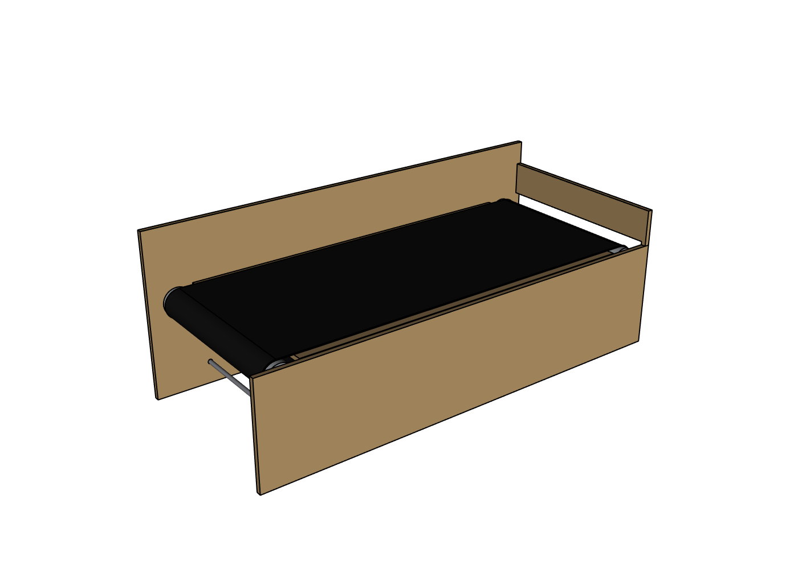
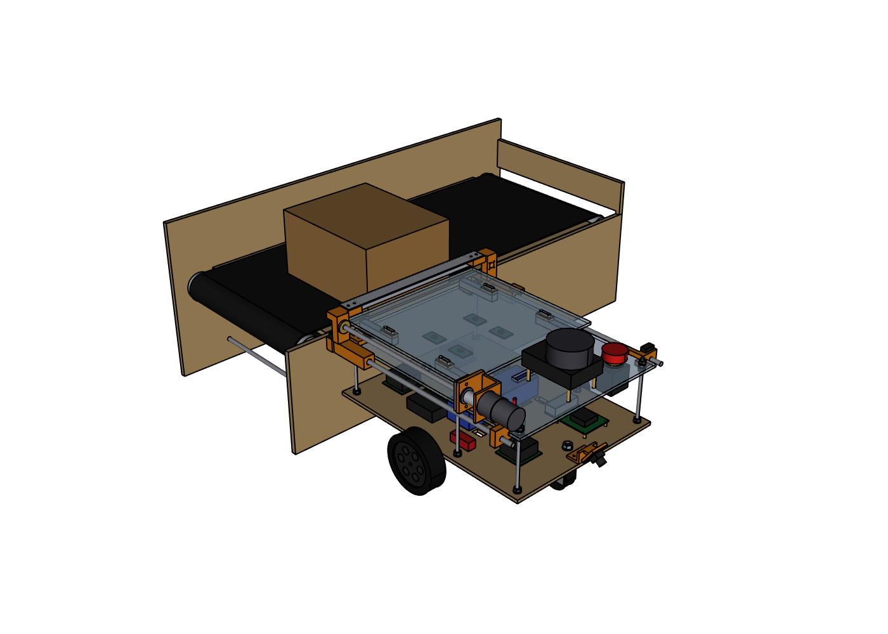

# Conveyor: 3D model for simulation

A small belt conveyor, shaped to be the drop-off that the cargo robot's pusher (design v3) unloads onto.

**It is a model for simulation and pictures, not a build design.** The outer shape and the heights are right, but there are no bearings, fasteners, belt tensioner or wiring in it.

| The conveyor | With the robot docked and a package just pushed onto the belt |
|---|---|
|  |  |

## Files

Everything is in `output/`.

| File | What it is | Units |
|---|---|---|
| `conveyor.step` | The whole conveyor: 11 named, coloured parts. For CAD programs and simulators that read STEP. | mm |
| `conveyor.glb` | The whole conveyor, coloured (glTF). For Blender, Unity, Godot and web viewers. | **metres** |
| `conveyor.stl` | The whole conveyor as one mesh | mm |
| `parts/frame.stl` | Everything that stands still: both side plates, the board under the belt, the tie rods, the motor and its bracket | mm |
| `parts/belt.stl` | The belt loop | mm |
| `parts/roller_idler.stl`, `parts/roller_drive.stl` | The two rollers with their shafts | mm |
| `parts/end_stop.stl` | The board across the end of the belt. Leave it out if packages should drop off the end. | mm |
| `dimensions.csv` | The numbers below | |
| `views/*.png` | Pictures | |

STL files carry no units. The numbers in them are millimetres, so scale them by 0.001 in a simulator that works in metres. The robot's own body mesh is used the same way.

## Axes and origin

- **Origin:** on the floor, under the middle of the belt.
- **X:** the way the belt carries a package. The drive roller, the motor and the end stop are at the +X end.
- **Y:** across the belt. The robot's side is −Y; the tall backstop is at +Y.
- **Z:** up.

`conveyor.glb` follows the glTF convention instead (Y up); programs that import glTF turn it the right way by themselves.

## Dimensions

| | Value | Where |
|---|---|---|
| Overall size | 800 × 429 × 300 mm | Y from −172 (robot side) to +257 (end of the motor) |
| Belt surface | 195 mm above the floor | The robot's bed is at 211 mm, so a package drops 16 mm |
| Belt width | 300 mm | Y from −150 to +150 |
| Flat carrying length | 700 mm | X from −350 to +350 |
| Belt loop length | 1563 mm | Round both rollers |
| Rollers | 50 mm diameter | Axes along Y at X = −350 and +350, Z = 168 |
| Robot-side plate | Outer face at Y = −172, top at Z = 191 | Flat from the floor up; nothing sticks out of it |
| Gap to the belt | 22 mm from that face | 27 mm from the edge of the robot's bed |
| Backstop plate | Inner face at Y = +163, top at Z = 300 | Taller than the robot's lidar plane (250 mm), so the lidar sees it |
| End stop | Face at X = +391, 60 mm high above the belt | |

## What moves

- **Belt:** its top surface moves towards +X. 0.10 m/s is a sensible speed.
- **Rollers:** they turn about their own axes, 36.7 rpm at that belt speed. This only matters for looks.
- **Everything else** stands still.

Most simulators do not bend a belt mesh round its rollers. The usual way is a fixed box with a "moving surface" or "conveyor" property, and the meshes only for looks. These boxes match the model (metres, in the axes above):

| Shape | Centre (x, y, z) | Size (x, y, z) |
|---|---|---|
| Carrying surface (moving, towards +X) | 0, 0, 0.189 | 0.700 × 0.300 × 0.012 |
| Robot-side plate | 0, −0.1675, 0.0955 | 0.800 × 0.009 × 0.191 |
| Backstop plate | 0, 0.1675, 0.150 | 0.800 × 0.009 × 0.300 |
| End stop | 0.3955, −0.0045, 0.227 | 0.009 × 0.335 × 0.060 |

Starting values to tune, not measurements: friction about 0.7 on the belt and 0.35 on the plywood; about 6 kg if the conveyor has to be a movable body. Making it static is simpler.

## How the robot meets it

- The robot reverses until its rear touches the robot-side plate. In the conveyor's axes, the middle of its drive axle is then at **Y = −372 mm**, and it faces −Y, away from the conveyor.
- It can dock anywhere along the plate with X between −220 and +220 mm; the picture uses X = −150.
- The pusher blade ends level with the robot's rear edge and passes 19 mm above the belt, so it never touches the conveyor.
- The largest package the bed holds (257 × 280 mm) lands with its back edge at the docking face and stops 78 mm short of the backstop.

`check_render.py` checks these against the robot's model in `../cad/robot_cad.py`. All 8 checks pass for the numbers above.

## Change it

The numbers are at the top of `conveyor_cad.py` (length, belt width and height, roller size, plate heights). After changing one, run from the project folder:

```
cad\.venv\Scripts\python conveyor\conveyor_cad.py     # STEP, STL, glTF, dimensions.csv
cad\.venv\Scripts\python conveyor\check_render.py     # collision check, fit to the robot, pictures
```

Remember to update the collision boxes in your simulator to match.

## What has and has not been checked

- **Checked in CAD:** no two parts overlap; the exported STEP, STL and glTF files open again with the right size and units; the heights and gaps fit the robot.
- **Not checked:** it has not been loaded into any simulator. The friction, speed and mass values above are starting points.
